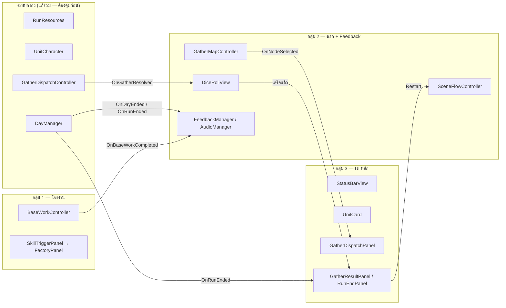
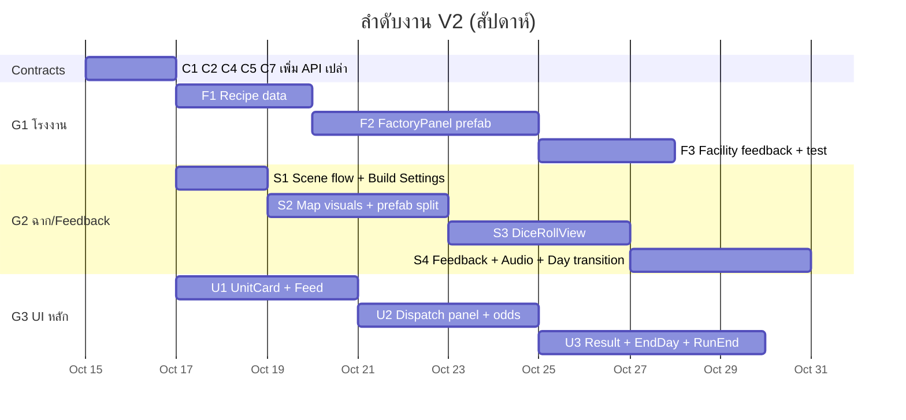

# Unity V2 — แบ่งงาน Developer 3 คน (Overview)

**Created:** 2026-10-14 | **Codebase:** `Unity-Projects/Assets/V2/` (scene `V2/Scenes/Core.unity`)
> เอกสารนี้สรุปการแบ่งงาน 3 กลุ่ม, ไฟล์ที่แต่ละกลุ่มเป็นเจ้าของ, และจุดที่ต้องประสานงานกัน — รายละเอียด task อยู่ใน user story ของแต่ละกลุ่ม
> อ่านประกอบ: [GDD Mechanics](../../gdd/01-mechanics.md) · [Unity V2 System Design](../../software/04-unity-system-design.md) · [Class Diagram](../../software/05-unity-class-diagram.md) · [Core Scene Hierarchy](../../software/06-unity-core-scene-hierarchy.md)

## 1. กลุ่มงาน

| กลุ่ม | User Story | ขอบเขต | Owner |
|---|---|---|---|
| **1. ระบบโรงงาน + UI โรงงาน** | [US-V2-FACTORY-01](US-V2-FACTORY-01.md) | งานในฐาน (Base Work) — ครัว (Cook), ห้องพยาบาล (Heal), Workshop (Craft): ข้อมูลสูตร, ตรรกะ, panel โรงงาน | Dev A — _TBD_ |
| **2. ระบบฉาก + Feedback ในเกม** | [US-V2-SCENE-01](US-V2-SCENE-01.md) | Scene flow / Build Settings, ภาพแมป + ถ้ำ + Scout, ทอยเต๋า D100, effect/เสียง, transition ระหว่างวัน | Dev B — _TBD_ |
| **3. UI หลักของเกม** | [US-V2-UI-01](US-V2-UI-01.md) | StatusBar, การ์ดยูนิต (+ ปุ่มให้อาหาร), panel ส่งสำรวจ, ผลการสำรวจ, ปุ่ม End Day, หน้าจอจบเกม | Dev C — _TBD_ |

> "โรงงาน" ในเอกสารนี้หมายถึงระบบ **Base Work** ของ V2 (`BaseWorkController` / `SkillTriggerPanel` + `SkillFlowController`) ซึ่งเป็นระบบผลิตเพียงระบบเดียวในเกมตอนนี้
> **อัปเดต 2026-10-28:** UI ของระบบนี้ถูก redesign ครบ P0–P5 — `BaseWorkPanel` (dropdown) ถูกลบแล้ว ดู [UI Layout Redesign §7.10](../../software/07-unity-v2-ui-layout-redesign.md)

## 2. File Ownership Matrix

**O** = เจ้าของ (แก้ได้เลย) · **E** = แก้ได้เฉพาะส่วนที่ระบุใน contract (§3) แจ้งเจ้าของก่อน · **R** = ต้องอ่าน/เรียกใช้ ไม่แก้ · — = ไม่เกี่ยว

### Scripts (`Assets/V2/Scripts/`)

| ไฟล์ | G1 โรงงาน | G2 ฉาก/Feedback | G3 UI หลัก |
|---|:-:|:-:|:-:|
| `Controllers/BaseWorkController.cs` | **O** | R | — |
| `BaseWorkType.cs`, `BaseWorkResult.cs` | **O** | R | — |
| `UI/SkillTriggerPanel.cs`, `UI/SkillFlowController.cs` | **O** | — | — |
| `Controllers/GatherMapController.cs` | R | **O** | R |
| `UI/MapNodeView.cs` | — | **O** | — |
| `Entities/MapNodeData.cs` | — | **O** | — |
| `DiceRollView.cs` | — | **O** | — |
| `UI/StatusBarView.cs` | — | — | **O** |
| `UI/UnitRosterView.cs`, `UI/UnitIconView.cs` | — | — | **O** |
| `UI/GatherDispatchPanel.cs` | — | R | **O** |
| `Controllers/StarvationController.cs` | — | — | **O** |
| `Controllers/DayManager.cs` | R | R | **O** |
| `Controllers/GatherDispatchController.cs` | — | E (event เท่านั้น) | R |
| `System/GatherResolver.cs` | — | R | R |
| `System/RunResources.cs` | E | R | E |
| `Entities/UnitCharacter.cs` | R | R | E |
| `System/UnitManager.cs`, `System/GatherZoneDatabase.cs`, `System/TraitLibrary.cs` | R | R | R |
| `Entities/GatherZoneData.cs` | — | R | R |

### Assets / Settings

| ไฟล์ | G1 | G2 | G3 |
|---|:-:|:-:|:-:|
| `V2/Scenes/Core.unity` | E (subtree `SkillTriggerPanel`) | **O** (root, `MapPanel`, `GameSystem`) | E (`StatusBar`, `CharacterHandPanel`, `DispatchActionPanel`, `LogPanel`, `SkillTriggerPanel`, `WarningText`, `GatherUI`) |
| `V2/Prefabs/Dungeon Prefab.prefab`, `ScoutIcon.prefab` | — | **O** | R |
| `V2/Prefabs/Factory/*` (ใหม่) | **O** | — | — |
| `V2/Prefabs/Feedback/*` (ใหม่) | — | **O** | — |
| `V2/Prefabs/UI/*` (ใหม่) | — | — | **O** |
| `ProjectSettings/EditorBuildSettings.asset` | — | **O** | — |
| `Assets/Day/Sprites/tilemap_packed*.png` | R | R | R |

### เอกสารที่ต้องอัปเดตเมื่อทำเสร็จ

| เอกสาร | G1 | G2 | G3 |
|---|:-:|:-:|:-:|
| [gdd/01-mechanics.md](../../gdd/01-mechanics.md) | §5 Base Work | — | §6 Starvation (ปุ่มให้อาหาร) |
| [gdd/03-art-direction.md](../../gdd/03-art-direction.md) | — | §1, §5, §6 | §4 Layout |
| [gdd/04-audio-direction.md](../../gdd/04-audio-direction.md) | — | §1, §3 | — |
| [software/04-unity-system-design.md](../../software/04-unity-system-design.md) | BaseWorkController, §4.2 | §2 Scene Flow, §4.1, §5 Event Map | UI Layer, §4.3, §6 |
| [software/05-unity-class-diagram.md](../../software/05-unity-class-diagram.md) | class ใหม่ของโรงงาน | class ใหม่ฉาก/feedback | class ใหม่ UI |
| [software/06-unity-core-scene-hierarchy.md](../../software/06-unity-core-scene-hierarchy.md) | `SkillTriggerPanel` subtree | root + `MapPanel` | `Canvas` ส่วนอื่น |

## 3. Interface Contracts (ตกลงกันก่อนเริ่มเขียน)

ทุก contract ให้ **เจ้าของเพิ่ม API ก่อนเป็นอันดับแรก** (แม้ยังไม่มี UI) แล้ว push ขึ้นไปก่อน เพื่อให้อีกกลุ่มเริ่มต่อได้โดยไม่ต้องรอ

| # | API | เจ้าของ (เพิ่ม) | ผู้ใช้ | รายละเอียด |
|---|---|---|---|---|
| C1 | `BaseWorkController.OnBaseWorkCompleted : event Action<BaseWorkResult>` | G1 | G2 (SFX/effect), G3 (refresh ถ้าต้องการ) | ยิงท้าย `Cook` / `Heal` / `UseWorkshop` ทุกครั้ง รวมถึงกรณี `blocked` |
| C2 | `GatherMapController.OnNodeSelected : event Action<MapNodeData>` | G2 | G3 (แสดงข้อมูลถ้ำ + odds ใน panel ส่งสำรวจ) | ยิงใน `HandleNodeClicked` |
| C3 | ~~ลำดับทริปใหม่: เดินถึงถ้ำ → Dispatch → DiceRollView → เดินกลับ → OnTripResolved~~ **ยกเลิกแล้ว (2026-10-27)** — ทริป resolve ในเฟรมเดียว: `ConfirmTrip()` → `Dispatch()` → `OnTripResolved` ทันที ไม่มีเวลาเดินทาง | G2 | G3 (`GatherDispatchPanel` แสดงผลทันที + `RunLogNarrator` เขียน log) | ไม่มี `TripInProgress` ให้ gate แล้ว |
| C4 | `DayManager.OnDayEnded : event Action<DayEndReport>` + `DayManager.PreviewFeeding() : DayEndReport` | G3 | G2 (transition "Day N" + เสียงกิน/หิว), G3 (dialog ยืนยัน End Day) | `DayEndReport` = วันก่อน/หลัง, รายชื่อคนที่ได้กิน, คนที่ได้ stack, คนที่ Lost Signal |
| C5 | `SceneFlowController.RestartRun()` / `GoToTitle()` | G2 | G3 (ปุ่มใน `RunEndPanel`) | reload `Core.unity` ผ่าน `SceneManager` (singleton ทุกตัวจะถูกสร้างใหม่) |
| C6 | `UnitCard.prefab` (มี `UnitIconView`) แยกจาก `ScoutIcon.prefab` | G3 สร้าง `UnitCard`, G2 ลบ `UnitIconView` ออกจาก `ScoutIcon` | G2, G3 | ทำพร้อมกันใน PR เดียว หรือ G3 ก่อนแล้ว G2 ตาม |
| C7 | `RunResources.OnChanged : event Action` | G3 | G1, G3 | ยิงทุกครั้งที่ค่าใน `RunResources` เปลี่ยน — ใช้แทนการ poll ทุกเฟรม; G1 เรียก `AddItem` / `TryConsumeItem` ตามเดิม ไม่ต้องแก้ |

## 4. กติกาการทำงานร่วมกันใน `Core.unity`

ไฟล์ scene เป็น YAML ก้อนเดียว — ถ้า 3 คนแก้พร้อมกัน **merge conflict แทบแน่นอน**

1. **ทำ UI ของตัวเองเป็น prefab** ใน `V2/Prefabs/<Factory|Feedback|UI>/` แล้วค่อยลาก instance เดียวเข้า scene — งานส่วนใหญ่จะแก้แค่ prefab ไม่แตะ `Core.unity`
2. **แก้ `Core.unity` ทีละคน** — ประกาศใน Discord ก่อนเปิดแก้ และ push ทันทีที่เสร็จ (G2 เป็นเจ้าของ scene ช่วยตัดสินเมื่อชน)
3. ห้ามแก้ object ของกลุ่มอื่นใน scene (ดู Ownership ด้านบน)
4. ถ้า conflict ใน `.unity` / `.prefab` อย่าแก้มือ — ใช้ Unity Smart Merge (`UnityYAMLMerge`) หรือเลือกเวอร์ชันหนึ่งแล้วทำซ้ำส่วนที่หาย
5. ตั้งชื่อ branch `v2/factory-*`, `v2/scene-*`, `v2/ui-*`

## 5. ลำดับแนะนำ

## 6. Definition of Done (ทุกกลุ่ม)

- [ ] เล่นครบ 1 run ใน `Core.unity` ได้ทั้งชนะและแพ้ โดยไม่มี error ใน Console
- [ ] ไม่มีตัวเลข balance ใหม่ hard-code ใน UI — อ่านจาก Controller / config เสมอ
- [ ] ตัวเลขใน UI ตรงกับ [GDD Mechanics](../../gdd/01-mechanics.md) (หรืออัปเดต GDD ถ้าตั้งใจเปลี่ยน)
- [ ] อัปเดตเอกสารตามตาราง §2
- [ ] PR มีภาพหน้าจอ/GIF ของสิ่งที่เปลี่ยน

## Related Documents
- [Product Backlog](../01-product-backlog.md)
- [Team](../team.md)
