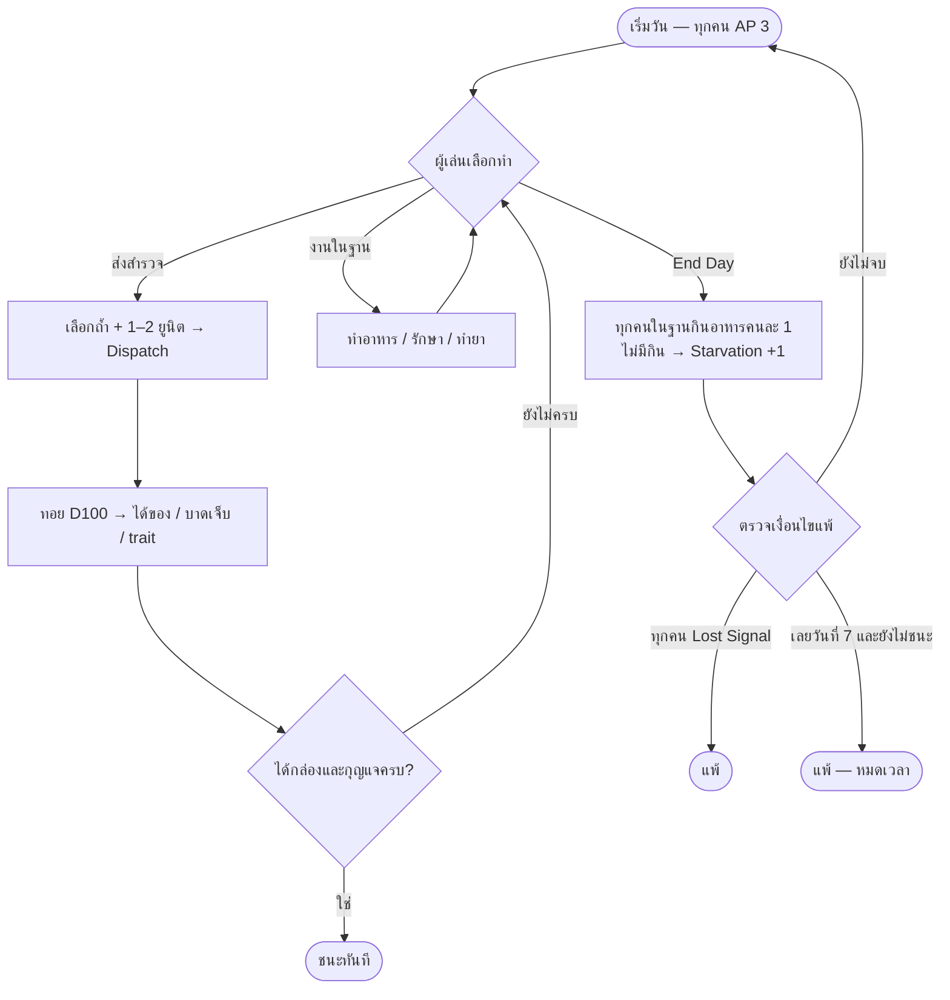
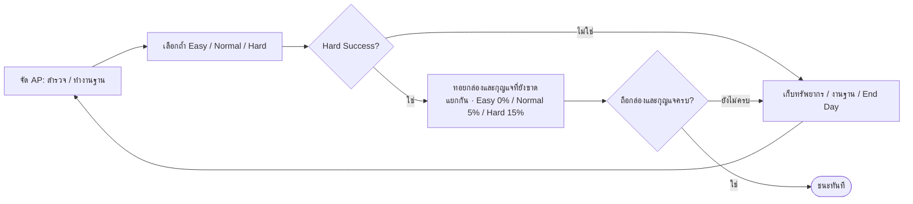

# clogged — Game Concept

**Version:** 2.1 (Unity V2) | **Last Updated:** 2026-10-29 | **Owner:** ทีม clogged
> อ้างอิงจากระบบที่ทำงานจริงใน `Unity-Projects/Assets/V2/` (scene `Core.unity`) — GDD v1.0 ของ Web Prototype (Phaser) เก็บไว้ที่ [wiki/archive/gdd-v1-prototype](../wiki/archive/gdd-v1-prototype/README.md)

## 1. Introduction

### Elevator Pitch
ผู้เล่นคุมทีมยูนิต 4 คนที่ติดอยู่ในฐาน และต้องหา **กล่องกับกุญแจ** (Core Item A/B) ให้ครบภายใน **7 วัน** ในแต่ละวันต้องตัดสินใจว่าจะใช้ **Action Point (AP)** ที่มีอยู่น้อยนิดไปกับ **การออกสำรวจถ้ำ** (ได้ของดีแต่เสี่ยงบาดเจ็บหรือหายตัว ตัดสินด้วยการทอย D100) หรือกับ **งานในฐาน** (ทำอาหาร รักษา ทำยา) ทั้งหมดนี้ภายใต้แรงกดดันของอาหารที่ต้องจ่ายทุกวัน

**คำถามหลักของผู้เล่น:** วันนี้จะเสี่ยงส่งใครไปไหน แล้วจะเหลือ AP ไว้เลี้ยงทุกคนให้รอดจนกว่าจะได้กล่องและกุญแจมาคู่กันได้อย่างไร

### Target Audience
- ผู้เล่นที่ชอบ resource management แบบ turn-based และการตัดสินใจภายใต้ความเสี่ยง (Darkest Dungeon, FTL, This War of Mine)
- ชอบระบบทอยเต๋าแบบ TRPG (roll-under D100 แบบ Call of Cthulhu)

### Genre & Platform
- **Genre:** Turn-based Resource Management + Risk/Dice Expedition
- **Perspective:** UI แมปมุมบน (ฐานกลางจอ ถ้ำกระจายรอบๆ)
- **Engine / Platform:** Unity (UGUI + TextMeshPro, URP 2D) — PC
- **Session Length:** 1 run = 7 วัน (เกมวัน) ≈ 10–15 นาที

### Design Pillars

| Pillar | ความหมาย | ระบบที่รองรับ |
|---|---|---|
| **AP ทุกแต้มมีค่า** | ทุกการกระทำแย่ง AP ก้อนเดียวกัน (3/คน/วัน) | AP, Base Work vs Gather, Starvation (+AP cost) |
| **ความเสี่ยงที่อ่านออก** | ผู้เล่นเห็นโอกาสก่อนตัดสินใจ และรับผลได้ทั้งดีและร้าย | D100 roll-under, Aptitude, Duo bonus, Trait |
| **อาหารไม่เคยพอ** | ทุกคืนต้องจ่ายอาหาร ขาดแล้วทุกอย่างแพงขึ้นจนเสียคน | Food, Starvation stack, Lost Signal |
| **เส้นตายบีบให้เสี่ยง** | ถ้ำง่ายปลอดภัยแต่ไม่มีโอกาสได้ Core Item; โซนที่ยากขึ้นมีโอกาสสูงกว่า | 7-day deadline, Hard Success และโอกาส Core Item ตามโซน |

### Unique Selling Points
- **ทอย D100 แบบ roll-under 4 ระดับผล** (Hard Success / Regular / Failure / Fumble) — ผลแต่ละระดับให้ทั้งของ, บาดแผล และ trait ถาวร
- **ยูนิตเปลี่ยนไปตามประสบการณ์** — ทริปที่ดีหรือแย่ให้ trait ที่ติดตัวไปตลอด run
- **ความหิวเป็นภาษีของ AP** — หิว 1 stack = ทุกการกระทำแพงขึ้น 1 AP, 3 stack = ยูนิตขาดการติดต่อ (Lost Signal)
- **เป้าหมายเป็นของสองชิ้น** — กล่องและกุญแจมีโอกาสดรอปแยกจากกันเมื่อได้ Hard Success; ไม่บังคับลำดับ และอาจได้ทั้งคู่จากทริปเดียว

---

## 2. Game Loop

### Core Loop (1 วัน)

### Run Loop (เป้าหมายระยะยาว)

### Win / Lose Conditions

| เงื่อนไข | ผล |
|---|---|
| ได้กล่องและกุญแจครบก่อนหมดเวลา | **WIN** (ชนะทันทีเมื่อได้ชิ้นที่สอง) |
| หมดวันที่ 7 แล้วยังได้ของไม่ครบคู่ | **LOSE** — หมดเวลา |
| ยูนิตทั้ง 4 คน Lost Signal (Missing) | **LOSE** — ไม่เหลือใคร |

---

## 3. Technical Stack

| Layer | Technology | Notes |
|---|---|---|
| Engine | Unity (URP) | โฟลเดอร์ระบบหลัก `Assets/V2/` |
| Language | C# | MonoBehaviour singleton + plain serializable data class |
| UI | Unity UGUI + TextMeshPro | Canvas 1920×1080 Scale With Screen Size |
| Input | Unity Input System (`InputSystemUIInputModule`) | |
| Scenes | `V2/Scenes/MainMenu.unity`, `V2/Scenes/Core.unity` | เมนูเริ่ม/เล่นต่อ และ scene gameplay |

รายละเอียดสถาปัตยกรรม: [Unity V2 System Design](../software/04-unity-system-design.md) · [Class Diagram](../software/05-unity-class-diagram.md) · [Core Scene Hierarchy](../software/06-unity-core-scene-hierarchy.md)

---

## 4. System Overview

| ระบบ | สรุป | รายละเอียด |
|---|---|---|
| **Unit** | 4 ยูนิตคงที่ มี AP, Aptitude/Non-aptitude, Trait, สถานะ 5 แบบ | [Mechanics §2](01-mechanics.md#2-unit-system) |
| **Day / AP** | วันละ 3 AP ต่อคน, End Day = กินอาหาร + รีเฟรช AP | [Mechanics §3](01-mechanics.md#3-day-system) |
| **Send-to-Gather** | ส่ง 1–2 คนไปถ้ำ 3 ระดับ ทอย D100 ตัดสินผล | [Mechanics §4](01-mechanics.md#4-send-to-gather--การออกสำรวจ) |
| **Base Work** | ทำอาหาร / รักษา / Workshop ทำซ้ำได้ไม่จำกัด | [Mechanics §5](01-mechanics.md#5-base-work--งานในฐาน) |
| **Starvation** | ไม่ได้กิน = +1 stack (+1 AP ทุกการกระทำ), 3 stack = Lost Signal | [Mechanics §6](01-mechanics.md#6-starvation--ความหิว) |
| **Core Item** | Hard Success มีโอกาสดรอปกล่องและกุญแจแยกกันตามโซน | [Mechanics §7](01-mechanics.md#7-core-item--เงื่อนไขชนะ) |

---

## 5. Design Evolution

| Version | Concept | สถานะ | Source |
|---|---|---|---|
| **v2.1 Unity V2** | Turn-based AP + D100 expedition, 4 ยูนิตคงที่, เก็บกล่องและกุญแจใน 7 วัน, เมนูและบันทึกเล่นต่อ | **ปัจจุบัน** | `Unity-Projects/Assets/V2/` |
| v1.5 Unity Day/Night | Ship Navigator + Day scene (crew mission, real-time clock) ↔ Night scene (tower defense) | เลิกใช้ (legacy) | `Unity-Projects/Assets/Day/`, `Assets/Night/` |
| v1.0 Web Prototype | Real-time mission chain + night monster attack, รอด 30 วัน | เลิกใช้ (ระยะที่ 1) | `src/`, [GDD archive](../wiki/archive/gdd-v1-prototype/00-concept.md) |
| v0.3 Concept | Turn-based Strategy + Tower Defense — Ship → Day → Night + Node Map Roguelike | แนวคิด | [Clogged_GDD_v0.3](https://docs.google.com/document/d/1SGxMLKs7FlRq_E-0OHyskQbingBxaU5L/edit) |

**สิ่งที่เปลี่ยนจาก v1.0 → v2.0**
- ตัด real-time clock และ mission chain ออก → เปลี่ยนเป็น **AP ต่อวัน** (turn-based)
- ตัด **ช่วงกลางคืน / ป้องกันฐาน** และ Base HP ออกทั้งหมด
- ผลการสำรวจจาก proficiency + สูตรต่อเนื่อง → **ทอย D100 แบบแบ่งระดับผล**
- ลูกเรือสุ่ม/จ้างได้ → **4 ยูนิตคงที่** ที่โตขึ้นด้วย Trait
- รอด 30 วัน → **หา Core Item ใน 7 วัน** (เป้าหมายเชิงรุก ไม่ใช่แค่ประคองตัว)
- ทรัพยากร 7 ชนิด + ชิ้นส่วนสัตว์ → **4 ชนิด** (Food, Cooking Material, Medicine, Materials)

---

## 6. Open Questions

- ปุ่ม/ทางเข้าถึงการให้อาหารเพื่อลด Starvation — มี controller แต่ยังไม่พบ UI ที่เรียกใช้
- Aptitude `Speed`, `Endurance`, `Gathering`, `Combat` ยังไม่มีผล — จะผูกกับกลไกอะไร
- Trait ทุกตัวให้ ±10 เท่ากัน — จะให้ trait แต่ละชื่อมีผลเฉพาะหรือไม่
- Lore ของโลก, ฐาน, กล่อง และกุญแจยังไม่กำหนด (ดู [Narrative](02-narrative.md))
- ภาพและเสียงเพิ่มเติมจาก pixel-art UI ปัจจุบันยังเป็นงานต่อยอด; ไม่มีระบบเพลง/SFX ใน V2 ตอนนี้

---

## Related Documents
- [Core Mechanics](01-mechanics.md)
- [Narrative & World](02-narrative.md) · [Art Direction](03-art-direction.md) · [Audio Direction](04-audio-direction.md)
- [Unity V2 System Design](../software/04-unity-system-design.md)
- [Product Backlog](../agile/01-product-backlog.md)
