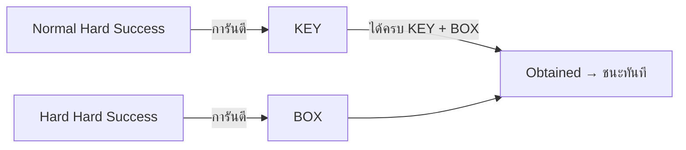

# clogged — Core Mechanics

**Version:** 2.1 (Unity V2) | **Last Updated:** 2026-10-29
> ตัวเลขทั้งหมดตรงกับค่าในโค้ด/Inspector ของ `Unity-Projects/Assets/V2/` ณ วันที่อัปเดต — ปรับได้ใน Inspector (ดู [§9](#9-tunable-values--ตัวเลขที่ปรับได้)) ถ้าเปลี่ยนค่าใน scene ให้อัปเดตเอกสารนี้ด้วย
> กลไกของ Web Prototype (mission chain, night defense, 30 วัน) ดูที่ [archive](../wiki/archive/gdd-v1-prototype/01-mechanics.md)

## 1. Core Loop

```
<<<<<<< HEAD
1. เริ่ม run จากเมนู หรือเล่นต่อจาก save — run ใหม่เริ่มวันที่ 1; วันใหม่คืน AP ให้ยูนิตที่ยังทำงานได้
=======
1. เริ่มวัน — ทุกคนที่ยังไม่ตาย (Death) ได้ AP เต็ม (3)
>>>>>>> origin/Kagerou
2. วางแผน — สลับทำได้อิสระจนกว่าจะพอใจ:
     • ส่ง 1–2 ยูนิตออกสำรวจถ้ำ (ยูนิตละ 1 ครั้ง/วัน) → ทอย D100 → รับผล
     • ให้ยูนิตทำงานในฐาน (ทำอาหาร / รักษา / ทำยา) — ไม่จำกัดครั้ง
3. End Day — ทุกคนที่ไม่ใช่ Away/Missing ในลำดับ roster กิน Food คนละ 1 → ใครไม่ได้กิน Starvation +1
4. ตรวจ win/lose → ถ้ายังเล่นต่อได้ รีเฟรช AP และบันทึก run เพื่อ Continue
```

1 run = สูงสุด 7 วัน ไม่มีเวลาจริงจับ — ผู้เล่นคิดได้นานเท่าที่ต้องการ

---

## 2. Unit System

### 2.1 ยูนิตตั้งต้น

ทีมมี 4 คนคงที่ตลอด run (ไม่มีการจ้างเพิ่ม)

| ยูนิต | Aptitude (ถนัด) | Non-aptitude (ไม่ถนัด) | บทบาทที่เหมาะ |
|---|---|---|---|
| **Ann** | Speed, **Easy** | **Hard** | หาวัตถุดิบอาหารที่ถ้ำ Easy |
| **Boon** | Endurance, **Hard** | Cooking | ลุยถ้ำ Hard |
| **Cia** | Gathering, **Normal**, **Cooking** | Combat | ถ้ำ Normal + คนครัว (อาหาร ×2) |
| **Dan** | Combat, **Hard** | Cooking | ลุยถ้ำ Hard |

> Tag ที่มีผลในเกมตอนนี้: **Easy / Normal / Hard** (ความถนัดหลักของยูนิต) + **Heal / Crafting / Cooking / Exploring** (talent) — `Speed`, `Endurance`, `Gathering`, `Combat` ถูกถอดออกแล้ว

### 2.2 Action Point (AP)

- ทุกคนมี **AP สูงสุด 3** ได้คืนเต็มตอนเริ่มวันใหม่ (ไม่สะสมข้ามวัน)
- **ค่า AP จริง = ค่าพื้นฐาน + จำนวน Starvation stack** ของยูนิตนั้น
- AP เหลือ 0 → สถานะเป็น **Resting** ทำอะไรไม่ได้จนถึงวันถัดไป

### 2.2b Readiness (ตั๋วเข้าถ้ำ — ไอคอนเป็นรูปดาบ)

- ทุกคนมี **Readiness 1 หน่วย/วัน** และได้คืนเต็มตอนเริ่มวันใหม่ (เหมือน AP)
- **การส่งเข้าถ้ำ 1 ครั้ง = −1 Readiness** ของยูนิตที่ไป (ส่ง 2 คน = −2 หน่วย)
- **Readiness ไม่เกี่ยวกับงานในฐาน** (Cook / Heal / Craft ไม่กิน Readiness) — เป็นตัวเช็คความพร้อมสำหรับ dispatch เท่านั้น
- Readiness หมด → ยูนิตนั้นส่งเข้าถ้ำไม่ได้จนถึงวันถัดไป (ขึ้นว่า "has no readiness left today") แต่ยังทำงานในฐานได้
- บนการ์ด: มุมซ้ายบนเป็นรูปดาบตอนพร้อม และ **จางลง (alpha 0.28)** เมื่อใช้ไปแล้ว
- ข้อความในเกมใช้คำว่า **READINESS** ทั้งหมด (เดิมคือ READY / SWORD): tooltip มุมซ้ายบน, บรรทัดต้นทุนใต้ปุ่ม DISPATCH (`1 AP + 1 READINESS`), และหน้า help §2/§4

> **หมายเหตุ:** ชื่อในโค้ดยังเป็น `currentSwords` / `HasSword` / `TrySpendSword()` (ไอคอนและกลไกเดิม) — เปลี่ยนเฉพาะข้อความที่ผู้เล่นเห็น

### 2.3 สถานะยูนิต

| สถานะ | แสดงใน UI | ส่งสำรวจ | งานในฐาน | กินอาหารตอน End Day | ออกจากสถานะนี้โดย |
|---|---|---|---|---|---|
| **Idle** | Readiness | ✅ (ถ้ายังมี Readiness) | ✅ | ✅ | — |
| **Resting** | Resting | ❌ | ❌ | ✅ | วันใหม่ |
| **Hurt** | Hurt (สีแดง) | ❌ | ❌ | ✅ | ยูนิตอื่น **รักษา** (ไม่หายเองข้ามวัน) → กลับเป็น Idle ถ้ามี AP, **Resting ถ้า AP หมด** |
| **Away** | Away | ❌ | ❌ | ❌ | กลับจากทริป |
| **Death** | D (จางมาก) | ❌ | ❌ | ❌ | **ถาวร** — ใช้อีกไม่ได้จนจบ run |

> ยูนิตที่ Hurt ยังได้ AP คืนทุกวัน แต่ใช้ไม่ได้จนกว่าจะถูกรักษา — และยังต้องกินอาหาร

> **AP หมด = Resting เสมอ** ไม่ว่าจะเพิ่งถูกส่งไปดันเจี้ยนหรือเพิ่งถูก heal: การรักษาล้างสถานะ Hurt อย่างเดียว ไม่ได้ให้ AP คืน ถ้าผู้ป่วยเหลือ 0 AP จะกลับมาเป็น Resting (กดไม่ได้) จนถึงวันใหม่

### 2.4 Trait

ได้จากผลการสำรวจ (ดู §4.4) ติดตัวถาวรตลอด run

| Polarity | ผล | ชื่อในคลัง (flavor เท่านั้น) |
|---|---|---|
| ดี (Positive) | +10 โอกาสสำเร็จ | Sharp-eyed, Steady Hands, Quick Feet, Thick-skinned, Lucky Streak |
| เสีย (Negative) | −10 โอกาสสำเร็จ | Clumsy, Jumpy, Shaky Nerves, Sluggish, Unlucky |

- สุ่มชื่อที่ยูนิตยังไม่มีก่อน ถ้ามีครบแล้วจะได้ชื่อซ้ำ
- ใน 1 ทริป trait ดีนับ **+10 ครั้งเดียว** และ trait เสียนับ **−10 ครั้งเดียว** ไม่ว่าทีมจะมีกี่ตัว

---

## 3. Day System

### 3.1 End Day (ปุ่ม End Day)

ลำดับที่เกิดขึ้นเมื่อกด:

<<<<<<< HEAD
1. **ถ้ามี Core Item ครบทั้งกล่องและกุญแจ → ชนะ** (ปกติชนะทันทีเมื่อได้ชิ้นที่สอง)
2. **กินอาหาร** — ไล่ตามลำดับ roster (Ann → Boon → Cia → Dan) ข้ามคนที่ Away/Missing ทุกคนกิน 1 Food; ถ้าอาหารหมดกลางทาง คนที่เหลือได้ **Starvation +1**
=======
1. **ถ้ามี Core Item อยู่แล้ว → ชนะ** (จบทันที)
2. **กินอาหาร** — ไล่ตามลำดับ roster (Ann → Boon → Cia → Dan) ข้ามคนที่ Away/Death ทุกคนกิน 1 Food; ถ้าอาหารหมดกลางทาง คนที่เหลือได้ **Starvation +1**
>>>>>>> origin/Kagerou
3. วัน +1
4. **ทุกคน Death → แพ้**
5. **ทุกคน Hurt (หรือ Hurt + Death ผสม) → แพ้** — การรักษาต้องมีคนที่พร้อมรักษา เมื่อไม่มีใครลุกได้ก็ไม่มีทางกลับมา
6. **วันเกิน 7 และยังไม่มี Core Item → แพ้ (หมดเวลา)**
7. **รีเฟรช** — ทุกคนที่ไม่ใช่ Away/Death ได้ AP เต็ม, **Readiness เต็ม (1 หน่วย)**, Resting → Idle, รีเซ็ตสิทธิ์ให้อาหารรายวัน

> ข้อ 5 ถูกตรวจ **ทันทีที่ผลของทริปจบลง** ด้วย (`DayManager.CheckImmediateLoss`) ไม่ต้องรอจบวัน — Fumble ที่ทำให้คนสุดท้ายที่ยังยืนอยู่ล้มลงก็จบรันตรงนั้นเลย

> ลำดับ roster สำคัญ: ถ้าอาหารไม่พอ **Ann หิวก่อน** แล้วตามด้วย Boon, Cia, Dan

ถ้า run ยังไม่จบหลังรีเฟรชวัน ระบบเขียน autosave สำหรับปุ่ม Continue; เมื่อ run จบ save จะถูกลบ

### 3.2 เส้นตาย

- เริ่มวันที่ 1, `deadlineDay = 7` → เล่นได้ 7 วันเต็ม
- HUD แสดง `Day X / 7 (N days left)` และขึ้น **"last day!"** สีแดงในวันที่ 7

---

## 4. Send-to-Gather — การออกสำรวจ

### 4.1 ขั้นตอน

<<<<<<< HEAD
1. คลิก **ถ้ำ** บนแมป (6 จุด — Easy/Normal/Hard อย่างละ 2, สุ่มตำแหน่งรอบฐานทุก run, สีบอกระดับ)
2. ติ๊กเลือก **1–2 ยูนิต** ที่ Ready และยังไม่ได้ออกสำรวจวันนี้
3. ยืนยัน **Dispatch** → หัก AP, ทอยและคำนวณผลทันที → ผลลง log
=======
1. คลิก **ถ้ำ** บนแมป — การ์ด 3 ใบเรียงตายตัว **Easy | Normal | Hard** (ไม่สุ่มตำแหน่งแล้ว)
2. ติ๊กเลือก **1–2 ยูนิต** ที่พร้อม (มีดาบ) และยังไม่ได้ออกสำรวจวันนี้
3. กด **Dispatch** → ทอย → ป๊อปอัปเต๋าแสดงผล → กด CONTINUE
   (กด DISPATCH แล้ว **ถ้ำจะถูกยกเลิกการเลือกทันที** พร้อมล้างยูนิตที่เลือก — เริ่มแผนใหม่ได้เลย)
>>>>>>> origin/Kagerou

กฎ:
- **ทุกคนที่ไปจ่าย AP เต็มจำนวน** ของถ้ำ (ไปคู่ไม่หารกัน)
- ยูนิตออกสำรวจได้ **1 ครั้ง/วัน** เพราะมี **Readiness 1 หน่วย/วัน** (ใช้แล้วจางลง รีเฟรชพร้อม AP) — AP ที่เหลือใช้ทำงานในฐานได้
- การ์ดถ้ำแสดง **โอกาส realtime** (SV จริงของทีมเมื่อเลือกถ้ำ + ยูนิตแล้ว) **เป็นตัวเลขล้วน ไม่มี `%`** (เช่น `65  --  1 AP`) พร้อมสี เขียว = โอกาสสูง → แดง = โอกาสต่ำ · ผู้เล่น **ทอย 1–100 แล้วต้องทอยให้ได้ต่ำกว่าค่านี้** · ของที่ดรอป และ **ชิ้น Core Item ที่ถ้ำนั้นให้** (ไอคอนกุญแจ/กล่องปลายแถวของที่ดรอป — ดู §7)
- เลือกถ้ำกับเลือกสกิลเป็นแผนที่ตัดกัน — เปิดสกิลจะยกเลิกถ้ำที่เลือก และคลิกถ้ำจะยกเลิกสกิล

### 4.2 ระดับถ้ำ

| ระดับ | สีบนแมป | AP ต่อคน | โอกาสพื้นฐาน | **Handicap** | ของหลัก | Bonus (Hard Success สุ่ม 1 อย่าง) |
|---|---|---|---|---|---|---|
| **Easy** | เขียว | 1 | 80 | 30 | Cooking Material ×2 | Cooking Material ×2 / Medicine ×1 |
| **Normal** | เหลือง | 2 | 55 | 20 | Medicine ×1 | Medicine ×1 / Cooking Material ×1 |
| **Hard** | แดง | 3 | 30 | 0 | Materials ×2 | Materials ×2 / Medicine ×1 |

> ถ้ำ Hard ใช้ 3 AP = AP ทั้งวันของยูนิตที่ไม่หิว — ยูนิตที่หิวแม้แต่ 1 stack ไป Hard ไม่ได้

### 4.3 Success Value (โอกาสสำเร็จ)

```
Success Value = โอกาสพื้นฐานของถ้ำ
              + 25  ถ้ามีคนในทีมถนัดระดับถ้ำนี้            (นับครั้งเดียว)
              − 10 × ระยะห่างของแต่ละคน                    (ต่อคน บวกกัน)
                     ถนัด E → ไป N −10 · ไป H −20
                     ถนัด N → ไป E −10 · ไป H −10
                     ถนัด H → ไป M/N −10 · ไป E −20
              + 25  ถ้าไป 2 คน
              + 10  ถ้ามีคนในทีมมี trait ดี                 (นับครั้งเดียว)
              − 10  ถ้ามีคนในทีมมี trait เสีย                (นับครั้งเดียว)
              + 10  ต่อคนที่มีบัพ Blessed
              + 10 × จำนวน stack ของ Buff Potion (ทั้งทีม)
              − Risk  +  Handicap ของถ้ำนั้น        (ผลรวมไม่ต่ำกว่า 0)
```

- **ไม่มีโทษ "ถ้ำ Hard คนเดียว" แล้ว** (ตัด −20 ออก)
- ค่าลบคิด **ต่อคน** ไม่ใช่ครั้งเดียว
- Blessed มาจาก talent `Heal`ของ Ann และหมดหลังลงดันครั้งถัดไป
- Buff Potion เป็นบัพถาวรของทั้ง run สะสมได้ (ไม่รีเซ็ตข้ามวัน)

#### Risk (หมอกแดง)

| หัวข้อ | สเปก |
|---|---|
| ค่าเริ่มต้น | **80** (`RunResources.MaxRisk`) ตอนเริ่ม run ใหม่, floor 0 |
| Handicap รายถ้ำ | Easy **30** / Normal **20** / Hard **0** (`GatherResolver.ZoneHandicap`) |
| โทษที่เกิดขึ้น | `−Risk + Handicap` ไม่ต่ำกว่า 0 → Easy/Normal จะหลุดโทษก่อน Hard · เป็นค่าลดหย่อนคงที่ ไม่ใช่เพดาน จึงไม่มีทางดัน SV เกินค่าพื้นฐานของถ้ำ |
| ผล | หักจาก SV ของทริปนั้นตรง ๆ และเป็นความหนาของหมอกบนแผนที่ + ระดับในหลอด RISK ข้างถ้ำ (ค่าเดียวกันหมด ไม่มีสไลเดอร์แยก) |
| ลดได้อย่างไร | เคลียร์ถ้ำสำเร็จเท่านั้น: Easy **−5**, Normal **−10**, Hard **−15** (Failure/Fumble ไม่ลด) |
| ตัวอย่าง SV | Risk 80 → Easy 30 / Normal −5 (แสดง 0%) / Hard −50 (0%) · Risk 40 → **70 / 35 / 0** · Risk 30 → **80** / 45 / 0 (Easy ฟรี) · Risk 20 → 80 / **55** / 10 · Risk 0 → 80 / 55 / 30 |

#### ตารางยูนิต

| ยูนิต | ความถนัดหลัก (E/N/H) | Talent | ผลของ Talent |
|---|---|---|---|
| **Ann** | Easy | **Heal** | คนที่ถูก Ann รักษาได้ **Blessed** (+10 SV ครั้งถัดไป) |
| **Boon** | Hard | **Crafting** | ยาที่ craft ได้ **×2** |
| **Cia** | Normal | **Cooking** | อาหารที่ได้ **×2** |
| **Dan** | Hard | **Exploring** | ไอเทมจากดันเจี้ยน **×2** (ยกเว้น Core Item) |


### 4.4 การทอย 1D100 (roll-under) และระดับผล

ทอยเลข 1–100 แล้วตรวจตามลำดับ:

| ระดับผล | เงื่อนไข | ของที่ได้ | ผลต่อยูนิต | Trait |
|---|---|---|---|---|
| **Fumble** | SV < 50: ทอย 96–100 · SV ≥ 50: ทอย 100 | ไม่ได้อะไร | **ยูนิตทุกคนที่เข้าทริป Hurt** (ไม่มีใครตายจากการทอย) | trait เสีย **100% — ทุกคนที่ไป** |
| **Hard Success** | ทอย ≤ ⌊SV ÷ 3⌋ | ของหลักเต็ม + bonus 1 อย่าง | — | trait ดี 50% |
| **Regular** | ทอย ≤ SV | ของหลักเต็ม | — | — |
| **Failure** | ทอย > SV | ของหลัก**ครึ่งเดียว** (ปัดลง) | **สุ่ม 1 คนบาดเจ็บ (Hurt)** | trait เสีย 50% |

- Trait ที่ได้จะสุ่มให้ **1 คน** ในทีม (ยกเว้น Fumble ที่แจกให้ทุกคนที่ไป)
- Failure ที่ถ้ำ Normal ได้ Medicine ⌊1 ÷ 2⌋ = **0** → ไม่ได้อะไรเลย
- Hard Success ที่ Normal / Hard ยังนับเป็นความคืบหน้า Core Item (§7)
- **(2026-11-02)** Hard Success แคบลงจากครึ่งบนของ SV (÷2) เหลือ **หนึ่งในสามของ SV (÷3)** — ตาราง §4.5 และ `GatherResolver.HardSuccessThreshold()` ใช้ค่าเดียวกันแล้ว

### 4.5 ตารางโอกาสตัวอย่าง (ทีมยังไม่มี trait)

Hard Success = ⌊SV ÷ 3⌋ · Regular = SV − Hard Success · Fumble ทอย 100 (หรือ 96–100 เมื่อ SV < 50)

| สถานการณ์ | SV | Hard Success | Regular | Failure | Fumble |
|---|---|---|---|---|---|
| Easy — Ann คนเดียว (ถนัด) | 105 | 35% | 64% | 0% | 1% |
| Easy — Boon คนเดียว (ห่าง 2 ชั้น) | 60 | 20% | 40% | 39% | 1% |
| Easy — Ann + Cia | 120 | 40% | 59% | 0% | 1% |
| Normal — Cia คนเดียว (ถนัด) | 80 | 26% | 54% | 19% | 1% |
| Normal — Ann + Cia | 95 | 31% | 64% | 4% | 1% |
| Normal — Boon คนเดียว (ห่าง 1 ชั้น) | 45 | 15% | 30% | 50% | 5% |
| Hard — Boon คนเดียว (ถนัด) | 55 | 18% | 37% | 44% | 1% |
| Hard — Boon + Dan | 80 | 26% | 54% | 19% | 1% |
| Hard — Dan + Ann (ถนัด + ห่าง 2 ชั้น) | 60 | 20% | 40% | 39% | 1% |
| Hard — Ann คนเดียว (ห่าง 2 ชั้น) | 10 | 3% | 7% | 85% | 5% |

> SV เกิน 100 ได้ (เช่น Ann ไป Easy = 105) — Regular จะกินส่วนที่เหลือทั้งหมด ไม่มีทางพลาด
> จุดตัดที่ SV = 50: ต่ำกว่านี้ Fumble กระโดดจาก 1% เป็น 5% — ที่ถ้ำ Hard Fumble แพงที่สุดเพราะทั้งทีม Hurt พร้อมกัน

---

## 5. Base Work — งานในฐาน

- ทำได้ **ไม่จำกัดครั้ง** ต่อวัน ทั้งก่อนและหลังออกสำรวจ ตราบที่ยูนิต Ready และมี AP
- ขั้นตอนใน panel: เลือกงาน → เลือกผู้ทำ (คนที่ Ready ขึ้นก่อน คนที่ไม่ว่างเป็นสีเทา) → เลือกจำนวนรอบ หรือผู้ป่วย → ดู preview ต้นทุน/ผลได้ → **Confirm (ย้อนไม่ได้)**
- เลือก worker จากการ์ดหนึ่งใบ; Cook/Craft ต่อคิวจำนวนรอบได้และปรับ AP ที่แสดง, Heal เลือกผู้ทำและผู้ป่วย พร้อมเลือกใช้ยา/AP; ปุ่มยืนยันใช้ร่วมกับ Dispatch
- Dispatch resolve ในเฟรมเดียว ไม่มีช่วงเดินทางหรือสถานะระหว่างทริปให้ผู้เล่นรอ

| งาน | ต้นทุนต่อรอบ | ผลต่อรอบ | หมายเหตุ |
|---|---|---|---|
<<<<<<< HEAD
| **Cook** ทำอาหาร | 1 AP + 1 Cooking Material | +1 Food (**+2** ถ้าถนัด Cooking) | เลือกหลายรอบได้; ในรายชื่อ คนถนัด = สีเขียว, ไม่ถนัด = สีแดง (ไม่ถนัดยังได้ +1 ปกติ) |
| **Heal** รักษา | เลือก 1 AP + 1 Medicine หรือ 2 AP โดยไม่ใช้ยา | ผู้ป่วย Hurt → Ready | เลือกผู้ทำและผู้ป่วย; รักษาตัวเองไม่ได้ |
| **Craft** (Workshop) | 1 AP + 2 Materials | +1 Medicine | เลือกหลายรอบได้ |
=======
| **Cook** ทำอาหาร | 1 AP + 1 Cooking Material | +1 Food (**+2** ถ้ามี talent Cooking) | เลือกหลายรอบได้ |
| **Heal** รักษา | 1 AP + 1 Medicine **หรือ** **3 AP** ถ้าไม่มียา | ผู้ป่วย Hurt → Ready (**+ Blessed** ถ้าผู้รักษามี talent Heal) | ใช้ยาอัตโนมัติถ้ามีในคลัง; รักษาตัวเองไม่ได้; **ถ้าผู้ป่วย AP เหลือ 0 จะกลับเป็น Resting ไม่ใช่ Ready** |
| **Craft** — โหมด Medicine | 1 AP + 2 Materials | +1 Medicine (**×2** ถ้ามี talent Crafting) | เลือกหลายรอบได้ |
| **Craft** — โหมด Buff Potion | 2 AP + 5 Materials | +10 Success Value ให้ทั้งทีมถาวร (สะสมได้) | สลับโหมดด้วยปุ่มข้างปุ่ม CRAFT |
>>>>>>> origin/Kagerou

> ทุกต้นทุน AP บวก Starvation stack ของผู้ทำด้วย (เช่น คนหิว 1 stack ทำอาหารรอบละ 2 AP)

---

## 6. Starvation — ความหิว

| กลไก | รายละเอียด |
|---|---|
| ได้ stack | ตอน End Day ถ้าอาหารหมดก่อนถึงคิวตัวเอง → +1 stack |
| ผล | ทุกการกระทำ (สำรวจ, ทำอาหาร, รักษา, Craft) แพงขึ้น **+1 AP ต่อ stack** |
<<<<<<< HEAD
| ครบ 3 stack | ยูนิต **Lost Signal (Missing)** ถาวร |
| ลด stack | `StarvationController` รองรับ 1 Food → −1 stack, 1 ครั้ง/คน/วัน; **ยังไม่พบปุ่ม/UI ที่เรียกใช้ใน scene หรือ UI scripts** |
=======
| ครบ 3 stack | ยูนิตเข้าสถานะ **Death** ถาวร |
| ลด stack | ปุ่ม **ให้อาหาร**: 1 Food → −1 stack, 1 ครั้ง/คน/วัน ใช้ได้ทุกเวลาในวัน — *มีระบบแล้วแต่ยังไม่มีปุ่มใน UI* |
>>>>>>> origin/Kagerou
| แสดงผล | การ์ดยูนิตขึ้น `Hungry xN`; HUD แสดง `Food: X (need N tonight)` เป็นสีแดงเมื่อไม่พอ |

> Stack ไม่ลดเองเมื่อกลับมามีอาหาร — การลด stack มี controller แต่ยังเข้าถึงจาก UI ไม่ได้

---

## 7. Core Item — เงื่อนไขชนะ

<<<<<<< HEAD
กล่อง (A) และกุญแจ (B) เป็นของคนละชิ้น ไม่มีกลไกปลดล็อกหรือลำดับการหา:

- เฉพาะ **Hard Success** เท่านั้นที่ทอยโอกาสดรอปของแต่ละชิ้นที่ยังไม่มี
- โอกาสต่อชิ้นต่อ Hard Success: Easy **0%**, Normal **5%**, Hard **15%**; ทอยแยก A/B จึงอาจได้ทั้งคู่จากทริปเดียว
- Regular, Failure และ Fumble ไม่ดรอป Core Item
- ได้ครบทั้งกล่องและกุญแจแล้วชนะทันทีภายใน deadline; HUD เปลี่ยนภาพกล่องเป็นเปิดและแสดง crystal reveal, จากนั้น Run Result screen แสดงผลและสถิติ
- HUD ใช้คำว่า `BOX` / `KEY`; ชนิด A/B เป็นชื่อภายในระบบ

คู่สีส้ม/เหลืองของกล่องและกุญแจสุ่มตอนเริ่ม run และคงเดิมเมื่อ Continue
=======


| สถานะ | ข้อความบน HUD |
|---|---|
| Locked | `BOX` / `KEY` (ยังไม่ได้ชิ้นนั้น) |
| Obtained | ได้ชิ้นนั้นแล้ว (ไอคอนเปลี่ยนทันที) |

**การดรอป: ผูกกับถ้ำ ไม่ใช่ทอย** (`GatherDispatchController.CoreItemForZone`) — Hard Success ของถ้ำไหนให้ชิ้นของถ้ำนั้น การันตี 100% ไม่มีตัวนับ pity และไม่มีอัตราต่อชิ้นแล้ว

| ระดับ | ชิ้นที่ได้จาก Hard Success |
|---|---|
| Easy | — (ไม่มี) |
| Normal | **KEY** |
| Hard | **BOX** |

- Regular Success / Failure / Fumble **ไม่ดรอป** Core Item
- ถ้ำที่ชิ้นนั้นถูกเก็บไปแล้ว = ไม่มีอะไรดรอปเพิ่มจากถ้ำนั้น
- **Jackpot** — ถ้า SV ของทริป **≥ 80** และทอยได้ **1** พอดี: รับ **ชิ้นที่ยังขาด** เพิ่มอีกชิ้นจากที่ถ้ำให้ (ถ้ายังขาดทั้งคู่ = ได้ทั้ง KEY และ BOX ในครั้งเดียว) · ที่ SV ต่ำกว่า 80 ไม่มี jackpot
- Talent `Exploring` (Dan) ไม่มีผลกับ Core Item แล้ว (คูณ ×2 เฉพาะไอเทมปกติ)
- Core Item **ไม่ถูกคูณ ×2** จาก Exploring
>>>>>>> origin/Kagerou

---

## 8. Resource & Economy

### 8.1 ทรัพยากร

| ทรัพยากร | เริ่มต้น | แหล่งที่มา | ใช้กับ |
|---|---|---|---|
| **Food** | 8 | Cook | End Day (1/คน); ระบบ feed ลด stack มีใน controller แต่ยังไม่มี UI |
| **Cooking Material** | 2 | ถ้ำ Easy, bonus Easy/Normal | Cook |
| **Medicine** | 1 | ถ้ำ Normal, Craft, bonus ทุกถ้ำ | Heal |
| **Materials** | 0 | ถ้ำ Hard, bonus Hard | Craft |
| **Readiness** (ไอคอนดาบ) | 1/ยูนิต/วัน | รีเฟรชตอนเริ่มวัน (เหมือน AP) | ส่งยูนิตเข้าถ้ำ (−1 ต่อคน) |

ทรัพยากรไม่เน่า ไม่มีเพดาน และไม่ติดลบ

### 8.2 สมดุลอาหาร (คำนวณจากค่าปัจจุบัน)

- ทีม 4 คนกิน **4 Food/คืน** → อาหารตั้งต้น 8 พอ **2 คืน** ถ้าไม่ทำอาหารเลย
- 1 ทริป Easy (1 AP) = Cooking Material 2 → ทำอาหารได้ 2 รอบ (2 AP) = **2 Food** หรือ **4 Food** ถ้า Cia ทำ
- ⇒ วงจร "Easy + Cook" ใช้ 3 AP (ทั้งวันของ 1 คน) ได้ 2–4 Food — เลี้ยงได้ 0.5–1 คน/วัน ผู้เล่นจึงต้องแบ่งทีมระหว่างหาอาหารกับลุยหา Core Item

---

## 9. Tunable Values — ตัวเลขที่ปรับได้

ปรับใน Inspector ของ GameObject ใต้ `GameSystem` ใน `Core.unity` (ดู [Scene Hierarchy](../software/06-unity-core-scene-hierarchy.md#31-gamesystem--logic-layer))

| ค่า | ค่าปัจจุบัน | อยู่ที่ |
|---|---|---|
| วันเส้นตาย | 7 | `DayManager.deadlineDay` |
| ทรัพยากรเริ่มต้น | Food 8, CM 2, Medicine 1, Materials 0 | `RunResources` |
| ต้นทุน/ผลของงานในฐาน | ตาม §5 | `BaseWorkController` |
<<<<<<< HEAD
| ต้นทุนให้อาหาร | 1 Food | `StarvationController.foodCostPerFeed` (controller only; UI ยังไม่ต่อ) |
| จำนวนถ้ำต่อระดับ | 2 | `GatherMapController.nodesPerDifficulty` |
=======
| ต้นทุนให้อาหาร | 1 Food | `StarvationController.foodCostPerFeed` |
| จำนวนถ้ำต่อระดับ | 1 (หน้าดันเจี้ยนตายตัว Easy/Normal/Hard) | `GatherMapController` (layout 3 คอลัมน์) |
>>>>>>> origin/Kagerou
| config ถ้ำ (AP, โอกาส, loot) | ตาม §4.2 | `GatherZoneDatabase.zones` (ว่าง = ใช้ค่า default ในโค้ด) |
| Risk ของ run | เริ่ม 80 · floor 0 | `RunResources.risk` / `MaxRisk` |
| Handicap รายถ้ำ (30/20/0) และส่วน Risk ที่ลดเมื่อเคลียร์ (−5/−10/−15) | ตาม §4.3 | **hard-coded** ใน `GatherResolver.ZoneHandicap` / `RiskReduction` |
| roster / AP สูงสุด / aptitude | ตาม §2.1 | `UnitManager.units` (ว่าง = ใช้ค่า default ในโค้ด) |
| ค่าโบนัสในสูตร SV (+25 ถนัด / +25 ส่งคู่ / −10 ต่อระดับที่ห่าง / ±10 trait / +10 Blessed), ช่วง Fumble, โอกาสได้ trait, starvation สูงสุด 3 | ตาม §4 / §6 | **hard-coded** ใน `GatherResolver`, `GatherDispatchController`, `UnitCharacter` |

---

## 10. ส่วนที่ยังต้องตัดสินใจ / ยังไม่ทำ

- **UI ให้อาหารลด Starvation** — controller ทำงานได้ แต่ยังไม่พบปุ่ม/flow ที่เรียกใช้
- **Aptitude ที่ยังไม่มีผล** (Speed, Endurance, Gathering, Combat)
- **Trait เฉพาะตัว** — ตอนนี้ทุก trait = ±10 เท่ากัน
<<<<<<< HEAD
- **Fumble ที่ Easy/Normal** ไม่ได้ของและไม่เจ็บ — เบากว่า Failure ในแง่บาดเจ็บ (ได้แค่ trait เสีย) ควรทบทวนว่าตั้งใจหรือไม่
- **Animation ทอยเต๋า** — ผล D100 คำนวณทันทีและแสดงเป็นข้อความใน log; ยังไม่มี dice-roll animation
- **เสียงและ lore** — ยังไม่มี AudioSource/music/SFX และยังไม่มีเรื่องราวกำหนดโลก
- **การบันทึกระหว่างวัน** — autosave เกิดเมื่อขึ้นวันใหม่เท่านั้น; การปิดเกมกลางวันจะกลับไปยัง checkpoint วันก่อนหน้า
=======
- **Fumble ที่ Easy/Normal** — **แก้แล้ว 2026-11-02:** Fumble ทำให้ยูนิตทุกคนที่ไป Hurt + ได้ trait เสียคนละ 1 ทุกถ้ำ (เดิม Easy/Normal ไม่มีผลกับยูนิต)
- **ทริปข้ามวัน** — สถานะ Away มีในระบบแล้ว แต่ปัจจุบันทุกทริปจบในวันเดียว

> **อัปเดต 2026-10-30:** `DiceRollView` ถูกต่อเข้า flow จริงแล้ว — กด DISPATCH แล้วป๊อปอัปเต๋า D100 (tens + ones) ทอยแล้วเลื่อน marker บนแถบ Hard/Regular/Failure/Fumble ก่อนสรุปผล; คลิกนอกกล่องเพื่อข้ามอนิเมชัน

### 9.1 หลักฐานประกอบการปรับตัวเลข (Balance Simulation)

| รายงาน | สิ่งที่ทดสอบ | ผลสรุป |
|---|---|---|
| [gather-balance-simulation.md](../../Unity-Projects/Assets/V2/test/gather-balance-simulation.md) | HS 1/2·1/3 × Core 25/50·5/15 (baseSV 80/55/30) — *แบบจำลองก่อนเปลี่ยนเป็น Core Item ผูกถ้ำ* | HS divisor เป็นคันเร่งที่แรงกว่า core chance |
| [gather-balance-basedsv-matrix.md](../../Unity-Projects/Assets/V2/test/gather-balance-basedsv-matrix.md) | **+ มิติ baseSV 4 ชุด** (80/55/30, 70/45/25, 65/40/20, 50/30/10) · 16 กติกา × 10 ซ้ำ × 3 policy × 10,000 เกม = 4.8 ล้านเกม | **คง 80/55/30 ไว้** หรือขยับลงไม่เกิน `70/45/25` |

**เส้นตายสองเส้นที่ต้องจำ** (พิสูจน์ด้วยการจำลอง 4.8 ล้านเกม)

| เงื่อนไข | เกิดอะไร | หลักฐาน |
|---|---|---|
| `base_Hard < 15` | SV ของ Hard เดี่ยวถนัด = `base+25` ตกใต้เพดานเสี่ยง 40 → **ไม่มีใครไป Hard** | ทริป Hard 55.3% → **1.0%**, win% 86.65 → 4.62 |
| `base_Hard < 25` | SV เดี่ยวถนัดตกใต้ 50 → **fumble 1% → 5%** (ช่วง 96–100) | `65/40/20` = 45 → 5% · `70/45/25` = 50 → 1% |

ถ้าจะปรับความยาวเกม ให้ปรับ **HS divisor หรือ Core chance** (§4.4 / §7) ก่อนเสมอ — HS divisor ให้ผลสม่ำเสมอ ~17–20 pp
ไม่ว่า base จะเป็นเท่าไร ส่วนการลด base ลามไปถึงเศรษฐกิจอาหาร: Easy คือถ้ำอาหาร ถ้า `base_Easy` ต่ำกว่า 65
ทริปหาอาหารของ Boon/Dan จะเหลือ SV 45 (fail 50%) → cooks/run พุ่ง 2.83 → 4.60–8.24 → AP หายจากถ้ำจริง

## 11. Onboarding — NEW GAME prompt + Tutorial

| ส่วน | รายละเอียด |
|---|---|
| จุดเข้า | ปุ่ม **NEW GAME** บนหน้าเมนูเริ่มรันใหม่ทันที การ์ดเป้าหมาย *FIND THE CRYSTAL AND WIN THE GAME!!* จะลอยขึ้นมาเอง **เมื่อโหลดซีนเกมเสร็จ** มีสองทาง: **START THE RUN** (ปิดการ์ดแล้วเล่นต่อ) และ **VIEW THE TUTORIAL?** (เข้าโหมดสอน) · การ์ดนี้เป็นของเส้นทางจากหน้าเมนูเท่านั้น — กลับจาก tutorial หรือกด Try Again หลังแพ้จะเข้าเกมตรง ๆ ไม่มีการ์ด |
| ซีน | tutorial อยู่ในซีน `Tutorial` แยกจาก `Core` แต่รันกติกาเกมจริงทั้งหมด — ไม่มีกฎพิเศษ ไม่มีของแถม |
| รูปแบบ | click to continue 27 จังหวะ · พื้นที่เป้าหมายถูกเจาะเป็นรูพร้อมกรอบเรืองแสง ผู้เล่นต้องทำสิ่งที่สอนก่อนจึงไปต่อได้ในบางจังหวะ (เลือกตัวละคร/ถ้ำ/สกิล/คลิกขวายกเลิก/จบวัน) · **จังหวะที่บังคับให้กดคอนโทรลจะกลืนคลิกที่อื่นทั้งจอ** กดผิดที่ไม่ได้ · จังหวะทอยเต๋าจะ **รออนิเมชันทอยจบก่อน** แล้วการ์ดจึงขึ้นมาอธิบายผล |
| เนื้อหา | เป้าหมายเกม → ที่อยู่ของคริสตัล (KEY + BOX) → การเลือกตัวแทนและเพดาน 2 คน → ความถนัดหลัก/รองและโทษของการจับผิดงาน → เลือก Ann → เลือก Easy → AP → ดาบ/readiness → SV → drop → DISPATCH → ทอยเต๋า (บังคับออก 10 = Hard Success ที่ Easy SV 55) → Risk และวิธีลด → ทรัพยากร/ความหิว → สกิล Cook และการคิวหลายรอบ → **คลิกขวาเพื่อยกเลิกทุกอย่าง** → จบวัน → ปุ่ม help |
| บทสรุป | การ์ด *RETURN TO GAME* โหลดผู้เล่นกลับเข้า `Core` แบบเริ่มรันใหม่ |
| เซฟ | ระหว่าง tutorial ระบบเซฟถูกระงับ (`SaveSystem.Suspended`) และ `Depart()` ล้างเซฟเดิมก่อนเริ่มรันใหม่ |
>>>>>>> origin/Kagerou

## Related Documents
- [Game Concept](00-concept.md)
- [Unity V2 System Design](../software/04-unity-system-design.md)
