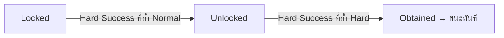

# clogged — Core Mechanics

**Version:** 2.0 (Unity V2) | **Last Updated:** 2026-10-14
> ตัวเลขทั้งหมดตรงกับค่าในโค้ด/Inspector ของ `Unity-Projects/Assets/V2/` ณ วันที่อัปเดต — ปรับได้ใน Inspector (ดู [§9](#9-tunable-values--ตัวเลขที่ปรับได้)) ถ้าเปลี่ยนค่าใน scene ให้อัปเดตเอกสารนี้ด้วย
> กลไกของ Web Prototype (mission chain, night defense, 30 วัน) ดูที่ [archive](../wiki/archive/gdd-v1-prototype/01-mechanics.md)

## 1. Core Loop

```
1. เริ่มวัน — ทุกคนที่ไม่ได้ Lost Signal ได้ AP เต็ม (3)
2. วางแผน — สลับทำได้อิสระจนกว่าจะพอใจ:
     • ส่ง 1–2 ยูนิตออกสำรวจถ้ำ (ยูนิตละ 1 ครั้ง/วัน) → ทอย D100 → รับผล
     • ให้ยูนิตทำงานในฐาน (ทำอาหาร / รักษา / ทำยา) — ไม่จำกัดครั้ง
3. End Day — ทุกคนในฐานกินอาหารคนละ 1 → ใครไม่ได้กิน Starvation +1
4. ตรวจ win/lose → ขึ้นวันใหม่
```

1 run = สูงสุด 7 วัน ไม่มีเวลาจริงจับ — ผู้เล่นคิดได้นานเท่าที่ต้องการ

---

## 2. Unit System

### 2.1 ยูนิตตั้งต้น

ทีมมี 4 คนคงที่ตลอด run (ไม่มีการจ้างเพิ่ม)

| ยูนิต | Aptitude (ถนัด) | Non-aptitude (ไม่ถนัด) | บทบาทที่เหมาะ |
|---|---|---|---|
| **Ann** | Speed, **Easy** | **Hard** | หาวัตถุดิบอาหารที่ถ้ำ Easy |
| **Boon** | Endurance, **Hard** | Cooking | ลุยถ้ำ Hard |
| **Cia** | Gathering, **Normal**, **Cooking** | Combat | ถ้ำ Normal + คนครัว (อาหาร ×2) |
| **Dan** | Combat, **Hard** | Cooking | ลุยถ้ำ Hard |

> Tag ที่มีผลในเกมตอนนี้: **Easy / Normal / Hard** (โอกาสสำเร็จของถ้ำระดับนั้น) และ **Cooking** (ผลผลิตทำอาหาร) — `Speed`, `Endurance`, `Gathering`, `Combat` ยังไม่มีผล (open question)

### 2.2 Action Point (AP)

- ทุกคนมี **AP สูงสุด 3** ได้คืนเต็มตอนเริ่มวันใหม่ (ไม่สะสมข้ามวัน)
- **ค่า AP จริง = ค่าพื้นฐาน + จำนวน Starvation stack** ของยูนิตนั้น
- AP เหลือ 0 → สถานะเป็น **Resting** ทำอะไรไม่ได้จนถึงวันถัดไป

### 2.3 สถานะยูนิต

| สถานะ | แสดงใน UI | ส่งสำรวจ | งานในฐาน | กินอาหารตอน End Day | ออกจากสถานะนี้โดย |
|---|---|---|---|---|---|
| **Idle** | Ready | ✅ (ถ้ายังไม่ได้ไปวันนี้) | ✅ | ✅ | — |
| **Resting** | Resting | ❌ | ❌ | ✅ | วันใหม่ |
| **Hurt** | Hurt (สีแดง) | ❌ | ❌ | ✅ | ยูนิตอื่น **รักษา** (ไม่หายเองข้ามวัน) |
| **Away** | Away | ❌ | ❌ | ❌ | กลับจากทริป |
| **Missing** | Missing (จางมาก) | ❌ | ❌ | ❌ | **ถาวร** — Lost Signal |

> ยูนิตที่ Hurt ยังได้ AP คืนทุกวัน แต่ใช้ไม่ได้จนกว่าจะถูกรักษา — และยังต้องกินอาหาร

### 2.4 Trait

ได้จากผลการสำรวจ (ดู §4.4) ติดตัวถาวรตลอด run

| Polarity | ผล | ชื่อในคลัง (flavor เท่านั้น) |
|---|---|---|
| ดี (Positive) | +10 โอกาสสำเร็จ | Sharp-eyed, Steady Hands, Quick Feet, Thick-skinned, Lucky Streak |
| เสีย (Negative) | −10 โอกาสสำเร็จ | Clumsy, Jumpy, Shaky Nerves, Sluggish, Unlucky |

- สุ่มชื่อที่ยูนิตยังไม่มีก่อน ถ้ามีครบแล้วจะได้ชื่อซ้ำ
- ใน 1 ทริป trait ดีนับ **+10 ครั้งเดียว** และ trait เสียนับ **−10 ครั้งเดียว** ไม่ว่าทีมจะมีกี่ตัว

---

## 3. Day System

### 3.1 End Day (ปุ่ม End Day)

ลำดับที่เกิดขึ้นเมื่อกด:

1. **ถ้ามี Core Item อยู่แล้ว → ชนะ** (จบทันที)
2. **กินอาหาร** — ไล่ตามลำดับ roster (Ann → Boon → Cia → Dan) ข้ามคนที่ Away/Missing ทุกคนกิน 1 Food; ถ้าอาหารหมดกลางทาง คนที่เหลือได้ **Starvation +1**
3. วัน +1
4. **ทุกคน Missing → แพ้**
5. **วันเกิน 7 และยังไม่มี Core Item → แพ้ (หมดเวลา)**
6. **รีเฟรช** — ทุกคนที่ไม่ใช่ Away/Missing ได้ AP เต็ม, Resting → Idle, รีเซ็ตสิทธิ์ส่งสำรวจและสิทธิ์ให้อาหารรายวัน

> ลำดับ roster สำคัญ: ถ้าอาหารไม่พอ **Dan หิวก่อนเสมอ** แล้วตามด้วย Cia, Boon, Ann

### 3.2 เส้นตาย

- เริ่มวันที่ 1, `deadlineDay = 7` → เล่นได้ 7 วันเต็ม
- HUD แสดง `Day X / 7 (N days left)` และขึ้น **"last day!"** สีแดงในวันที่ 7

---

## 4. Send-to-Gather — การออกสำรวจ

### 4.1 ขั้นตอน

1. คลิก **ถ้ำ** บนแมป (6 จุด — Easy/Normal/Hard อย่างละ 2, สุ่มตำแหน่งรอบฐานทุก run, สีบอกระดับ)
2. ติ๊กเลือก **1–2 ยูนิต** ที่ Ready และยังไม่ได้ออกสำรวจวันนี้
3. กด **Dispatch** → ไอคอนเดินไปถ้ำ → ทอย → เดินกลับ → แสดงผล

กฎ:
- **ทุกคนที่ไปจ่าย AP เต็มจำนวน** ของถ้ำ (ไปคู่ไม่หารกัน)
- ยูนิตออกสำรวจได้ **1 ครั้ง/วัน** แม้จะกลับมาพร้อม AP เหลือ (AP ที่เหลือใช้ทำงานในฐานได้)
- ถ้ำ 2 จุดที่ระดับเดียวกันให้ผลเหมือนกันทุกประการ — ต่างกันแค่ตำแหน่งบนแมป

### 4.2 ระดับถ้ำ

| ระดับ | สีบนแมป | AP ต่อคน | โอกาสพื้นฐาน | ของหลัก | Bonus (Hard Success สุ่ม 1 อย่าง) |
|---|---|---|---|---|---|
| **Easy** | เขียว | 1 | 80 | Cooking Material ×2 | Cooking Material ×2 / Medicine ×1 |
| **Normal** | เหลือง | 2 | 55 | Medicine ×1 | Medicine ×1 / Cooking Material ×1 |
| **Hard** | แดง | 3 | 30 | Materials ×2 | Materials ×2 / Medicine ×1 |

> ถ้ำ Hard ใช้ 3 AP = AP ทั้งวันของยูนิตที่ไม่หิว — ยูนิตที่หิวแม้แต่ 1 stack ไป Hard ไม่ได้

### 4.3 Success Value (โอกาสสำเร็จ)

```
Success Value = โอกาสพื้นฐานของถ้ำ
              + 20  ถ้ามีคนในทีมถนัดระดับถ้ำนี้          (นับครั้งเดียว)
              − 15  ถ้ามีคนในทีมไม่ถนัดระดับถ้ำนี้        (นับครั้งเดียว)
              + 15  ถ้าไป 2 คน
              − 20  ถ้าไปถ้ำ Hard คนเดียว
              + 10  ถ้ามีคนในทีมมี trait ดี               (นับครั้งเดียว)
              − 10  ถ้ามีคนในทีมมี trait เสีย              (นับครั้งเดียว)
```

### 4.4 การทอย 1D100 (roll-under) และระดับผล

ทอยเลข 1–100 แล้วตรวจตามลำดับ:

| ระดับผล | เงื่อนไข | ของที่ได้ | ผลต่อยูนิต | Trait |
|---|---|---|---|---|
| **Fumble** | SV < 50: ทอย 96–100 · SV ≥ 50: ทอย 100 | ไม่ได้อะไร | **ถ้ำ Hard: สุ่ม 1 คนหายตัว (Missing)** · ถ้ำอื่น: ไม่มี | trait เสีย **100%** |
| **Hard Success** | ทอย ≤ ⌊SV ÷ 2⌋ | ของหลักเต็ม + bonus 1 อย่าง | — | trait ดี 50% |
| **Regular** | ทอย ≤ SV | ของหลักเต็ม | — | — |
| **Failure** | ทอย > SV | ของหลัก**ครึ่งเดียว** (ปัดลง) | **สุ่ม 1 คนบาดเจ็บ (Hurt)** | trait เสีย 50% |

- Trait ที่ได้จะสุ่มให้ **1 คน** ในทีม
- Failure ที่ถ้ำ Normal ได้ Medicine ⌊1 ÷ 2⌋ = **0** → ไม่ได้อะไรเลย
- Hard Success ที่ Normal / Hard ยังนับเป็นความคืบหน้า Core Item (§7)

### 4.5 ตารางโอกาสตัวอย่าง (ทีมยังไม่มี trait)

| สถานการณ์ | SV | Hard Success | Regular | Failure | Fumble |
|---|---|---|---|---|---|
| Easy คนเดียว | 80 | 40% | 40% | 19% | 1% |
| Easy — Ann คนเดียว (ถนัด) | 100 | 50% | 49% | 0% | 1% |
| Easy ไปคู่ | 95 | 47% | 48% | 4% | 1% |
| Normal คนเดียว | 55 | 27% | 28% | 44% | 1% |
| Normal — Cia คนเดียว (ถนัด) | 75 | 37% | 38% | 24% | 1% |
| Normal — Cia + อีก 1 คน | 90 | 45% | 45% | 9% | 1% |
| Hard คนเดียว (ไม่ถนัด) | 10 | 5% | 5% | 85% | 5% |
| Hard — Boon หรือ Dan คนเดียว | 30 | 15% | 15% | 65% | 5% |
| Hard ไปคู่ (ไม่มีใครถนัด) | 45 | 22% | 23% | 50% | 5% |
| Hard — Boon + Dan | 65 | 32% | 33% | 34% | 1% |
| Hard — Dan + Ann (ถนัด + ไม่ถนัด) | 50 | 25% | 25% | 49% | 1% |

> จุดตัดที่ SV = 50: ต่ำกว่านี้ Fumble กระโดดจาก 1% เป็น 5% — สำคัญมากที่ถ้ำ Hard เพราะ Fumble = เสียยูนิตถาวร

---

## 5. Base Work — งานในฐาน

- ทำได้ **ไม่จำกัดครั้ง** ต่อวัน ทั้งก่อนและหลังออกสำรวจ ตราบที่ยูนิต Ready และมี AP
- ขั้นตอนใน panel: เลือกงาน → เลือกผู้ทำ (คนที่ Ready ขึ้นก่อน คนที่ไม่ว่างเป็นสีเทา) → เลือกจำนวนรอบ หรือผู้ป่วย → ดู preview ต้นทุน/ผลได้ → **Confirm (ย้อนไม่ได้)**
- ล็อก Confirm ระหว่างที่ไอคอนสำรวจกำลังเดิน (กันไม่ให้ยูนิตที่กำลังจะถูกส่งไปทำงานในฐาน)

| งาน | ต้นทุนต่อรอบ | ผลต่อรอบ | หมายเหตุ |
|---|---|---|---|
| **Cook** ทำอาหาร | 1 AP + 1 Cooking Material | +1 Food (**+2** ถ้าถนัด Cooking) | เลือกหลายรอบได้; ในรายชื่อ คนถนัด = สีเขียว, ไม่ถนัด = สีแดง (ไม่ถนัดยังได้ +1 ปกติ) |
| **Heal** รักษา | 1 AP + 1 Medicine **หรือ** 2 AP ถ้าไม่มียา | ผู้ป่วย Hurt → Ready | ใช้ยาอัตโนมัติถ้ามีในคลัง; รักษาตัวเองไม่ได้ |
| **Craft** (Workshop) | 1 AP + 2 Materials | +1 Medicine | เลือกหลายรอบได้ |

> ทุกต้นทุน AP บวก Starvation stack ของผู้ทำด้วย (เช่น คนหิว 1 stack ทำอาหารรอบละ 2 AP)

---

## 6. Starvation — ความหิว

| กลไก | รายละเอียด |
|---|---|
| ได้ stack | ตอน End Day ถ้าอาหารหมดก่อนถึงคิวตัวเอง → +1 stack |
| ผล | ทุกการกระทำ (สำรวจ, ทำอาหาร, รักษา, Craft) แพงขึ้น **+1 AP ต่อ stack** |
| ครบ 3 stack | ยูนิต **Lost Signal (Missing)** ถาวร |
| ลด stack | ปุ่ม **ให้อาหาร**: 1 Food → −1 stack, 1 ครั้ง/คน/วัน ใช้ได้ทุกเวลาในวัน — *มีระบบแล้วแต่ยังไม่มีปุ่มใน UI* |
| แสดงผล | การ์ดยูนิตขึ้น `Hungry xN`; HUD แสดง `Food: X (need N tonight)` เป็นสีแดงเมื่อไม่พอ |

> Stack ไม่ลดเองเมื่อกลับมามีอาหาร — ต้องใช้ปุ่มให้อาหารเท่านั้น

---

## 7. Core Item — เงื่อนไขชนะ



| สถานะ | ข้อความบน HUD |
|---|---|
| Locked | `Core Item: Locked - go Mid first` |
| Unlocked | `Core Item: Unlocked - go Far` |
| Obtained | `Core Item: OBTAINED` |

- Hard Success ที่ Hard **ก่อน** ปลดล็อก → ได้แค่ของปกติ ไม่นับ
- ต้องได้ Hard Success **2 ครั้ง** (ที่ Normal 1 และ Hard 1) ภายใน 7 วัน

---

## 8. Resource & Economy

### 8.1 ทรัพยากร

| ทรัพยากร | เริ่มต้น | แหล่งที่มา | ใช้กับ |
|---|---|---|---|
| **Food** | 8 | Cook | End Day (1/คน), ปุ่มให้อาหาร |
| **Cooking Material** | 2 | ถ้ำ Easy, bonus Easy/Normal | Cook |
| **Medicine** | 1 | ถ้ำ Normal, Craft, bonus ทุกถ้ำ | Heal |
| **Materials** | 0 | ถ้ำ Hard, bonus Hard | Craft |

ทรัพยากรไม่เน่า ไม่มีเพดาน และไม่ติดลบ

### 8.2 สมดุลอาหาร (คำนวณจากค่าปัจจุบัน)

- ทีม 4 คนกิน **4 Food/คืน** → อาหารตั้งต้น 8 พอ **2 คืน** ถ้าไม่ทำอาหารเลย
- 1 ทริป Easy (1 AP) = Cooking Material 2 → ทำอาหารได้ 2 รอบ (2 AP) = **2 Food** หรือ **4 Food** ถ้า Cia ทำ
- ⇒ วงจร "Easy + Cook" ใช้ 3 AP (ทั้งวันของ 1 คน) ได้ 2–4 Food — เลี้ยงได้ 0.5–1 คน/วัน ผู้เล่นจึงต้องแบ่งทีมระหว่างหาอาหารกับลุยหา Core Item

---

## 9. Tunable Values — ตัวเลขที่ปรับได้

ปรับใน Inspector ของ GameObject ใต้ `GameSystem` ใน `Core.unity` (ดู [Scene Hierarchy](../software/06-unity-core-scene-hierarchy.md#31-gamesystem--logic-layer))

| ค่า | ค่าปัจจุบัน | อยู่ที่ |
|---|---|---|
| วันเส้นตาย | 7 | `DayManager.deadlineDay` |
| ทรัพยากรเริ่มต้น | Food 8, CM 2, Medicine 1, Materials 0 | `RunResources` |
| ต้นทุน/ผลของงานในฐาน | ตาม §5 | `BaseWorkController` |
| ต้นทุนให้อาหาร | 1 Food | `StarvationController.foodCostPerFeed` |
| จำนวนถ้ำต่อระดับ | 2 | `GatherMapController.nodesPerDifficulty` |
| config ถ้ำ (AP, โอกาส, loot) | ตาม §4.2 | `GatherZoneDatabase.zones` (ว่าง = ใช้ค่า default ในโค้ด) |
| roster / AP สูงสุด / aptitude | ตาม §2.1 | `UnitManager.units` (ว่าง = ใช้ค่า default ในโค้ด) |
| ค่าโบนัสในสูตร SV (+20/−15/+15/−20/±10), ช่วง Fumble, โอกาสได้ trait, starvation สูงสุด 3 | ตาม §4 / §6 | **hard-coded** ใน `GatherResolver`, `GatherDispatchController`, `UnitCharacter` |

---

## 10. ส่วนที่ยังต้องตัดสินใจ / ยังไม่ทำ

- **หน้าจอจบเกม** — ระบบรู้ผล Win/Lose แล้วแต่ยังไม่แสดงให้ผู้เล่นเห็น
- **ปุ่มให้อาหาร** — ระบบพร้อม รอ UI
- **Aptitude ที่ยังไม่มีผล** (Speed, Endurance, Gathering, Combat)
- **Trait เฉพาะตัว** — ตอนนี้ทุก trait = ±10 เท่ากัน
- **Fumble ที่ Easy/Normal** ไม่ได้ของและไม่เจ็บ — เบากว่า Failure ในแง่บาดเจ็บ (ได้แค่ trait เสีย) ควรทบทวนว่าตั้งใจหรือไม่
- **ทริปข้ามวัน** — สถานะ Away มีในระบบแล้ว แต่ปัจจุบันทุกทริปจบในวันเดียว
- **Animation ทอยเต๋า** (`DiceRollView`) — ตอนนี้ผลแสดงเป็นข้อความ

## Related Documents
- [Game Concept](00-concept.md)
- [Unity V2 System Design](../software/04-unity-system-design.md)
