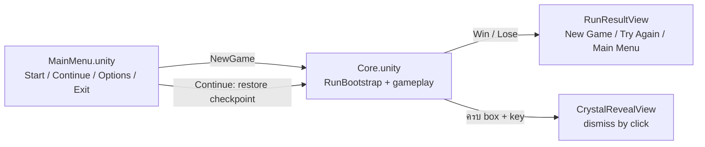
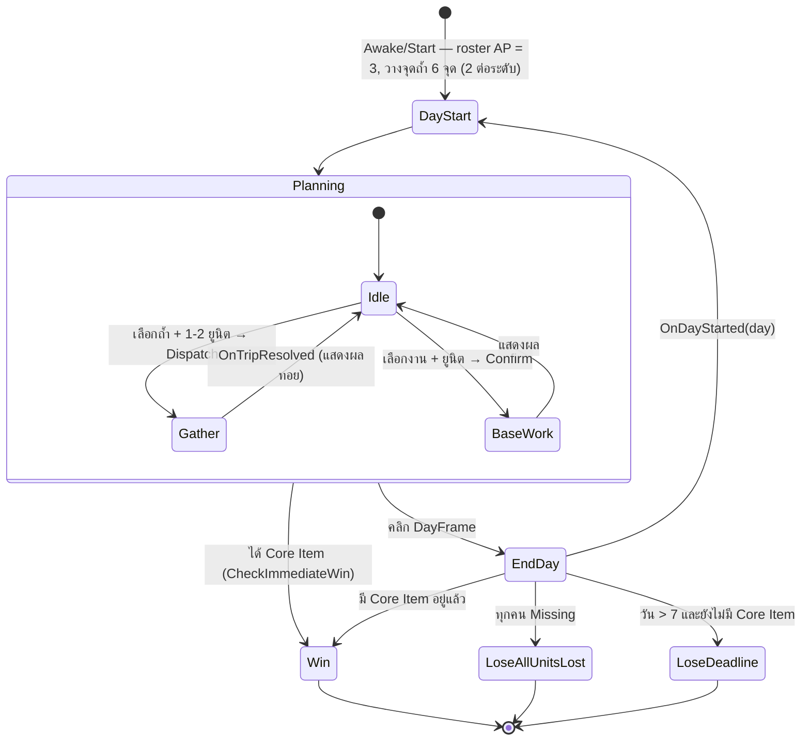
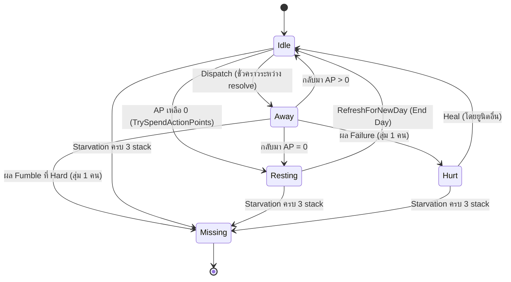
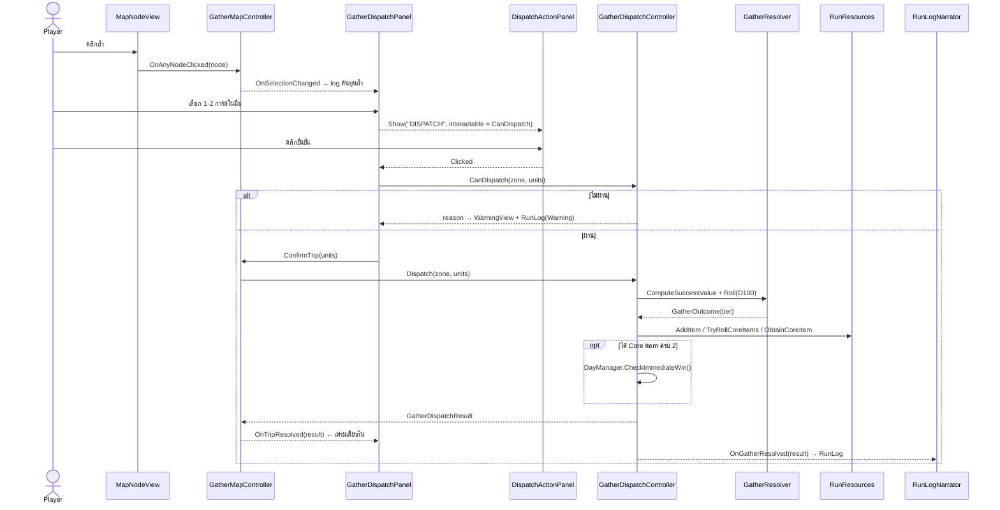
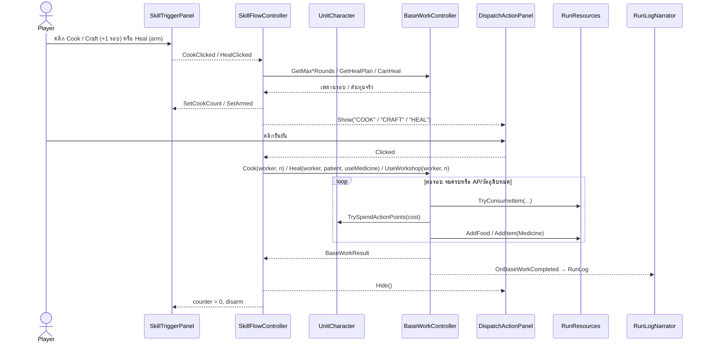
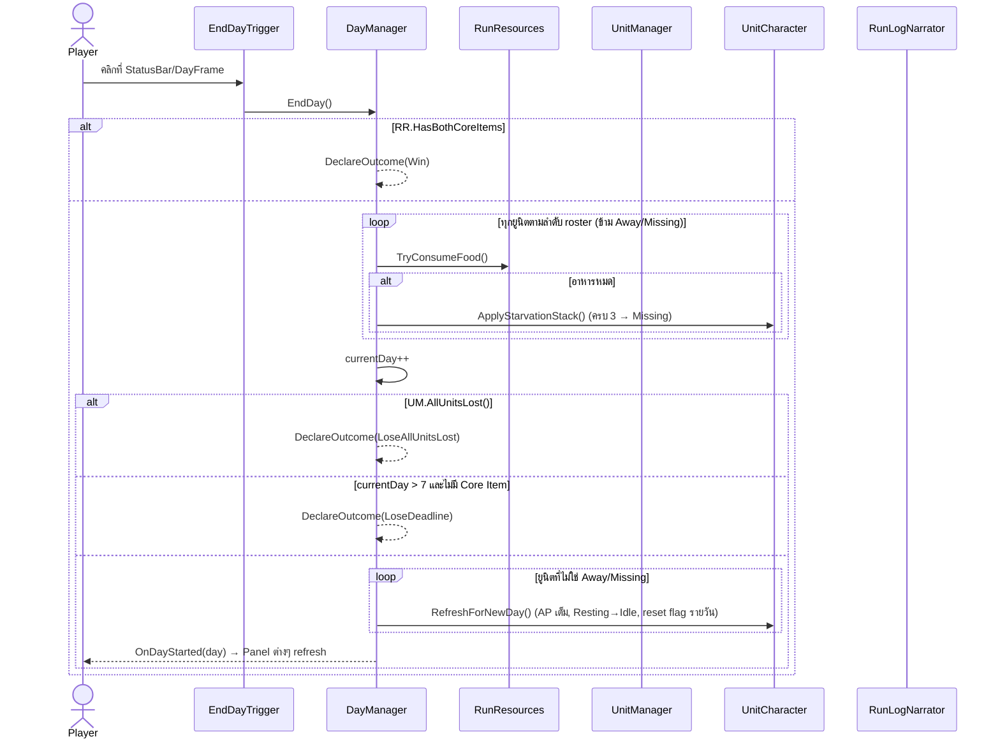

# clogged (Unity V2) — System Design

**Version:** 3.1 | **Last Updated:** 2026-10-29
> สร้างจากการอ่านโค้ดจริงใน `Unity-Projects/Assets/V2/` (scene `V2/Scenes/Core.unity`) — เป็น **ระบบหลักปัจจุบัน** ของเกมใน Unity
> เอกสาร [01](01-system-design.md) / [02](02-class-diagram.md) / [03](03-class-design.md) อธิบาย Web Prototype (Phaser) ซึ่งเป็นระยะที่ 1 — เก็บไว้เป็นข้อมูลอ้างอิง

## 0. สรุปเกม V2 ในหนึ่งย่อหน้า

ผู้เล่นมี **ยูนิตคงที่ 4 ตัว** (Ann, Boon, Cia, Dan) และต้องหา **Core Item** ให้ได้ภายใน **7 วัน** ในแต่ละวัน ยูนิตใช้ **AP (3/วัน)** ไปทำ 2 อย่าง: **ส่งออกสำรวจ (Send-to-Gather)** ไปยังถ้ำบนแมป (Easy/Normal/Hard) ซึ่งตัดสินผลด้วย **ทอย D100 แบบ roll-under** หรือ **ทำงานในฐาน (Base Work)** — ทำอาหาร / รักษา / Workshop ทำยา เมื่อกด **End Day** ทุกคนที่อยู่ในฐานต้องกินอาหารคนละ 1 ใครไม่ได้กินจะสะสม **Starvation stack** (+1 AP cost ต่อ stack, ครบ 3 = หายตัว) Core Item มี 2 ชิ้น (A = ชิ้นใช้ escape, B = กุญแจ) ดรอป**อิสระจากกัน ไม่มีลำดับ** โดยทอยเฉพาะทริปที่ออกมาเป็น **Hard Success** ตาม `coreItemChancePercent` ของโซน (Easy 0% · Normal 5% · Hard 15%) — ได้ครบทั้ง 2 = ชนะทันที

## 1. Project Structure

```
Unity-Projects/Assets/V2/
├── Scenes/
│   ├── MainMenu.unity          ← Start / Continue / Options / Exit
│   └── Core.unity              ← gameplay run, HUD, result/reveal
├── Prefabs/
│   ├── Dungeon Prefab.prefab   ← MapNodeView (จุดถ้ำบนแมป)
│   ├── ScoutIcon.prefab        ← UnitIconView (ใช้เป็นการ์ดยูนิตในมือ; ไม่มี walker แล้ว)
│   └── UI/                     ← LogPanel, CharacterHandPanel, DispatchActionPanel, SkillTriggerPanel
│                                 (sprite ของ prefab ทั้งสองดึงจาก Assets/Day/Sprites/tilemap_packed*.png)
└── Scripts/
    ├── BaseWorkType.cs          (enum Cooking/Healing/Workshop)
    ├── BaseWorkResult.cs        (ผลของงานในฐาน 1 ครั้ง)
    ├── CoreItemKind.cs          (enum A/B — box/key)
    ├── DiceRollView.cs          (stub ว่าง — สำรองไว้ทำ animation ทอยเต๋า)
    ├── Entities/               ← ข้อมูลล้วน ไม่ใช่ MonoBehaviour
    │   ├── UnitCharacter.cs     (UnitState, AptitudeTag, UnitTrait, UnitCharacter)
    │   ├── GatherZoneData.cs    (GatherZone, LootAmount, GatherZoneConfig)
    │   └── MapNodeData.cs       (ตำแหน่ง + zone ของจุดบนแมป)
    ├── System/                 ← เก็บ state กลาง / คำนวณล้วน
    │   ├── UnitManager.cs       (roster 4 ตัว)
    │   ├── RunResources.cs      (อาหาร, inventory, Core Item A/B)
    │   ├── GatherZoneDatabase.cs(config ของ 3 zone + Core Item chance)
    │   ├── GatherResolver.cs    (static — สูตร success value + ทอย D100)
    │   ├── RunLog.cs            (static — buffer log 16 entry + event)
    │   ├── RunStats.cs          (สถิติ run และ snapshot)
    │   ├── SaveData.cs          (ข้อมูล serializable ของ save)
    │   ├── SaveSystem.cs        (อ่าน/เขียน checkpoint ของ run)
    │   ├── RunBootstrap.cs      (restore save หลัง scene ตื่น)
    │   ├── SceneFlow.cs         (New Game / Continue / menu / retry)
    │   └── TraitLibrary.cs      (static — สุ่มชื่อ trait)
    ├── Controllers/            ← กฎของเกม / การกระทำของผู้เล่น
    │   ├── DayManager.cs        (End Day, win/lose)
    │   ├── GatherDispatchController.cs (ส่งสำรวจ + ใช้ผลทอย + ทอย Core Item)
    │   ├── GatherMapController.cs      (วางจุดบนแมป + เลือกถ้ำ; ทริป resolve ทันที)
    │   ├── BaseWorkController.cs       (ทำอาหาร / รักษา / Workshop)
    │   └── StarvationController.cs     (กฎให้อาหารเพื่อลด stack; ยังไม่มี UI เรียกใช้)
    └── UI/                     ← อ่าน state มาแสดง + ส่ง input ไป Controller
        ├── MainMenuController.cs, RunResultView.cs, CrystalRevealView.cs
        ├── StatusBarView.cs, EndDayTrigger.cs, WarningView.cs
        ├── UnitRosterView.cs, UnitIconView.cs, CharacterHandPanel.cs
        ├── GatherDispatchPanel.cs, DispatchActionPanel.cs, MapNodeView.cs
        ├── SkillTriggerPanel.cs, SkillFlowController.cs, RightClickHandler.cs
        └── LogMessagePanel.cs, RunLogNarrator.cs
```

**หลักการแบ่งชั้น**

| ชั้น | หน้าที่ | ห้าม |
|---|---|---|
| `Entities/` | ข้อมูล + กฎเล็กๆ ของตัวเอง (เช่น `UnitCharacter.TrySpendActionPoints`) | อ้างถึง singleton อื่น |
| `System/` | ถือ state กลางของ run หรือเป็นฟังก์ชันคำนวณล้วน (`GatherResolver`) | ตัดสินผลเกม / แตะ UI |
| `Controllers/` | กฎของเกมทั้งหมด — ตรวจเงื่อนไข (`CanX`) แล้วทำ (`X`) คืนเป็น `*Result` | แตะ UI |
| `UI/` | แสดงผล, เก็บ input, เรียก Controller, แสดง `*Result` | ถือ business logic หรือตัวเลข balance |

**รูปแบบที่ใช้ทั้งโปรเจกต์**
- **Singleton** — ทุก MonoBehaviour ใน `System/` และ `Controllers/` มี `public static X Instance` ตั้งใน `Awake()` (ตัวซ้ำถูก `Destroy`)
- **`CanX()` + `X()` → `XResult`** — Controller มีเมธอดตรวจก่อน (ให้ UI ใช้แสดงเหตุผล/ปิดปุ่ม) และเมธอดทำจริงที่คืน result object ให้ UI แสดง
- **ตัวเลข balance อยู่ใน Inspector** (`[SerializeField]`) ถ้า list ใน scene ว่าง (`units: []`, `zones: []`) จะใช้ค่า default ในโค้ด (`SetupDefaultRoster`, `SetupDefaults`) — ปัจจุบัน `Core.unity` ใช้ค่า default ทั้งหมด

## 2. Scene Flow

### 2.1 Scene ของ V2

V2 ใช้ 2 scenes: `MainMenu.unity` และ `Core.unity`. `SceneFlow` เป็นเจ้าของการเปลี่ยน scene; gameplay ภายใน Core ใช้ state และ overlays แทนการเปลี่ยน scene ทุกวัน



**Hierarchy ของ `Core.unity`** (GameObject → component)

| GameObject | Component (V2) | บทบาท |
|---|---|---|
| `UnitManager` | `UnitManager` | roster |
| `RunResources` | `RunResources` | ทรัพยากร |
| `GatherZoneDatabase` | `GatherZoneDatabase` | config zone |
| `DayManager` | `DayManager` | วัน + win/lose |
| `GatherDispatchController` | `GatherDispatchController` | ตรรกะส่งสำรวจ |
| `GatherMapController` | `GatherMapController` | แมป + เลือกถ้ำ (ใช้ `MapPanel`, `Dungeon Prefab`) — ไม่มี walker/เวลาเดินทางแล้ว |
| `BaseworkController` | `BaseWorkController` | ตรรกะงานในฐาน |
| `StavingController` | `StarvationController` | ลด Starvation ด้วย Food (controller มี แต่ยังไม่พบ UI ที่เรียกใช้) |
| `RunBootstrap` | `RunBootstrap` | restore pending save หลัง singleton ตื่น |
| `— (static)` | `RunStats` / `SaveSystem` / `SceneFlow` | สถิติ run, checkpoint, scene navigation; เป็น static classes ไม่ได้ติดอยู่บน GameObject |
| `GameSystem` | `RunLogNarrator`, `SkillFlowController` | แปลง event เป็น log / เจ้าของ flow สกิล |
| `Canvas/RunResult` | `RunResultView` | ผลจบ run, สรุปสถิติ, New Game/Try Again/Main Menu |
| `Canvas/CrystalReveal` | `CrystalRevealView` | reveal crystal เมื่อถือ box/key ครบ |
| `StatusBar` | `StatusBarView` | HUD 3 กลุ่ม: `DayFrame` (ขวา, คลิก = จบวัน ผ่าน `EndDayTrigger`), `CoreItemGroup` 2 ช่อง A/B (ซ้าย), `TopBar` (กลาง) |
| `CharacterHandPanel` | `CharacterHandPanel` + `UnitRosterView` | มือไพ่ล่างกลาง (`UnitIconView` 195×265) — dispatch เลือกได้ 2, สกิล 1, heal target เฉพาะคน Hurt |
| `GatherUI` | `GatherDispatchPanel` | ประสานการส่งสำรวจ: เลือกถ้ำ + การ์ด → ปุ่มยืนยัน |
| `DispatchActionPanel` | `DispatchActionPanel` | ปุ่มยืนยันตัวเดียว (ซ่อนเมื่อว่าง, label ตามบริบท) ใช้ร่วมกันทั้ง gather และ skill |
| `SkillTriggerPanel` | `SkillTriggerPanel` | ปุ่ม Cook / Heal (+toggle MED/AP) / Craft แทน `BaseWorkPanel` เดิม |
| `LogPanel` | `LogMessagePanel` | ประวัติการกระทำ 16 entry, ย่อ/กางได้ |
| `Warning` | `WarningView` | แบนเนอร์เตือนในเกม: สีข้อความมาจาก `UiPalette` (ตัวเดียวกับที่ log ใช้) + แผงหลังดำ |

### 2.2 Game Flow ภายใน `Core.unity`



- ใน 1 วัน ผู้เล่นสลับทำ Gather / Base Work ได้ไม่จำกัดลำดับ ตราบที่ยูนิตมี AP
- ยูนิตหนึ่ง **ส่งสำรวจได้ 1 ครั้งต่อวัน** (`HasGatheredToday`) แต่ **งานในฐานทำซ้ำได้ไม่จำกัด** ทั้งก่อนและหลังออกสำรวจ
- `deadlineDay = 7` → ผู้เล่นมี 7 วันเต็ม; กด End Day ในวันที่ 7 แล้ววันจะกลายเป็น 8 → แพ้ถ้ายังไม่มี Core Item
- เมื่อยังเล่นต่อได้หลัง rollover ระบบเขียน checkpoint; Continue โหลดวัน/ทรัพยากร/ยูนิต/สถิติและคู่สี Core Item กลับมา

### 2.3 Legacy (นอก V2)

โฟลเดอร์ `Assets/Day/` และ `Assets/Night/` เป็นระบบ Unity รุ่นก่อน (ส.ค. 2026): `ShipDay.unity` ↔ `Night.unity` สลับกันด้วย `GameManager.GoToNight()` / `GoToShip()` และฉากป้องกันฐานกลางคืน (`NightGameManager`, `WaveManager`, `Turret`) **V2 ไม่ได้ใช้โค้ดเหล่านี้** — ไม่มีระบบกลางคืนใน V2

`ProjectSettings/EditorBuildSettings.asset` มี `V2/Scenes/MainMenu.unity` และ `V2/Scenes/Core.unity` อยู่ก่อน scenes legacy (`ShipDay`, `Night`, `NPCtest`); scene legacy ไม่ใช่ส่วนหนึ่งของ flow V2

## 3. Subsystem Breakdown

### UnitManager — roster
ถือ `List<UnitCharacter>` 4 ตัว (เรียงตามลำดับ roster ซึ่ง UI ใช้ index ตรงกัน) ตั้ง `currentActionPoints = maxActionPoints` ตอน `Awake` มี `AliveCount()` และ `AllUnitsLost()` (เงื่อนไขแพ้)

| ยูนิต | Aptitude (+20) | Non-aptitude (−15) |
|---|---|---|
| Ann | Speed, Easy | Hard |
| Boon | Endurance, Hard | Cooking |
| Cia | Gathering, Normal, Cooking | Combat |
| Dan | Combat, Hard | Cooking |

> มีผลจริงในโค้ดเฉพาะ tag `Easy/Normal/Hard` (สูตรทอย) และ `Cooking` (ผลผลิตทำอาหาร) — `Speed/Endurance/Gathering/Combat` ยังเป็นแค่ป้าย

### UnitCharacter — สถานะยูนิต (entity)



- `CanBeDispatched` = `Idle` (ใช้กับงานในฐาน), `CanBeSentGathering` = `Idle && !HasGatheredToday`
- **ค่า AP จริง** = `baseCost + starvationStacks` (`GetActualApCost`) — หิว 2 stack แล้วไป Hard (3 AP) ต้องใช้ 5 AP ซึ่งเกิน max 3 → ทำไม่ได้
- `Hurt` ไม่หายเองข้ามวัน ต้องมีคนรักษา; `Missing` ถาวร

### RunResources — ทรัพยากรของ run

| ทรัพยากร | เริ่มต้น | ได้จาก | ใช้กับ |
|---|---|---|---|
| Food | 8 | Cooking | End Day (คนละ 1), ปุ่มให้อาหาร |
| Cooking Material | 2 | Easy, bonus | Cooking (1/รอบ) |
| Medicine | 1 | Normal, Workshop, bonus | Healing (ถ้ามี) |
| Materials | 0 | Hard, bonus | Workshop (2/รอบ) |
| Core Item A (กล่อง) / B (กุญแจ) | false / false | Hard Success: roll แยกต่อชิ้นที่ยังไม่มี ตาม `coreItemChancePercent` ของโซน | ได้ครบแล้วชนะ; ไม่บังคับลำดับ |
| CoreItemVariant | Orange / Yellow | สุ่มครั้งเดียวเมื่อเริ่ม run; save คงคู่สีเดิม | เลือก sprite กล่อง/กุญแจ/crystal ให้เข้าคู่ |

ทุกค่า clamp ไม่ให้ติดลบ, `TryConsumeItem` ไม่หักถ้าไม่พอ

### GatherZoneDatabase + GatherResolver — ระบบทอย D100

| Zone (สีบนแมป) | AP ต่อคน | Base success | Main loot | Bonus pool (Hard Success สุ่ม 1) |
|---|---|---|---|---|
| Easy (เขียว) | 1 | 80 | Cooking Material ×2 | Cooking Material ×2 / Medicine ×1 |
| Normal (เหลือง) | 2 | 55 | Medicine ×1 | Medicine ×1 / Cooking Material ×1 |
| Hard (แดง) | 3 | 30 | Materials ×2 | Materials ×2 / Medicine ×1 |

**Success value** (`GatherResolver.ComputeSuccessValue`) = base
`+20` ถ้ามีคนใดมี aptitude ตรง zone · `−15` ถ้ามีคนใดมี non-aptitude ตรง zone · `+15` ถ้าไป 2 คน · `−20` ถ้าไป Hard คนเดียว · `+10` ถ้ามีใครมี trait ดี · `−10` ถ้ามีใครมี trait เสีย (แต่ละข้อนับครั้งเดียวต่อทริป)

**ทอย 1D100** (`GatherResolver.Roll`) — ตรวจ Fumble ก่อน:

| Tier | เงื่อนไข | ผล (`GatherDispatchController.ApplyOutcome`) |
|---|---|---|
| Fumble | SV < 50: ทอย 96–100 · SV ≥ 50: ทอย 100 | ไม่ได้ของ; ถ้า Hard → สุ่ม 1 คน **Missing**; trait เสีย 100% |
| Hard Success | ทอย ≤ ⌊SV/2⌋ | main loot เต็ม + bonus 1 อย่าง; trait ดี 50%; ความคืบหน้า Core Item |
| Regular | ทอย ≤ SV | main loot เต็ม |
| Failure | ทอย > SV | main loot ครึ่ง (ปัดลง — Normal ได้ 0); สุ่ม 1 คน **Hurt**; trait เสีย 50% |

`TraitLibrary.CreateRandom` เลือกชื่อ trait ที่ยูนิตยังไม่มีก่อน ชื่อเป็น flavor ล้วน ผลจริงคือ ±10 ตาม polarity

### GatherDispatchController — ส่งสำรวจ
`CanDispatch(zone, units, out reason)` ตรวจ 1–2 คน, `CanBeSentGathering`, AP พอ → `Dispatch()` หัก AP **เต็มจำนวนต่อคน** (ไปคู่ไม่หาร), mark `HasGatheredToday`, ตั้ง `Away` → ทอย → ใช้ผล → คนที่ยัง `Away` กลับเป็น `Idle`/`Resting` → ยิง `OnGatherResolved` และคืน `GatherDispatchResult`

### GatherMapController — แมปและการเลือกถ้ำ
ชั้นภาพที่ครอบ `GatherDispatchController` ไว้: สร้าง `MapNodeData` 2 จุดต่อระดับ (รวม 6) วางแบบ best-candidate sampling รอบฐานที่กลาง `MapPanel` (เว้นขอบ margin L150/R360/T150/B420 + รัศมีฐาน 180 เพื่อไม่ให้ถ้ำไปอยู่ใต้ panel) เลือกจุดผ่าน static event `MapNodeView.OnAnyNodeClicked` — **คลิกซ้ำที่ถ้ำเดิมเพื่อยกเลิกการเลือกได้** (เหมือน toggle) และยิง `OnSelectionChanged` ทุกครั้งที่เปลี่ยน จากนั้น `ConfirmTrip()` เรียก `Dispatch()` แล้วยิง `OnTripResolved` **ในเฟรมเดียวกัน** — ไม่มีการเดินทาง ไม่มี `TripInProgress`

### BaseWorkController — งานในฐาน (ไม่จำกัดครั้งต่อวัน)

| งาน | ต้นทุนต่อรอบ | ผลต่อรอบ | หมายเหตุ |
|---|---|---|---|
| Cooking | 1 AP + 1 Cooking Material | +1 Food (+2 ถ้ามี aptitude Cooking) | เลือกจำนวนรอบได้, หยุดเองเมื่อ AP/วัตถุดิบหมด |
| Healing | ผู้เล่นเลือก 1 AP + 1 Medicine หรือ 2 AP โดยไม่ใช้ยา | ผู้ป่วย `Hurt → Idle` | รักษาตัวเองไม่ได้ |
| Workshop | 1 AP + 2 Materials | +1 Medicine | เลือกจำนวนรอบได้ |

มี helper (`GetMaxCookRounds`, `GetHealPlan`, `GetMaxWorkshopRounds`, …) ให้ UI ใช้แสดง preview โดยไม่ต้องรู้ตัวเลขเอง

### DayManager — End Day และ win/lose
ดู sequence ใน §4.3 ยิง `OnDayStarted(day)` เมื่อขึ้นวันใหม่ และ `OnRunEnded(RunOutcome)` เมื่อจบ run (`Win`, `LoseDeadline`, `LoseAllUnitsLost`)

### StarvationController — กฎให้อาหารลด stack
ระบบ controller รองรับ 1 Food → −1 starvation stack, ใช้ได้ 1 ครั้ง/ยูนิต/วัน (`HasBeenFedManuallyToday`) แยกจากการกินอัตโนมัติตอน End Day — ยังไม่พบ UI script ที่เรียก `FeedUnit()` จึงยังไม่มีทางให้ผู้เล่นใช้ความสามารถนี้จาก UI

### Save / Continue

`DayManager` เขียน checkpoint หลัง rollover เมื่อ run ยังดำเนินต่อ; `SaveSystem` เก็บ day, deadline, resources, Core Item flags/variant, unit state/AP/starvation และ `RunStats` ลง `Application.persistentDataPath/clogged-run.json`. `MainMenuController` เปิดใช้ Continue เมื่อมี save; `RunBootstrap` restore หลัง singleton ตื่นแล้ว. เริ่ม run ใหม่และจบ run จะลบ save.

### UI Layer

| Class | อัปเดตแบบ | หน้าที่ |
|---|---|---|
| `StatusBarView` | poll ทุกเฟรม | `DayFrame` (วัน/เส้นตาย), `TopBar` (Food/Medicine/CookingMaterial/Materials), `CoreItemGroup` (BOX/KEY และภาพตามคู่สี/สถานะ); เตือนเมื่อ Food < จำนวนคนที่ต้องกินคืนนี้ |
| `UnitRosterView` + `UnitIconView` | poll ทุกเฟรม | การ์ดยูนิตแบบการ์ด (กรอบสีประจำตัว: แดง/เหลือง/เขียว/น้ำเงิน): ชื่อ, AP, สถานะ, Hungry ×n, จางเมื่อใช้งานไม่ได้ — **การ์ดเป็นตัวเลือกยูนิตด้วยการคลิก** (สูงสุด 2 ใบ, การ์ดที่เลือกได้กรอบหนาขึ้น + ขยายเล็กน้อย) |
| `GatherDispatchPanel` | event `OnTripResolved`, `OnDayStarted`, `UnitRosterView.OnSelectionChanged`, `GatherMapController.OnSelectionChanged`, `SkillFlowController.StateChanged` | อ่านยูนิตที่เลือกจาก `UnitRosterView`; แสดง/ซ่อน `DispatchActionPanel` ตามการเลือก; ข้อมูลถ้ำที่เลือก + คำเตือน ไปที่ `RunLog`/`WarningView` (ไม่มี `MessageUi` แล้ว); trait ที่ได้จากทริปถูก log เพิ่มเอง |
| `SkillTriggerPanel` | event จากปุ่ม (คลิกซ้าย/ขวา) | view อย่างเดียว: `SetCookCount` / `SetCraftCount` / `SetArmed` / `SetHealAvailable` / `SetHealMode` — ไม่มี state |
| `SkillFlowController` | event + `Update` (ตรวจ selection/resource) | เจ้าของ flow สกิล: counter ของ Cook/Craft (เพดานจาก `GetMaxCookRounds` / `GetMaxWorkshopRounds`), โหมด Heal (`MED`/`AP`), การเลือกผู้ป่วย, ยิง `StateChanged` ให้ gather flow รู้ว่าใครถือปุ่ม |
| `CharacterHandPanel` | `OnModeChanged` | นิยามโหมด (`Dispatch` / `Skill` / `HealTarget`), จำนวนที่เลือกได้, ขนาด/ระยะการ์ด, กติกาว่าใครกดได้ |
| `DispatchActionPanel` | — | ปุ่มยืนยันตัวเดียว: `Show(label)` / `ShowDispatch()` / `Hide()` / `Clicked` — ซ่อนตัวเองใน `Awake` |
| `LogMessagePanel` | `RunLog.OnEntryAdded` / `OnCleared` | render จาก `RunLog` ด้วย row pool (≤ 16), ใหม่สุดล่าง, auto-scroll, ย่อ/กางพร้อมเปลี่ยนความสูง panel (300 → 64) |
| `RunLogNarrator` | event ของ `BaseWorkController` / `DayManager` / `GatherDispatchController` | ที่เดียวที่แปลง event เป็นข้อความ log (เลือก `LogKind`) |
| `EndDayTrigger` | `IPointerClickHandler` | คลิกที่ `DayFrame` = `DayManager.EndDay()` (ไม่มี confirm, ไม่ทำงานซ้ำถ้า run จบ) |
| `WarningView` | event (เรียกจาก `GatherDispatchPanel` / `SkillFlowController`) | แบนเนอร์เตือนในเกม: คิวข้อความ, สีตัวอักษรจาก `UiPalette.For(LogKind)` ตารางเดียวกับ log (outline ไม่มีแล้ว), fade in → hold 2.5s → fade out + แผงหลังดำ (`WarningBackdrop`) |
| `ButtonVisual` | — | เตรียมปุ่มให้สลับระหว่างข้อความกับ sprite icon (`mode` = Label/Icon) |
| `MapNodeView` | — | วงกลมสีตาม zone + `ZoneLabel` (TMP, สร้างตอน runtime) แสดงชื่อโซน/AP กลางวง, ยิง `OnAnyNodeClicked` (คลิกซ้ำ = ยกเลิกการเลือก) |

## 4. Data Flow

### 4.1 ส่งสำรวจ (Send-to-Gather)



### 4.2 งานในฐาน (Base Work)



### 4.3 End Day



## 5. Event Map

| Event | ผู้ยิง | ผู้ฟังปัจจุบัน |
|---|---|---|
| `DayManager.OnDayStarted(int)` | `EndDay()` | `GatherDispatchPanel` |
| `DayManager.OnDayEnded(DayEndReport)` | `EndDay()` | `RunLogNarrator` |
| `DayManager.OnRunEnded(RunOutcome)` | `DeclareOutcome()` | `RunLogNarrator` |
| `GatherMapController.OnTripResolved(result)` | `ConfirmTrip()` (เฟรมเดียวกัน) | `GatherDispatchPanel` |
| `GatherDispatchController.OnGatherResolved(result)` | ท้าย `Dispatch()` | `RunLogNarrator` |
| `BaseWorkController.OnBaseWorkCompleted(result)` | ท้าย Cook/Heal/UseWorkshop (ทุก path) | `RunLogNarrator` |
| `SkillFlowController.StateChanged` | arm / confirm / cancel | `GatherDispatchPanel` |
| `RunLog.OnEntryAdded` / `OnCleared` | `RunLog.Add/Clear` | `LogMessagePanel` |
| `DayManager.OnRunEnded(RunOutcome)` | `DeclareOutcome()` | `RunLogNarrator`, `RunResultView` |
| `RunResources.HasBothCoreItems` transition | HUD state เปลี่ยน | `CrystalRevealView` |
| `MapNodeView.OnAnyNodeClicked(view)` (static) | คลิกจุดบนแมป | `GatherMapController` |
| `GatherMapController.OnSelectionChanged(node)` | เลือก/ยกเลิกถ้ำ (คลิกซ้ำ = ยกเลิก) | `GatherDispatchPanel` (log ต้นทุนถ้ำ) |
| `UnitRosterView.OnSelectionChanged()` | คลิกเลือก/ยกเลิกการ์ดยูนิต | `GatherDispatchPanel` |
| `UnitRosterView.OnSelectionRejected(reason)` | คลิกการ์ดที่เลือกไม่ได้ / เกิน 2 คน | `GatherDispatchPanel` (ส่งต่อให้ `WarningView`) |

## 6. Known Gaps / Technical Debt (อัปเดต 2026-10-29)

- **UI ให้อาหาร (`StarvationController`) ยังไม่มี control ที่เรียกใช้** — controller ลด stack ได้ แต่ยังไม่พบ UI invocation
- **ไม่มี `TripInProgress` / เวลาเดินทางแล้ว** — `ConfirmTrip` resolve ในเฟรมเดียว จึงไม่ต้องล็อก UI ระหว่างทริปอีก
- **สถานะ `Away` เป็นของยุคเก่า** — `Dispatch()` resolve ทันที ยูนิตไม่เคยค้างเป็น `Away` ข้ามเฟรม; เงื่อนไข "ข้าม Away" ใน `DayManager`/`StatusBarView` จึงยังไม่ทำงานจริง
- `GatherUI` (เดิมชื่อ `TestDispatch`) เป็นที่อยู่ของ `GatherDispatchPanel` — ชื่อ object ยังเป็น legacy footprint
- `DiceRollView` เป็น stub — ผลทอยแสดงเป็นข้อความใน log โดยไม่มี animation
- `SkillTriggerPanel` มี `Count` บนปุ่ม Heal ที่ไม่ถูกใช้ (โครงสร้างมาจาก prefab ร่วม) — ลบได้ถ้าต้องการ
- Aptitude `Speed/Endurance/Gathering/Combat` ยังไม่มีผลต่อกลไกใด
- save เป็น checkpoint หลัง End Day เท่านั้น; ไม่มี autosave ระหว่างกิจกรรมในวัน

## Related Documents
- [Unity V2 Class Diagram](05-unity-class-diagram.md)
- [Unity V2 Core Scene Hierarchy](06-unity-core-scene-hierarchy.md)
- [Core Mechanics](../gdd/01-mechanics.md)
- [Web Prototype System Design](01-system-design.md) (ระยะที่ 1)
