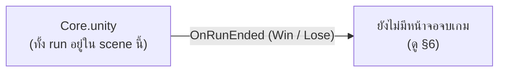
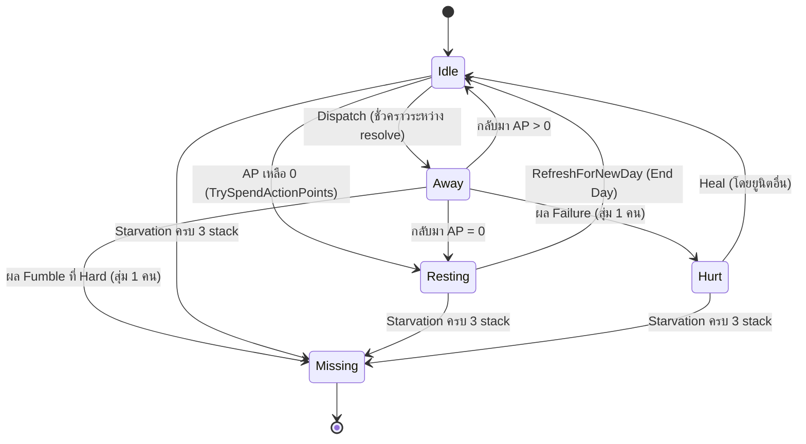
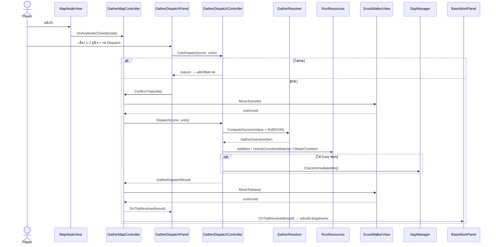
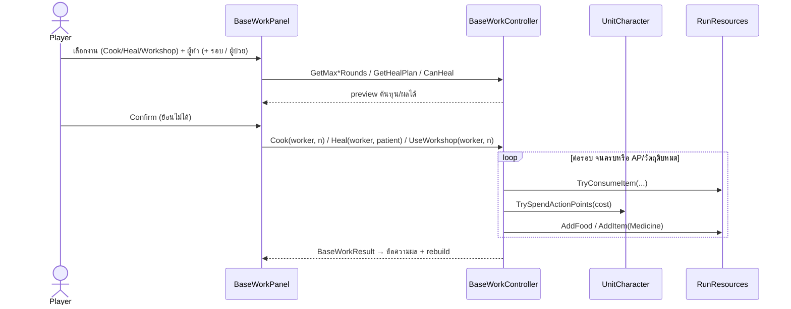
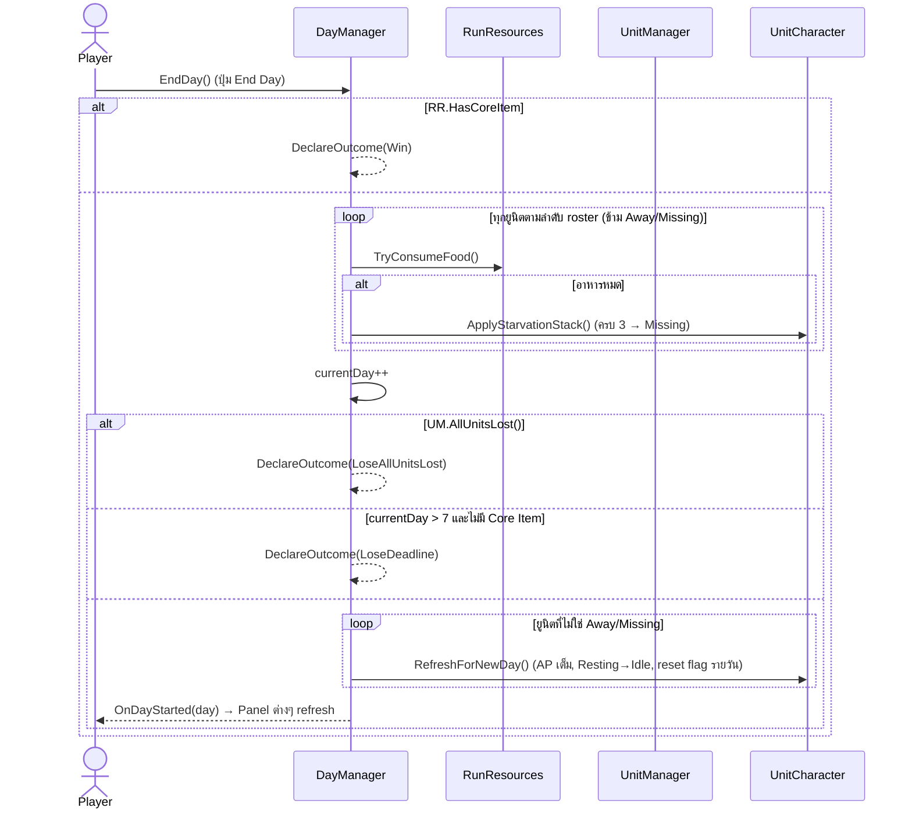

# clogged (Unity V2) — System Design

**Version:** 2.0 | **Last Updated:** 2026-10-14
> สร้างจากการอ่านโค้ดจริงใน `Unity-Projects/Assets/V2/` (scene `V2/Scenes/Core.unity`) — เป็น **ระบบหลักปัจจุบัน** ของเกมใน Unity
> เอกสาร [01](01-system-design.md) / [02](02-class-diagram.md) / [03](03-class-design.md) อธิบาย Web Prototype (Phaser) ซึ่งเป็นระยะที่ 1 — เก็บไว้เป็นข้อมูลอ้างอิง

## 0. สรุปเกม V2 ในหนึ่งย่อหน้า

ผู้เล่นมี **ยูนิตคงที่ 4 ตัว** (Ann, Boon, Cia, Dan) และต้องหา **Core Item** ให้ได้ภายใน **7 วัน** ในแต่ละวัน ยูนิตใช้ **AP (3/วัน)** ไปทำ 2 อย่าง: **ส่งออกสำรวจ (Send-to-Gather)** ไปยังถ้ำบนแมป (Easy/Normal/Hard) ซึ่งตัดสินผลด้วย **ทอย D100 แบบ roll-under** หรือ **ทำงานในฐาน (Base Work)** — ทำอาหาร / รักษา / Workshop ทำยา เมื่อกด **End Day** ทุกคนที่อยู่ในฐานต้องกินอาหารคนละ 1 ใครไม่ได้กินจะสะสม **Starvation stack** (+1 AP cost ต่อ stack, ครบ 3 = หายตัว) Core Item ได้จาก Hard Success ที่ Normal (ปลดล็อก) แล้วตามด้วย Hard Success ที่ Hard (ได้ไอเท็ม → ชนะทันที)

## 1. Project Structure

```
Unity-Projects/Assets/V2/
├── Scenes/
│   └── Core.unity              ← scene เดียวของ V2 — ทุกระบบอยู่ในนี้
├── Prefabs/
│   ├── Dungeon Prefab.prefab   ← MapNodeView (จุดถ้ำบนแมป)
│   └── ScoutIcon.prefab        ← ScoutWalkerView (ไอคอนเดินออก-กลับ)
├── Sprites/                    ← tilemap_packed*.png (ยังเป็น placeholder)
└── Scripts/
    ├── BaseWorkType.cs          (enum Cooking/Healing/Workshop)
    ├── BaseWorkResult.cs        (ผลของงานในฐาน 1 ครั้ง)
    ├── DiceRollView.cs          (stub ว่าง — สำรองไว้ทำ animation ทอยเต๋า)
    ├── Entities/               ← ข้อมูลล้วน ไม่ใช่ MonoBehaviour
    │   ├── UnitCharacter.cs     (UnitState, AptitudeTag, UnitTrait, UnitCharacter)
    │   ├── GatherZoneData.cs    (GatherZone, LootAmount, GatherZoneConfig)
    │   └── MapNodeData.cs       (ตำแหน่ง + zone ของจุดบนแมป)
    ├── System/                 ← เก็บ state กลาง / คำนวณล้วน
    │   ├── UnitManager.cs       (roster 4 ตัว)
    │   ├── RunResources.cs      (อาหาร, inventory, ความคืบหน้า Core Item)
    │   ├── GatherZoneDatabase.cs(config ของ 3 zone)
    │   ├── GatherResolver.cs    (static — สูตร success value + ทอย D100)
    │   └── TraitLibrary.cs      (static — สุ่มชื่อ trait)
    ├── Controllers/            ← กฎของเกม / การกระทำของผู้เล่น
    │   ├── DayManager.cs        (End Day, win/lose)
    │   ├── GatherDispatchController.cs (ส่งสำรวจ + ใช้ผลทอย)
    │   ├── GatherMapController.cs      (วางจุดบนแมป + animation เดินทาง)
    │   ├── BaseWorkController.cs       (ทำอาหาร / รักษา / Workshop)
    │   └── StarvationController.cs     (ปุ่มให้อาหารลด stack ด้วยมือ)
    └── UI/                     ← อ่าน state มาแสดง + ส่ง input ไป Controller
        ├── StatusBarView.cs, UnitRosterView.cs, UnitIconView.cs
        ├── GatherDispatchPanel.cs, MapNodeView.cs, ScoutWalkerView.cs
        └── BaseWorkPanel.cs
```

**หลักการแบ่งชั้น**

| ชั้น | หน้าที่ | ห้าม |
|---|---|---|
| `Entities/` | ข้อมูล + กฎเล็กๆ ของตัวเอง (เช่น `UnitCharacter.TrySpendActionPoints`) | อ้างถึง singleton อื่น |
| `System/` | ถือ state กลางของ run หรือเป็นฟังก์ชันคำนวณล้วน (`GatherResolver`) | ตัดสินผลเกม / แตะ UI |
| `Controllers/` | กฎของเกมทั้งหมด — ตรวจเงื่อนไข (`CanX`) แล้วทำ (`X`) คืนเป็น `*Result` | แตะ UI |
| `UI/` | แสดงผล, เก็บ input, เรียก Controller, แสดง `*Result` | ถือ business logic หรือตัวเลข balance |

**รูปแบบที่ใช้ทั้งโปรเจกต์**
- **Singleton** — ทุก MonoBehaviour ใน `System/` และ `Controllers/` มี `public static X Instance` ตั้งใน `Awake()` (ตัวซ้ำถูก `Destroy`)
- **`CanX()` + `X()` → `XResult`** — Controller มีเมธอดตรวจก่อน (ให้ UI ใช้แสดงเหตุผล/ปิดปุ่ม) และเมธอดทำจริงที่คืน result object ให้ UI แสดง
- **ตัวเลข balance อยู่ใน Inspector** (`[SerializeField]`) ถ้า list ใน scene ว่าง (`units: []`, `zones: []`) จะใช้ค่า default ในโค้ด (`SetupDefaultRoster`, `SetupDefaults`) — ปัจจุบัน `Core.unity` ใช้ค่า default ทั้งหมด

## 2. Scene Flow

### 2.1 Scene ของ V2

V2 มี **scene เดียว** คือ `Core.unity` ไม่มีการโหลด scene (`SceneManager`) ระหว่างเล่น — การเปลี่ยน "ช่วง" ของเกมเกิดขึ้นใน scene เดียวผ่านปุ่ม End Day และ panel ต่างๆ



**Hierarchy ของ `Core.unity`** (GameObject → component)

| GameObject | Component (V2) | บทบาท |
|---|---|---|
| `UnitManager` | `UnitManager` | roster |
| `RunResources` | `RunResources` | ทรัพยากร |
| `GatherZoneDatabase` | `GatherZoneDatabase` | config zone |
| `DayManager` | `DayManager` | วัน + win/lose |
| `GatherDispatchController` | `GatherDispatchController` | ตรรกะส่งสำรวจ |
| `GatherMapController` | `GatherMapController` | แมป + เดินทาง (ใช้ `MapPanel`, `Dungeon Prefab`, `ScoutIcon`) |
| `BaseworkController` | `BaseWorkController` | ตรรกะงานในฐาน |
| `StavingController` | `StarvationController` | ปุ่มให้อาหาร (ยังไม่มี UI ต่อ) |
| `StatusBar` | `StatusBarView` | HUD วัน + ทรัพยากร |
| `CharCard` | `UnitRosterView` | การ์ดยูนิต 4 ใบ (`UnitIconView`) |
| `TestDispatch` | `GatherDispatchPanel` | toggle ยูนิต + ปุ่ม Dispatch |
| `BaseWorkPanel` | `BaseWorkPanel` | panel งานในฐาน |
| `EndDay button` | (Button) | `onClick → DayManager.EndDay()` |

### 2.2 Game Flow ภายใน `Core.unity`


- ใน 1 วัน ผู้เล่นสลับทำ Gather / Base Work ได้ไม่จำกัดลำดับ ตราบที่ยูนิตมี AP
- ยูนิตหนึ่ง **ส่งสำรวจได้ 1 ครั้งต่อวัน** (`HasGatheredToday`) แต่ **งานในฐานทำซ้ำได้ไม่จำกัด** ทั้งก่อนและหลังออกสำรวจ
- `deadlineDay = 7` → ผู้เล่นมี 7 วันเต็ม; กด End Day ในวันที่ 7 แล้ววันจะกลายเป็น 8 → แพ้ถ้ายังไม่มี Core Item

### 2.3 Legacy (นอก V2)

โฟลเดอร์ `Assets/Day/` และ `Assets/Night/` เป็นระบบ Unity รุ่นก่อน (ส.ค. 2026): `ShipDay.unity` ↔ `Night.unity` สลับกันด้วย `GameManager.GoToNight()` / `GoToShip()` และฉากป้องกันฐานกลางคืน (`NightGameManager`, `WaveManager`, `Turret`) **V2 ไม่ได้ใช้โค้ดเหล่านี้** — ไม่มีระบบกลางคืนใน V2

> ⚠️ `ProjectSettings/EditorBuildSettings.asset` ยังชี้ไปที่ scene legacy (`Setup` — ไฟล์ไม่มีอยู่แล้ว, `ShipDay`, `Night`, `NPCtest`) และ **ไม่มี `V2/Scenes/Core.unity`** ต้องเพิ่มก่อน build

## 3. Subsystem Breakdown

### UnitManager — roster
ถือ `List<UnitCharacter>` 4 ตัว (เรียงตามลำดับ roster ซึ่ง UI ใช้ index ตรงกัน) ตั้ง `currentActionPoints = maxActionPoints` ตอน `Awake` มี `AliveCount()` และ `AllUnitsLost()` (เงื่อนไขแพ้)

| ยูนิต | Aptitude (+20) | Non-aptitude (−15) |
|---|---|---|
| Ann | Speed, Easy | Hard |
| Boon | Endurance, Hard | Cooking |
| Cia | Gathering, Normal, Cooking | Combat |
| Dan | Combat, Hard | Cooking |

> มีผลจริงในโค้ดเฉพาะ tag `Easy/Normal/Hard` (สูตรทอย) และ `Cooking` (ผลผลิตทำอาหาร) — `Speed/Endurance/Gathering/Combat` ยังเป็นแค่ป้าย

### UnitCharacter — สถานะยูนิต (entity)



- `CanBeDispatched` = `Idle` (ใช้กับงานในฐาน), `CanBeSentGathering` = `Idle && !HasGatheredToday`
- **ค่า AP จริง** = `baseCost + starvationStacks` (`GetActualApCost`) — หิว 2 stack แล้วไป Hard (3 AP) ต้องใช้ 5 AP ซึ่งเกิน max 3 → ทำไม่ได้
- `Hurt` ไม่หายเองข้ามวัน ต้องมีคนรักษา; `Missing` ถาวร

### RunResources — ทรัพยากรของ run

| ทรัพยากร | เริ่มต้น | ได้จาก | ใช้กับ |
|---|---|---|---|
| Food | 8 | Cooking | End Day (คนละ 1), ปุ่มให้อาหาร |
| Cooking Material | 2 | Easy, bonus | Cooking (1/รอบ) |
| Medicine | 1 | Normal, Workshop, bonus | Healing (ถ้ามี) |
| Materials | 0 | Hard, bonus | Workshop (2/รอบ) |
| Core Item Unlock / Core Item | false | Hard Success ที่ Normal / Hard | เงื่อนไขชนะ |

ทุกค่า clamp ไม่ให้ติดลบ, `TryConsumeItem` ไม่หักถ้าไม่พอ

### GatherZoneDatabase + GatherResolver — ระบบทอย D100

| Zone (สีบนแมป) | AP ต่อคน | Base success | Main loot | Bonus pool (Hard Success สุ่ม 1) |
|---|---|---|---|---|
| Easy (เขียว) | 1 | 80 | Cooking Material ×2 | Cooking Material ×2 / Medicine ×1 |
| Normal (เหลือง) | 2 | 55 | Medicine ×1 | Medicine ×1 / Cooking Material ×1 |
| Hard (แดง) | 3 | 30 | Materials ×2 | Materials ×2 / Medicine ×1 |

**Success value** (`GatherResolver.ComputeSuccessValue`) = base
`+20` ถ้ามีคนใดมี aptitude ตรง zone · `−15` ถ้ามีคนใดมี non-aptitude ตรง zone · `+15` ถ้าไป 2 คน · `−20` ถ้าไป Hard คนเดียว · `+10` ถ้ามีใครมี trait ดี · `−10` ถ้ามีใครมี trait เสีย (แต่ละข้อนับครั้งเดียวต่อทริป)

**ทอย 1D100** (`GatherResolver.Roll`) — ตรวจ Fumble ก่อน:

| Tier | เงื่อนไข | ผล (`GatherDispatchController.ApplyOutcome`) |
|---|---|---|
| Fumble | SV < 50: ทอย 96–100 · SV ≥ 50: ทอย 100 | ไม่ได้ของ; ถ้า Hard → สุ่ม 1 คน **Missing**; trait เสีย 100% |
| Hard Success | ทอย ≤ ⌊SV/2⌋ | main loot เต็ม + bonus 1 อย่าง; trait ดี 50%; ความคืบหน้า Core Item |
| Regular | ทอย ≤ SV | main loot เต็ม |
| Failure | ทอย > SV | main loot ครึ่ง (ปัดลง — Normal ได้ 0); สุ่ม 1 คน **Hurt**; trait เสีย 50% |

`TraitLibrary.CreateRandom` เลือกชื่อ trait ที่ยูนิตยังไม่มีก่อน ชื่อเป็น flavor ล้วน ผลจริงคือ ±10 ตาม polarity

### GatherDispatchController — ส่งสำรวจ
`CanDispatch(zone, units, out reason)` ตรวจ 1–2 คน, `CanBeSentGathering`, AP พอ → `Dispatch()` หัก AP **เต็มจำนวนต่อคน** (ไปคู่ไม่หาร), mark `HasGatheredToday`, ตั้ง `Away` → ทอย → ใช้ผล → คนที่ยัง `Away` กลับเป็น `Idle`/`Resting` → ยิง `OnGatherResolved` และคืน `GatherDispatchResult`

### GatherMapController — แมปและการเดินทาง
ชั้นภาพที่ครอบ `GatherDispatchController` ไว้: สร้าง `MapNodeData` 2 จุดต่อระดับ (รวม 6) วางแบบ best-candidate sampling รอบฐานที่กลาง `MapPanel` (เว้นขอบ + รัศมีฐาน 180) เลือกจุดผ่าน static event `MapNodeView.OnAnyNodeClicked` และ `ConfirmTrip()` ให้ `ScoutWalkerView` เดินไป (0.6 s) → `Dispatch()` ตอนถึง → เดินกลับ → `OnTripResolved` ระหว่างนั้น `TripInProgress = true`

### BaseWorkController — งานในฐาน (ไม่จำกัดครั้งต่อวัน)

| งาน | ต้นทุนต่อรอบ | ผลต่อรอบ | หมายเหตุ |
|---|---|---|---|
| Cooking | 1 AP + 1 Cooking Material | +1 Food (+2 ถ้ามี aptitude Cooking) | เลือกจำนวนรอบได้, หยุดเองเมื่อ AP/วัตถุดิบหมด |
| Healing | 1 AP + 1 Medicine **หรือ** 2 AP ถ้าไม่มียา | ผู้ป่วย `Hurt → Idle` | ใช้ยาอัตโนมัติถ้ามี, รักษาตัวเองไม่ได้ |
| Workshop | 1 AP + 2 Materials | +1 Medicine | เลือกจำนวนรอบได้ |

มี helper (`GetMaxCookRounds`, `GetHealPlan`, `GetMaxWorkshopRounds`, …) ให้ UI ใช้แสดง preview โดยไม่ต้องรู้ตัวเลขเอง

### DayManager — End Day และ win/lose
ดู sequence ใน §4.3 ยิง `OnDayStarted(day)` เมื่อขึ้นวันใหม่ และ `OnRunEnded(RunOutcome)` เมื่อจบ run (`Win`, `LoseDeadline`, `LoseAllUnitsLost`)

### StarvationController — ให้อาหารลด stack
ปุ่มที่ใช้ได้ตลอดวัน: 1 Food → −1 starvation stack, ใช้ได้ 1 ครั้ง/ยูนิต/วัน (`HasBeenFedManuallyToday`) แยกจากการกินอัตโนมัติตอน End Day — **อยู่ใน scene แล้วแต่ยังไม่มี UI เรียกใช้**

### UI Layer

| Class | อัปเดตแบบ | หน้าที่ |
|---|---|---|
| `StatusBarView` | poll ทุกเฟรม | วัน/deadline, ทรัพยากร, เตือนสีแดงถ้า Food < จำนวนคนที่ต้องกินคืนนี้, สถานะ Core Item |
| `UnitRosterView` + `UnitIconView` | poll ทุกเฟรม | การ์ดยูนิต: ชื่อ, AP, สถานะ, Hungry ×n, จางเมื่อใช้งานไม่ได้ |
| `GatherDispatchPanel` | event `OnTripResolved`, `OnDayStarted` | toggle เลือก ≤ 2 คน (index ตรงกับ roster), ปุ่ม Dispatch, แสดงผลทอย/loot/trait |
| `MapNodeView` | — | วงกลมสีตาม zone, ยิง `OnAnyNodeClicked` |
| `ScoutWalkerView` | coroutine | `MoveTo(pos, onArrived)` / `SnapTo` |
| `BaseWorkPanel` | event + เช็ก `TripInProgress` ใน `Update` | เลือกงาน → ผู้ทำ (ไล่สีเขียว/แดงตาม aptitude Cooking) → รอบ หรือ ผู้ป่วย → preview → Confirm; ล็อก Confirm ระหว่างทริป |

## 4. Data Flow

### 4.1 ส่งสำรวจ (Send-to-Gather)



### 4.2 งานในฐาน (Base Work)



### 4.3 End Day



## 5. Event Map

| Event | ผู้ยิง | ผู้ฟังปัจจุบัน |
|---|---|---|
| `DayManager.OnDayStarted(int)` | `EndDay()` | `GatherDispatchPanel`, `BaseWorkPanel` |
| `DayManager.OnRunEnded(RunOutcome)` | `DeclareOutcome()` | — (ยังไม่มี) |
| `GatherMapController.OnTripResolved(result)` | หลังเดินกลับถึงฐาน | `GatherDispatchPanel`, `BaseWorkPanel` |
| `GatherDispatchController.OnGatherResolved(result)` | ท้าย `Dispatch()` | — (ยังไม่มี) |
| `MapNodeView.OnAnyNodeClicked(view)` (static) | คลิกจุดบนแมป | `GatherMapController` |

## 6. Known Gaps / Technical Debt (สังเกตจากโค้ด ณ 2026-10-14)

- **ไม่มีหน้าจอจบเกม** — `OnRunEnded` ไม่มีผู้ฟัง ผู้เล่นไม่เห็นว่าชนะ/แพ้ และปุ่ม End Day ไม่ถูกปิด (แค่ `EndDay()` return เฉยๆ)
- **ปุ่มให้อาหาร (`StarvationController`) ยังไม่มี UI** — ระบบลด starvation stack จึงยังเล่นไม่ได้
- **End Day ไม่ถูกล็อกระหว่างทริป** — `BaseWorkPanel` ล็อกตาม `TripInProgress` แต่ปุ่ม End Day ไม่ล็อก ถ้ากดระหว่างไอคอนกำลังเดินออก ยูนิตที่ส่งไปจะยังเป็น `Idle` (ได้กินอาหาร + refresh AP) แล้วค่อยถูก dispatch ในวันใหม่ — ยังไม่ได้ทดสอบในเกม
- **สถานะ `Away` เกิดขึ้นชั่วคราวเท่านั้น** — `Dispatch()` resolve ในเฟรมเดียว ยูนิตจึงไม่เคยเป็น `Away` ตอน End Day; เงื่อนไข "ข้าม Away" ใน `DayManager`/`StatusBarView` จะมีผลก็ต่อเมื่อทำทริปข้ามวันในอนาคต
- **Build Settings ไม่มี `Core.unity`** และยังอ้าง `Setup.unity` ที่ไม่มีไฟล์แล้ว
- `GatherDispatchPanel` อยู่บน GameObject ชื่อ `TestDispatch` และผูก toggle ตาม index roster (Ann, Boon, Cia, Dan) — ถ้าเปลี่ยนลำดับ roster ต้องแก้ toggle ตาม
- `DiceRollView` เป็น class ว่าง — ยังไม่มี animation ทอยเต๋า ผลแสดงเป็นข้อความ
- Aptitude `Speed/Endurance/Gathering/Combat` ยังไม่มีผลต่อกลไกใด
- ไม่มี save/load — state ทั้งหมดอยู่ใน memory ของ scene เดียว

## Related Documents
- [Unity V2 Class Diagram](05-unity-class-diagram.md)
- [Core Mechanics](../gdd/01-mechanics.md)
- [Web Prototype System Design](01-system-design.md) (ระยะที่ 1)
