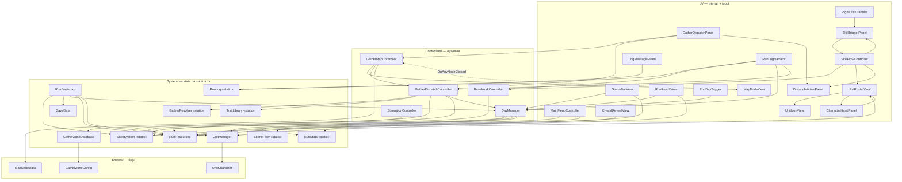
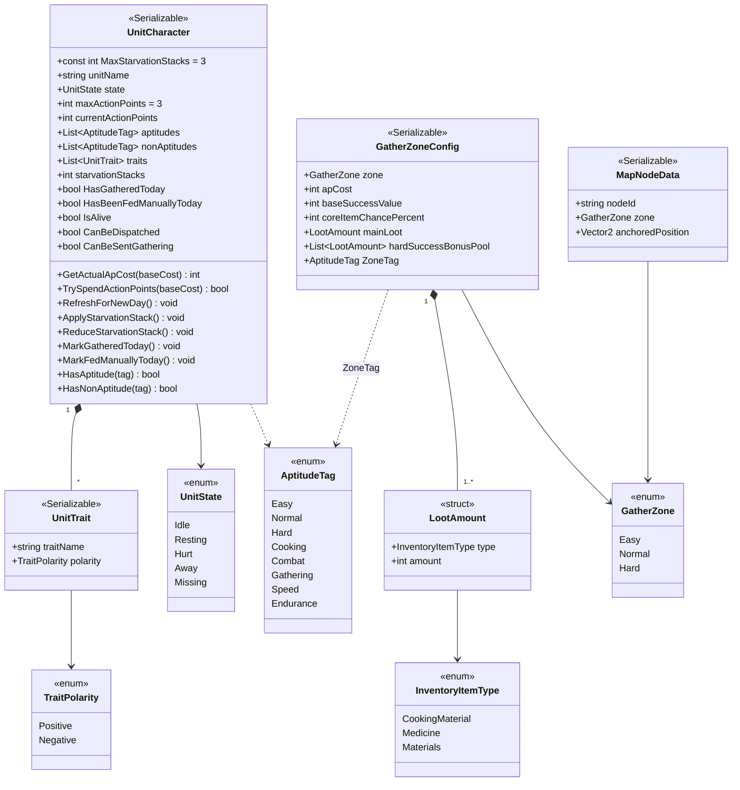

# clogged (Unity V2) — Class Diagram

**Version:** 3.1 | **Last Updated:** 2026-10-29
> สร้างจากโค้ดจริงใน `Unity-Projects/Assets/V2/Scripts/` — ภาพรวมระบบและ flow ดูที่ [Unity V2 System Design](04-unity-system-design.md)
> **v3.1:** เพิ่ม flow ของ `MainMenuController`, `SceneFlow`, save/restore, `RunResultView` และ `CrystalRevealView`; แก้ model Core Item ให้เป็นกล่อง/กุญแจที่ดรอปแยกกัน

## 1. Layer Overview

## 2. Entities & Data Types

## 3. Systems & Controllers

```mermaid
classDiagram
    class UnitManager {
        <<MonoBehaviour, Singleton>>
        -List~UnitCharacter~ units
        +IReadOnlyList~UnitCharacter~ Units
        +AliveCount() int
        +AllUnitsLost() bool
        -SetupDefaultRoster() void
    }

    class RunResources {
        <<MonoBehaviour, Singleton>>
        -int food = 8
        -int cookingMaterial = 2
        -int medicine = 1
        -int materials = 0
        -bool coreItemA
        -bool coreItemB
        -CoreItemVariant variant
        +bool HasCoreItemA / HasCoreItemB
        +bool HasBothCoreItems
        +CoreItemVariant Variant
        +TryConsumeFood() bool
        +AddFood(amount) void
        +AddItem(type, amount) void
        +TryConsumeItem(type, amount) bool
        +GetItemAmount(type) int
        +ObtainCoreItem(kind) void
        +RestoreState(data) void
    }

    class CoreItemKind {
        <<enum>>
        A
        B
    }

    class CoreItemVariant {
        <<enum>>
        Orange
        Yellow
    }

    class GatherZoneDatabase {
        <<MonoBehaviour, Singleton>>
        -List~GatherZoneConfig~ zones
        +GetConfig(zone) GatherZoneConfig
        -SetupDefaults() void
    }

    class GatherResolver {
        <<static>>
        +ComputeSuccessValue(config, sentUnits) int
        +Roll(successValue) GatherOutcome
    }

    class TraitLibrary {
        <<static>>
        +CreateRandom(polarity, owner) UnitTrait
    }

    class GatherOutcome {
        +GatherResultTier tier
        +int successValue
        +int rollValue
    }

    class GatherResultTier {
        <<enum>>
        HardSuccess
        Regular
        Failure
        Fumble
    }

    class DayManager {
        <<MonoBehaviour, Singleton>>
        -int currentDay = 1
        -int deadlineDay = 7
        +RunOutcome Outcome
        +event OnDayStarted(int)
        +event OnDayEnded(DayEndReport)
        +event OnRunEnded(RunOutcome)
        +EndDay() void
        +CheckImmediateWin() void
        +PreviewFeeding() DayEndReport
        +RestoreDay(day, deadline) void
        -FeedEligibleUnitsInOrder() void
        -RefreshEligibleUnitsForNewDay() void
    }

    class RunOutcome {
        <<enum>>
        InProgress
        Win
        LoseDeadline
        LoseAllUnitsLost
    }

    class SaveSystem {
        <<static>>
        +string FilePath
        +HasSave bool
        +SaveNow() bool
        +QueueLoad() bool
        +ConsumePendingLoad() SaveData
        +Peek() SaveData
        +Delete() void
        -Capture() SaveData
        -Read() SaveData
    }

    class SaveData {
        <<Serializable>>
        +int version
        +int currentDay / deadlineDay
        +int food / cookingMaterial / medicine / materials
        +bool coreItemA / coreItemB
        +int variant
        +List~UnitSnapshot~ units
        +RunStatsSnapshot stats
    }

    class UnitSnapshot {
        <<Serializable, nested>>
        +string unitName
        +int state / currentActionPoints / starvationStacks
    }

    class RunBootstrap {
        <<MonoBehaviour>>
        +static Apply(data) void
    }

    class SceneFlow {
        <<static>>
        +NewGame() void
        +Continue() void
        +TryAgain() void
        +ToMainMenu() void
        +Quit() void
    }

    class RunStats {
        <<static>>
        +DaysPlayed / HealsPerformed
        +CookRounds / FoodCooked
        +CraftRounds / MedicineCrafted
        +FoodConsumed / StarvationTicks
        +GatherTrips / UnitsLost
        +TakeSnapshot() RunStatsSnapshot
        +ApplySnapshot(snapshot) void
    }

    class GatherDispatchController {
        <<MonoBehaviour, Singleton>>
        +event OnGatherResolved(GatherDispatchResult)
        +CanDispatch(zone, units, out reason) bool
        +Dispatch(zone, units) GatherDispatchResult
        -ApplyOutcome(...) GatherDispatchResult
        -GrantMainLoot / GrantBonusLoot()
        -MaybeAwardTrait / InjureRandomUnit / LoseRandomUnit()
        -TryRollCoreItems(config, result) void
    }

    class GatherDispatchResult {
        +GatherZone zone
        +List~UnitCharacter~ sentUnits
        +GatherResultTier tier
        +int rollValue
        +int successValue
        +LootAmount? mainLootGranted
        +LootAmount? bonusLootGranted
        +UnitCharacter hurtUnit
        +UnitCharacter missingUnit
        +bool traitAwarded
        +string traitName
        +UnitCharacter traitRecipient
        +List~CoreItemKind~ coreItemsObtained
    }

    class GatherMapController {
        <<MonoBehaviour, Singleton>>
        -List~MapNodeData~ nodeData
        -List~MapNodeView~ nodeViews
        -MapNodeView selectedNode
        +MapNodeView SelectedNode
        +event OnTripResolved(GatherDispatchResult)
        +event OnSelectionChanged(MapNodeView)
        +ConfirmTrip(units) void
        +ClearSelection() void
        -HandleNodeClicked(view) void
        -SetupDefaultNodes() void
        -FindScatterPosition(min, max) Vector2
    }

    class BaseWorkController {
        <<MonoBehaviour, Singleton>>
        +CanCook(worker) bool
        +Cook(worker, rounds) BaseWorkResult
        +CanHeal(healer, patient) bool
        +Heal(healer, patient) BaseWorkResult
        +CanUseWorkshop(worker) bool
        +UseWorkshop(worker, rounds) BaseWorkResult
        +GetMaxCookRounds(worker) int
        +GetMaxWorkshopRounds(worker) int
        +GetHealPlan(healer, out useMedicine, out apCost) void
    }

    class BaseWorkResult {
        +BaseWorkType workType
        +UnitCharacter worker
        +bool blocked
        +int repeatsPerformed
        +int foodProduced
        +int cookingMaterialConsumed
        +UnitCharacter healedUnit
        +bool usedMedicine
        +int medicineProduced
    }

    class BaseWorkType {
        <<enum>>
        Cooking
        Healing
        Workshop
    }

    class StarvationController {
        <<MonoBehaviour, Singleton>>
        -int foodCostPerFeed = 1
        +GetBlockReason(unit) string
        +CanFeedUnit(unit) bool
        +FeedUnit(unit) FeedResult
    }

    class FeedResult {
        +UnitCharacter unit
        +bool blocked
        +int stacksBefore
        +int stacksAfter
    }

    UnitManager "1" o-- "4" UnitCharacter
    GatherZoneDatabase "1" o-- "3" GatherZoneConfig
    GatherResolver ..> GatherOutcome : creates
    GatherOutcome --> GatherResultTier
    DayManager --> RunOutcome
    DayManager ..> UnitManager
    DayManager ..> RunResources
    DayManager ..> SaveSystem : checkpoint
    DayManager ..> RunStats
    GatherDispatchController ..> GatherZoneDatabase
    GatherDispatchController ..> GatherResolver
    GatherDispatchController ..> TraitLibrary
    GatherDispatchController ..> RunResources
    GatherDispatchController ..> DayManager : CheckImmediateWin
    GatherDispatchController ..> GatherDispatchResult : creates
    GatherMapController "1" o-- "*" MapNodeData
    GatherMapController ..> GatherDispatchController
    BaseWorkController ..> RunResources
    BaseWorkController ..> BaseWorkResult : creates
    BaseWorkResult --> BaseWorkType
    StarvationController ..> RunResources
    StarvationController ..> FeedResult : creates
    RunResources --> CoreItemKind
    RunResources --> CoreItemVariant
    GatherDispatchController ..> CoreItemKind
    SaveSystem ..> SaveData : reads/writes
    SaveData "1" *-- "*" UnitSnapshot
    SaveData --> RunStatsSnapshot
    StatusBarView ..> CoreItemArt
    RunBootstrap ..> SaveSystem
    RunBootstrap ..> SaveData
    RunBootstrap ..> UnitManager
    RunBootstrap ..> RunResources
    RunBootstrap ..> DayManager
    RunBootstrap ..> RunStats
    SceneFlow ..> SaveSystem
```

## 4. UI Classes

```mermaid
classDiagram
    class StatusBarView {
        <<MonoBehaviour>>
        -TMP_Text dayText, foodText, cookingMaterialText
        -TMP_Text medicineText, materialsText, coreItemStatusText
        -Image coreItemIcon, coreItemBIcon
        -CoreItemArt orangePair / yellowPair
        -RefreshIcons() void
        -Update() poll DayManager + RunResources
    }

    class CoreItemArt {
        <<Serializable, nested>>
        +Sprite closedBox / openBox / key / crystal
    }

    class MainMenuController {
        <<MonoBehaviour>>
        -BuildUi() void
        -RefreshContinue() void
        -HandleStart() void
        -HandleContinue() void
        -HandleOptions() void
        -HandleExit() void
        -ApplyPreferenceState() void
    }

    class RunResultView {
        <<MonoBehaviour>>
        -HandleRunEnded(outcome) void
        -Populate(won, outcome) void
        -DaysUsed() int
        -Survivors() int
    }

    class CrystalRevealView {
        <<MonoBehaviour, IPointerClickHandler>>
        +bool IsShowing
        +Show() void
        +Hide(instant) void
        +OnPointerClick(eventData) void
    }

    class UnitRosterView {
        <<MonoBehaviour>>
        -RectTransform container
        -UnitIconView iconPrefab
        -int maxSelection = 2
        -Color[] unitColors
        +event OnSelectionChanged
        +event OnSelectionRejected(string)
        +GetSelectedUnits() List~UnitCharacter~
        +ClearSelection() void
        +SetSelectionEnabled(bool) void
        +RefreshAvailability() void
        -Update() refresh cards + drop unavailable selections
    }

    class UnitIconView {
        <<MonoBehaviour, IPointerClickHandler>>
        -Image iconImage
        -TMP_Text nameText, statusText
        -float frameThickness, selectedFrameThickness
        +event Clicked(UnitIconView)
        +Bind(unit, accentColor, selectable) void
        +SetSelected(bool) void
        +SetSelectable(bool) void
        +SetSelectionEnabled(bool) void
        +Refresh() void
        +OnPointerClick(eventData) void
    }

    class GatherDispatchPanel {
        <<MonoBehaviour>>
        -Button dispatchButton
        -UnitRosterView rosterView
        -WarningView warningView
        -TMP_Text messageText
        -OnDispatchClicked() void
        -HandleTripResolved(result) void
        -HandleSelectionChanged() void
        -RefreshAvailability() void
    }

    class MapNodeView {
        <<MonoBehaviour>>
        +MapNodeData Data
        -TMP_Text zoneLabel
        +static event OnAnyNodeClicked(MapNodeView)
        +Initialize(data) void
        +SetSelected(bool) void
        -BuildZoneLabel() void
    }

    class TmpOutlineUtil {
        <<static>>
        +ApplyOutline(text, color, width, softness) bool
        +CreateOutlineMaterial(text, color, width, softness) Material
        +SetOutlineColor(material, color) void
        +CreateLabel(parent, name, width, height) TextMeshProUGUI
    }

    class WarningView {
        <<MonoBehaviour>>
        -TMP_Text label
        -CanvasGroup backdropGroup
        -float holdSeconds = 2.5
        -float fadeSeconds = 0.3
        +Show(text, LogKind kind) void
        +Clear() void
    }

    class UiPalette {
        <<static>>
        +Color For(LogKind) Color
    }

    class ButtonVisual {
        <<MonoBehaviour>>
        -Image iconImage
        -TMP_Text label
        -VisualMode mode = Label
        -Sprite icon
        +SetIcon(sprite, switchToIcon) void
        +SetLabel(text, switchToLabel) void
        +SetMode(mode) void
        +Apply() void
    }

    class EndDayTrigger {
        <<MonoBehaviour, IPointerClickHandler>>
        +OnPointerClick(eventData) void
    }

    class CharacterHandPanel {
        <<MonoBehaviour>>
        +SelectionMode Mode
        +int MaxSelection
        +bool CanSelect(unit) bool
        +SetMode(mode) void
        +event OnModeChanged
    }

    class DispatchActionPanel {
        <<MonoBehaviour>>
        +string CurrentLabel
        +bool IsVisible
        +Show(label, interactable) void
        +ShowDispatch(interactable) void
        +Hide() void
        +event Clicked
    }

    class SkillTriggerPanel {
        <<MonoBehaviour>>
        -int hideCountBelow = 1
        +SetCookCount(n) void
        +SetCraftCount(n) void
        +SetArmed(kind) void
        +SetHealAvailable(ok) void
        +SetHealMode(useMedicine, hasMedicine) void
        +event CookClicked / CraftClicked / HealClicked
        +event CookCleared / CraftCleared / HealCancelled / HealModeToggled
    }

    class SkillFlowController {
        <<MonoBehaviour>>
        +SkillKind Armed
        +bool IsSkillActive
        -int pendingRounds
        -bool healUseMedicine
        -QueueRound(kind) void
        -ArmHeal() void
        -HandleConfirm() void
        +event StateChanged
    }

    class LogMessagePanel {
        <<MonoBehaviour>>
        -int capacity = 16
        -float expandedHeight = 300
        -float collapsedHeight = 64
        -Render() void
    }

    class RunLogNarrator {
        <<MonoBehaviour>>
        -HandleBaseWork(result) void
        -HandleDayEnded(report) void
        -HandleGatherResolved(result) void
        -HandleRunEnded(outcome) void
    }

    class RightClickHandler {
        <<MonoBehaviour, IPointerClickHandler>>
        +event Clicked
    }

    class RunLog {
        <<static>>
        +int Capacity = 16
        +IReadOnlyList~LogEntry~ Entries
        +Add(kind, message) void
        +Clear() void
        +event OnEntryAdded / OnCleared
    }

    class RunStatsSnapshot {
        <<Serializable>>
        +int daysPlayed / heals / cookRounds / foodCooked
        +int craftRounds / medicineCrafted / foodConsumed
        +int starvationTicks / gatherTrips / unitsLost
    }

    class DiceRollView {
        <<stub>>
    }

    UnitRosterView "1" *-- "*" UnitIconView : spawns
    UnitIconView ..> UnitCharacter
    UnitRosterView ..> UnitCharacter : selection
    UnitRosterView ..> CharacterHandPanel : mode + card layout
    CharacterHandPanel ..> UnitRosterView : pick rule
    StatusBarView ..> DayManager
    StatusBarView ..> RunResources
    MainMenuController ..> SceneFlow
    MainMenuController ..> SaveSystem : Continue state
    RunResultView ..> DayManager : OnRunEnded
    RunResultView ..> RunStats
    RunResultView ..> SceneFlow : buttons
    CrystalRevealView ..> RunResources : HasBothCoreItems
    EndDayTrigger ..> DayManager : EndDay()
    GatherDispatchPanel ..> GatherMapController : ConfirmTrip / OnTripResolved
    GatherDispatchPanel ..> GatherDispatchController : CanDispatch
    GatherDispatchPanel ..> DayManager : OnDayStarted
    GatherDispatchPanel ..> WarningView : warns
    GatherDispatchPanel ..> UnitRosterView : selection
    GatherDispatchPanel ..> DispatchActionPanel : confirm button
    GatherDispatchPanel ..> SkillFlowController : stands down while armed
    SkillTriggerPanel ..> SkillFlowController : raises input
    SkillFlowController ..> BaseWorkController : Cook / Heal / UseWorkshop
    SkillFlowController ..> UnitRosterView : mode + selection
    SkillFlowController ..> DispatchActionPanel : confirm button
    SkillFlowController ..> WarningView : warns
    RightClickHandler ..> SkillTriggerPanel : right-click events
    LogMessagePanel ..> RunLog
    RunLogNarrator ..> RunLog : Add()
    RunLogNarrator ..> BaseWorkController : OnBaseWorkCompleted
    RunLogNarrator ..> DayManager : OnDayEnded / OnRunEnded
    RunLogNarrator ..> GatherDispatchController : OnGatherResolved
    MapNodeView ..> TmpOutlineUtil : label outline
    WarningView ..> TmpOutlineUtil : text outline
    GatherMapController "1" o-- "*" MapNodeView : spawns
```

## Notes

- `UnitCharacter`, `GatherZoneConfig`, `MapNodeData` เป็น plain `[Serializable]` class (ไม่ใช่ MonoBehaviour / ScriptableObject) — แก้ค่าได้ใน Inspector ของ `UnitManager` / `GatherZoneDatabase` ถ้า list ว่างจะใช้ค่า default ในโค้ด
- ระบบทั้งหมดสื่อสารผ่าน **singleton `Instance`** + **C# event** — ไม่มี dependency injection หรือ ScriptableObject event channel
- `GatherResolver` เป็น pure function (ไม่มี side effect) — จุดที่ทำ unit test ได้ง่ายที่สุดในโปรเจกต์
- `*Result` class (`GatherDispatchResult`, `BaseWorkResult`, `FeedResult`) เป็นรายงานสำหรับ UI เท่านั้น ไม่มี logic
- **ไม่มี `TripInProgress` แล้ว** — `GatherMapController.ConfirmTrip` เรียก `Dispatch()` แล้วยิง `OnTripResolved` ในเฟรมเดียวกัน
- `RunLog` เป็น **static** (ไม่ใช่ singleton) เพื่อให้ทุกระบบเขียน log ได้โดยไม่ต้องมี inspector reference — `LogMessagePanel` เป็น renderer ตัวเดียว, `RunLogNarrator` เป็นที่เดียวที่แปลง event เป็นข้อความ
- `SkillFlowController` เป็นเจ้าของ state ของ flow สกิล (armed kind, queue count, heal mode, ผู้ป่วย) — `SkillTriggerPanel` เป็นแค่ view ที่ยิง event, `DispatchActionPanel` เป็นปุ่มเดียวที่ทั้ง 2 flow แชร์กันโดยดูจาก `IsSkillActive()`

## Related Documents
- [Unity V2 System Design](04-unity-system-design.md)
- [Unity V2 Core Scene Hierarchy](06-unity-core-scene-hierarchy.md)
- [Web Prototype Class Diagram](02-class-diagram.md) (ระยะที่ 1)
