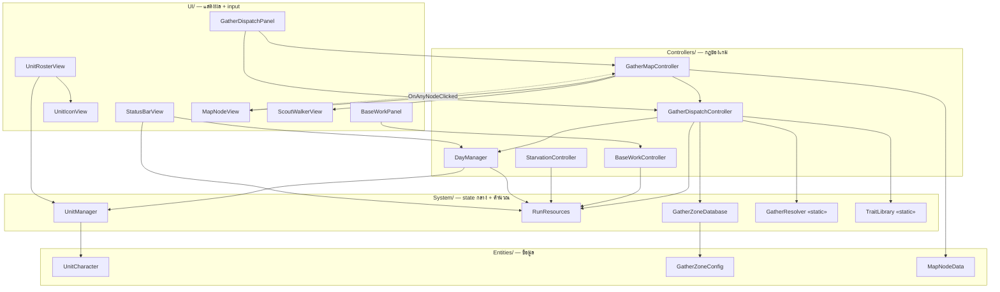
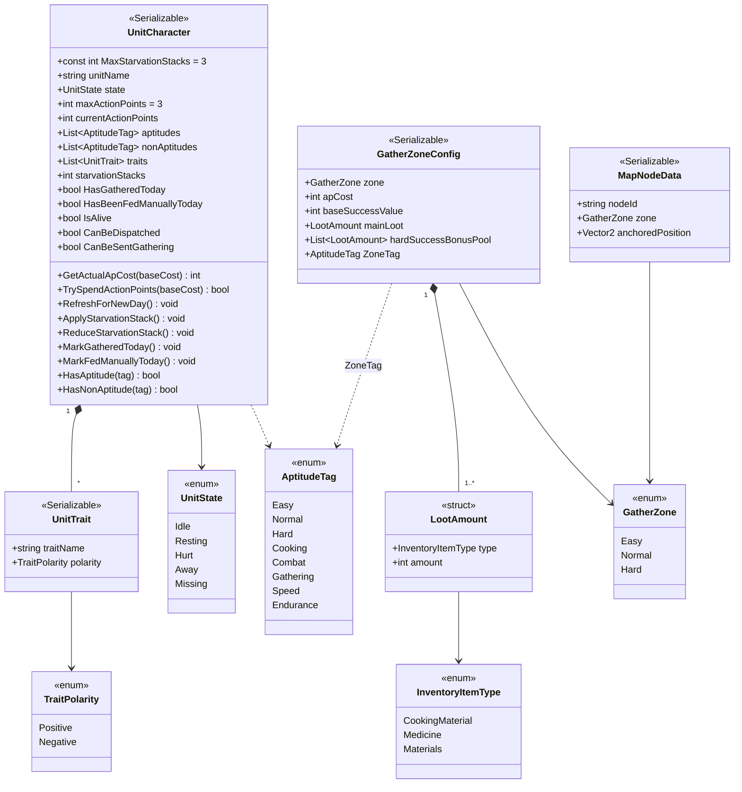
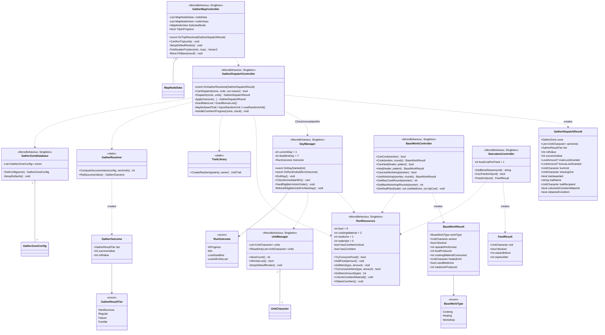
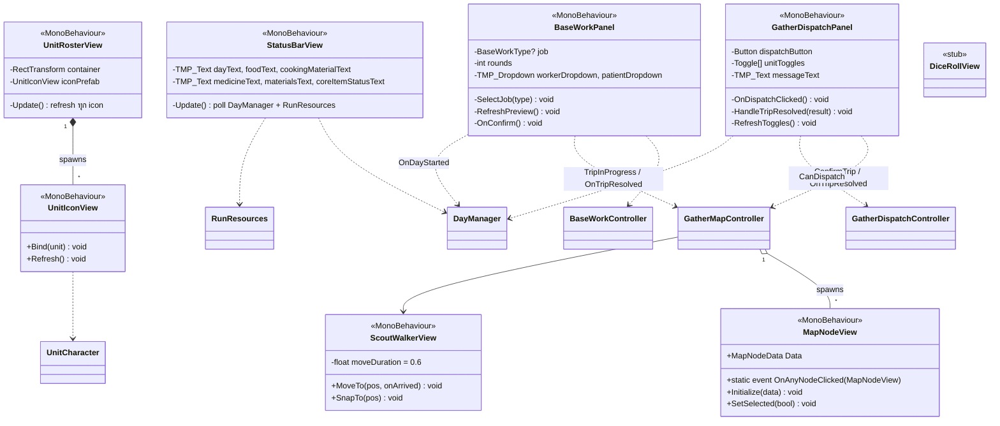

# clogged (Unity V2) — Class Diagram

**Version:** 2.0 | **Last Updated:** 2026-10-14
> สร้างจากโค้ดจริงใน `Unity-Projects/Assets/V2/Scripts/` — ภาพรวมระบบและ flow ดูที่ [Unity V2 System Design](04-unity-system-design.md)

## 1. Layer Overview

## 2. Entities & Data Types

## 3. Systems & Controllers

## 4. UI Classes

## Notes

- `UnitCharacter`, `GatherZoneConfig`, `MapNodeData` เป็น plain `[Serializable]` class (ไม่ใช่ MonoBehaviour / ScriptableObject) — แก้ค่าได้ใน Inspector ของ `UnitManager` / `GatherZoneDatabase` ถ้า list ว่างจะใช้ค่า default ในโค้ด
- ระบบทั้งหมดสื่อสารผ่าน **singleton `Instance`** + **C# event** — ไม่มี dependency injection หรือ ScriptableObject event channel
- `GatherResolver` เป็น pure function (ไม่มี side effect) — จุดที่ทำ unit test ได้ง่ายที่สุดในโปรเจกต์
- `*Result` class (`GatherDispatchResult`, `BaseWorkResult`, `FeedResult`) เป็นรายงานสำหรับ UI เท่านั้น ไม่มี logic

## Related Documents
- [Unity V2 System Design](04-unity-system-design.md)
- [Web Prototype Class Diagram](02-class-diagram.md) (ระยะที่ 1)
