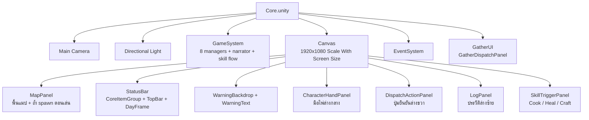

# clogged (Unity V2) — Core Scene Hierarchy

**Version:** 3.0 | **Last Updated:** 2026-10-28
> อธิบาย Hierarchy ทั้งหมดของ `Unity-Projects/Assets/V2/Scenes/Core.unity` — ตรวจจาก `unity command scene.get_hierarchy` ของ scene จริง
> ตรรกะของแต่ละระบบดู [Unity V2 System Design](04-unity-system-design.md) · class ดู [Unity V2 Class Diagram](05-unity-class-diagram.md) · layout/UI ล่าสุดดู [UI Layout Redesign](07-unity-v2-ui-layout-redesign.md)

## 1. ภาพรวม

Root object 6 ตัว แบ่งเป็น 3 กลุ่ม:

| Root | กลุ่ม | หน้าที่ |
|---|---|---|
| `Main Camera` | Rendering | กล้อง URP + AudioListener |
| `Directional Light` | Rendering | แสง URP (UI ล้วน จึงแทบไม่มีผล) |
| `GameSystem` | **Logic** | ที่รวม manager/controller ทั้งหมด (ไม่มีภาพ) + `RunLogNarrator` + `SkillFlowController` |
| `Canvas` | **UI** | ทุกอย่างที่ผู้เล่นเห็นและกด |
| `EventSystem` | Input | ส่ง click ให้ UI (ใช้ **Input System package** — `InputSystemUIInputModule`) |
| `GatherUI` | Logic ↔ UI | ถือ `GatherDispatchPanel` (UI controller ของการส่งสำรวจ) |



## 2. Hierarchy เต็ม

สัญลักษณ์: **ตัวหนา** = มี script ของ V2 · `[inactive]` = ปิดไว้ใน scene · ⟳ = ถูก spawn เพิ่มตอน runtime (ไม่อยู่ในไฟล์ scene)

```
Core.unity
├── Main Camera                      Camera, UniversalAdditionalCameraData, AudioListener
├── Directional Light                Light, UniversalAdditionalLightData
├── GameSystem                       (Transform เปล่า) **RunLogNarrator**, **SkillFlowController**
│   ├── UnitManager                  **UnitManager**
│   ├── RunResources                 **RunResources**
│   ├── DayManager                   **DayManager**
│   ├── GatherDispatchController     **GatherDispatchController**
│   ├── GatherZoneDatabase           **GatherZoneDatabase**
│   ├── GatherMapController          **GatherMapController**  (RectTransform)
│   ├── BaseworkController           **BaseWorkController**
│   └── StavingController            **StarvationController**
├── Canvas                           Canvas (Screen Space - Overlay), CanvasScaler, GraphicRaycaster
│   ├── MapPanel                     Image (เต็มจอ — พื้นที่แมป)
│   │   └── ⟳ Dungeon Prefab ×6      ← spawn โดย GatherMapController (**MapNodeView**) → ลูก ZoneLabel (runtime)
│   ├── StatusBar                    **StatusBarView**, HorizontalLayoutGroup
│   │   ├── DayFrame                 **EndDayTrigger**  (คลิก = จบวัน)
│   │   │   ├── DayBackground        Image ขาวโปร่ง
│   │   │   ├── Day                  TextMeshProUGUI "DAY / n / 7 (x left)"
│   │   │   └── BorderTop/Bottom/Left/Right   Image ดำ
│   │   ├── CoreItemGroup            380×140
│   │   │   ├── CoreItemStatus       TextMeshProUGUI "Core A +/-" + "Core B +/-", LayoutElement
│   │   │   ├── CoreItemFrame        กรอบดำ 120×120  (ช่อง A)
│   │   │   │   ├── CoreItemIcon     Image (placeholder สำหรับ sprite จริง)
│   │   │   │   └── BorderTop/Bottom/Left/Right   Image ดำ
│   │   │   └── CoreItemFrameB       กรอบดำ 120×120  (ช่อง B, เยื้อง +236)
│   │   │       ├── CoreItemBIcon    Image
│   │   │       └── BorderTop/Bottom/Left/Right   Image ดำ
│   │   └── TopBar                   HorizontalLayoutGroup (กลาง)
│   │       ├── Food                 TextMeshProUGUI
│   │       ├── Medicine             TextMeshProUGUI
│   │       ├── CookingMaterial      TextMeshProUGUI
│   │       └── Materials            TextMeshProUGUI
│   ├── WarningBackdrop              Image (ดำ a0.85), CanvasGroup
│   ├── WarningText                  **WarningView**, CanvasGroup, TextMeshProUGUI
│   ├── CharacterHandPanel           **CharacterHandPanel**, **UnitRosterView**
│   │   └── Cards                    HorizontalLayoutGroup
│   │       └── ⟳ ScoutIcon(Clone) ×4  ← spawn โดย UnitRosterView (**UnitIconView**)
│   │           ├── Portrait         Image (runtime)
│   │           ├── nametext         TextMeshProUGUI
│   │           ├── statustest       TextMeshProUGUI
│   │           └── Frame0..3        Image ×4 (กรอบสีประจำตัว)
│   ├── DispatchActionPanel          **DispatchActionPanel**, Button, Image  (ซ่อนตอน Awake)
│   │   ├── Icon                     Image (placeholder ไอคอนการกระทำ)
│   │   └── Label                    TextMeshProUGUI "DISPATCH" / "COOK" / "HEAL" / "CRAFT"
│   ├── LogPanel                     **LogMessagePanel**, Image (ทึบ)
│   │   ├── Header                   Image
│   │   │   ├── Title                TextMeshProUGUI "LOG"
│   │   │   └── MinMaxButton         Button → ย่อ/กาง
│   │   │       └── Label            TextMeshProUGUI "–"
│   │   ├── Expanded                 ScrollRect
│   │   │   └── Viewport             RectMask2D, Image
│   │   │       └── Content          VerticalLayoutGroup, ContentSizeFitter
│   │   │           └── EntryTemplate [inactive]  TMP + LayoutElement (ต้นแบบ row)
│   │   └── Collapsed [inactive]     TextMeshProUGUI (บรรทัดล่าสุดตอนย่อ)
│   └── SkillTriggerPanel            **SkillTriggerPanel**, VerticalLayoutGroup
│       ├── CookButton               Button, LayoutElement
│       │   ├── Label                TextMeshProUGUI "Cook"
│       │   └── Count                TextMeshProUGUI (จำนวนรอบที่ queue)
│       ├── HealRow                  HorizontalLayoutGroup
│       │   ├── HealButton           Button, LayoutElement  (ไม่มี queue)
│       │   │   ├── Label            TextMeshProUGUI "Heal"
│       │   │   └── Count            TextMeshProUGUI (ไม่ถูกใช้)
│       │   └── HealModeButton       Button → "MED" / "AP"
│       │       └── Label            TextMeshProUGUI
│       └── CraftButton              Button, LayoutElement
│           ├── Label                TextMeshProUGUI "Craft"
│           └── Count                TextMeshProUGUI
├── EventSystem                      EventSystem, InputSystemUIInputModule
└── GatherUI                         **GatherDispatchPanel**
```

## 3. รายละเอียดแต่ละส่วน

### 3.1 `GameSystem` — Logic layer

GameObject ลูกแต่ละตัวถือ singleton 1 ตัว ไม่มีภาพ ไม่มีลูก:

| GameObject | Component | ค่าใน Inspector | อ้างถึง |
|---|---|---|---|
| `GameSystem` | `RunLogNarrator` | — | อ่าน `Instance` เองทั้งหมด |
| `GameSystem` | `SkillFlowController` | — | `rosterView` → `CharacterHandPanel`, `actionPanel` → `DispatchActionPanel`, `skillPanel` → `SkillTriggerPanel`, `warningView` → `WarningText` |
| `UnitManager` | `UnitManager` | `units: []` → ใช้ roster default ในโค้ด (Ann, Boon, Cia, Dan) | — |
| `RunResources` | `RunResources` | food 8, cookingMaterial 2, medicine 1, materials 0, coreItemA/B ปิดทั้งคู่ | — |
| `DayManager` | `DayManager` | currentDay 1, deadlineDay 7 | — |
| `GatherDispatchController` | `GatherDispatchController` | (ไม่มี field) | — |
| `GatherZoneDatabase` | `GatherZoneDatabase` | `zones: []` → ใช้ 3 zone default (Easy 0% · Normal 5% · Hard 15%) | — |
| `GatherMapController` | `GatherMapController` | baseOffset (0, 10), nodesPerDifficulty 2, margin **L150 / R400 / T300 / B420**, baseClearRadius 180, candidatesPerNode 60 | `mapPanel` → `MapPanel`, `nodeViewPrefab` → `Dungeon Prefab.prefab` |
| `BaseworkController` | `BaseWorkController` | cook 1 AP / 1 วัตถุดิบ → 1 Food (2 ถ้าถนัด); heal 1 AP+ยา หรือ 2 AP; workshop 1 AP + 2 Materials → 1 Medicine | — |
| `StavingController` | `StarvationController` | foodCostPerFeed 1 | — (ยังไม่มี UI เรียก) |

> margin ของ `GatherMapController` ถูกขยายใน P5 + §7.11 เพื่อกันไม่ให้ถ้ำไปอยู่ใต้ `LogPanel` / `CharacterHandPanel` / `SkillTriggerPanel` / `DayFrame` (เดิมมีถ้ำที่มองไม่เห็นและกดไม่ได้ · R400/T300 คือค่าที่กัน rect 160×30 ของถ้ำออกจากกรอบ DAY จริง)

ลำดับ `Awake` ของ singleton ไม่สำคัญ เพราะทุกตัวแค่ตั้ง `Instance` ใน `Awake` และ UI ไปอ่าน `Instance` ใน `Start` (รันหลัง `Awake` ทุกตัว)

### 3.2 `Canvas` — UI layer

- **Render Mode:** Screen Space - Overlay
- **CanvasScaler:** Scale With Screen Size, reference **1920×1080**, match 0.5
- **ลำดับการวาด (หลัง→หน้า):** MapPanel → StatusBar → WarningBackdrop → WarningText → CharacterHandPanel → DispatchActionPanel → LogPanel → SkillTriggerPanel

```
┌──────────────────── StatusBar (เต็มความกว้าง) ────────────────────┐
│ [A][B]            Food  Medicine  Cooking  Materials      ┌─────┐ │
│ CoreItemGroup                                             │ DAY │ │
│  (ซ้าย)                                                   │ 1/7 │ │
│                    MapPanel (เต็มจอ)                      └─────┘ │
│         ● ถ้ำ ×6 (สุ่มใน MAP AREA เท่านั้น)          ┌───────────┐ │
│                                                      │ Cook   [2]│ │
│                                                      │ Heal [MED]│ │
│                                                      │ Craft     │ │
│ ┌────────────┐   ┌Ann┐┌Boon┐┌Cia┐┌Dan┐               └───────────┘ │
│ │ LOG    [–] │   │   ││    ││   ││   │    ┌──────────┐            │
│ │ ...        │   └───┘└────┘└───┘└───┘    │ DISPATCH │            │
│ └────────────┘    CharacterHandPanel      └──────────┘            │
└──────────────────────────────────────────────────────────────────┘
```

| GameObject | Anchor | หน้าที่ | ใครควบคุม |
|---|---|---|---|
| `MapPanel` | stretch เต็มจอ | พื้นแมป; parent ของถ้ำที่ spawn ตอนเล่นเท่านั้น | `GatherMapController` |
| `StatusBar/DayFrame` | ขวาบน | `DAY n / 7 (x left)` — **คลิกที่กรอบ = จบวัน** (พื้นผิวคลิกคือ `DayBackground` ที่ `raycastTarget = true`; `Day`/border ปิด raycast) | `StatusBarView` (ข้อความ) + `EndDayTrigger` (คลิก) |
| `StatusBar/CoreItemGroup` | ซ้ายบน | ช่อง Core Item A/B + ข้อความสถานะ | `StatusBarView` |
| `StatusBar/TopBar` | กลางบน | Food / Medicine / CookingMaterial / Materials | `StatusBarView` |
| `WarningBackdrop` | กลางจอ 620×120 | แผงดำโปร่ง 85% หลังข้อความเตือน (ปิด raycast) | `WarningView.backdropGroup` |
| `WarningText` | กลางจอ 620×120 | แบนเนอร์เตือน: outline เปลี่ยนสีตามระดับ | `WarningView` |
| `CharacterHandPanel` | ล่างกลาง (0.5,0) +190, 830×300 | มือไพ่ 4 ใบ — dispatch เลือก 2, สกิล 1, heal target เฉพาะคน Hurt | `CharacterHandPanel` + `UnitRosterView` |
| `DispatchActionPanel` | ล่างขวา 300×200 | ปุ่มยืนยันตัวเดียว; ซ่อนตอน `Awake`, label ตามบริบท | `DispatchActionPanel` → `GatherDispatchPanel` / `SkillFlowController` |
| `LogPanel` | ล่างซ้าย (24,24) 700×300 | log 16 entry, ย่อเหลือบรรทัดเดียว (สูง 64) | `LogMessagePanel` |
| `SkillTriggerPanel` | ขวา (−24, 244) 236×300 | ปุ่ม Cook / Heal (+toggle MED/AP) / Craft | `SkillTriggerPanel` → `SkillFlowController` |

**ปุ่มทั้งหมดผูกด้วย `onClick.AddListener` ใน `Awake`/`Start`** — ไม่มีปุ่มไหนผูกใน Inspector (รวม `DayFrame` ที่ใช้ `IPointerClickHandler`)

### 3.3 การอ้างอิงใน Inspector ของ UI script

**`StatusBarView`** (บน `StatusBar`)

| Field | → GameObject |
|---|---|
| dayText | `StatusBar/DayFrame/Day` |
| foodText | `StatusBar/TopBar/Food` |
| cookingMaterialText | `StatusBar/TopBar/CookingMaterial` |
| medicineText | `StatusBar/TopBar/Medicine` |
| materialsText | `StatusBar/TopBar/Materials` |
| coreItemStatusText | `StatusBar/CoreItemGroup/CoreItemStatus` |
| coreItemIcon | `StatusBar/CoreItemGroup/CoreItemFrame/CoreItemIcon` |
| **coreItemBIcon** | `StatusBar/CoreItemGroup/CoreItemFrameB/CoreItemBIcon` |
| foodIcon / cookingMaterialIcon / medicineIcon / materialsIcon | ว่าง — ยังไม่มีกรอบไอคอนใน TopBar |
| coreItemSprite / coreItemBSprite | ว่าง — รอใส่ art |

**`CharacterHandPanel`** (บน `CharacterHandPanel`)

| Field | ค่า |
|---|---|
| handRoot / cardsContainer | `CharacterHandPanel` / `CharacterHandPanel/Cards` |
| cardSpacing / cardWidth / cardHeight | 12 / 195 / 265 |
| maxDispatchSelection / maxSkillSelection | 2 / 1 |

**`UnitRosterView`** (บน `CharacterHandPanel`)

| Field | ค่า |
|---|---|
| container | `CharacterHandPanel/Cards` |
| iconPrefab | `Assets/V2/Prefabs/ScoutIcon.prefab` (**UnitIconView**) |
| handPanel | `CharacterHandPanel` |
| maxSelection / cardSpacing | 2 / 12 |

**`LogMessagePanel`** (บน `LogPanel`)

| Field | → GameObject / ค่า |
|---|---|
| panelRoot | `LogPanel` |
| scrollRect | `LogPanel/Expanded` |
| entriesContainer | `LogPanel/Expanded/Viewport/Content` |
| entryTemplate | `…/Content/EntryTemplate` (inactive) |
| expandedRoot / collapsedRoot / collapsedLine | `Expanded` / `Collapsed` / `Collapsed` (TMP) |
| minMaxButton / minMaxLabel | `Header/MinMaxButton` / `Header/MinMaxButton/Label` |
| capacity / expandedHeight / collapsedHeight | 16 / 300 / 64 |

**`DispatchActionPanel`** (บน `DispatchActionPanel`)

| Field | → GameObject |
|---|---|
| panelRoot / actionButton | `DispatchActionPanel` (ทั้งคู่) |
| actionIcon / actionLabel | `Icon` / `Label` |
| hideWhenIdle / dispatchLabel | true / `DISPATCH` |

**`SkillTriggerPanel`** (บน `SkillTriggerPanel`)

| Field | → GameObject |
|---|---|
| cookButton / cookCountLabel | `CookButton` / `CookButton/Count` |
| healButton / healModeButton / healModeLabel | `HealRow/HealButton` / `HealRow/HealModeButton` / `HealRow/HealModeButton/Label` |
| craftButton / craftCountLabel | `CraftButton` / `CraftButton/Count` |
| hideCountBelow / armedTint | 1 / ฟ้า (ไฮไลต์ปุ่มที่ถือ action อยู่) |

**`SkillFlowController`** (บน `GameSystem`)

| Field | → GameObject |
|---|---|
| rosterView | `CharacterHandPanel` (UnitRosterView) |
| actionPanel | `DispatchActionPanel` |
| skillPanel | `SkillTriggerPanel` |
| warningView | `WarningText` |

**`GatherDispatchPanel`** (บน `GatherUI`)

| Field | → GameObject |
|---|---|
| actionPanel | `DispatchActionPanel` |
| rosterView | `CharacterHandPanel` (UnitRosterView) |
| warningView | `WarningText` |

**`GatherMapController`** (บน `GameSystem/GatherMapController`)

| Field | → |
|---|---|
| mapPanel | `Canvas/MapPanel` |
| nodeViewPrefab | `Assets/V2/Prefabs/Dungeon Prefab.prefab` |

**`EndDayTrigger`** (บน `StatusBar/DayFrame`)

| Field | ค่า |
|---|---|
| hintLabel / hintText | ว่าง (ไม่ใช้ — ข้อความ DAY มีอยู่แล้ว) |
| runOverMessage | `The run is already over.` (ขึ้น warning + log ถ้าคลิกหลัง run จบ) |

> `EndDayTrigger.Awake()` เรียก `EnsureClickSurface()` — ถ้าไม่มี Graphic ที่ `raycastTarget` ใต้กรอบเลย จะเพิ่ม transparent `Image` ให้เองพร้อม warning (กัน bug §7.11 กลับมา)

**`WarningView`** (บน `WarningText`)

| Field | → GameObject |
|---|---|
| messageText | ตัวเอง (`WarningText`) |
| backdropGroup | `WarningBackdrop` (CanvasGroup) |

### 3.4 สิ่งที่ถูกลบไปแล้ว (P5, 2026-10-28)

ของพวกนี้อยู่ในสเปกเดิมแต่ **ไม่มีในซีนแล้ว** — อย่าอ้างถึงในเอกสารอื่น:

| ของเดิม | แทนที่ด้วย |
|---|---|
| `Canvas/EndDay button` | คลิกที่ `StatusBar/DayFrame` (`EndDayTrigger`) |
| `Canvas/BaseWorkPanel` (+ `Scripts/UI/BaseWorkPanel.cs`) | `SkillTriggerPanel` + `SkillFlowController` |
| `Canvas/CharCard` | `CharacterHandPanel` |
| `Canvas/MapPanel/MessageUi` | `LogPanel` (ข้อมูลถ้ำ/คำเตือนไปที่ log + `WarningText`) |
| `Canvas/MapPanel/Dispatch` | `DispatchActionPanel` |
| `Canvas/MapPanel/ScoutIcon` + `Scripts/UI/ScoutWalkerView.cs` | ไม่มี — เกมไม่มีเวลาเดินทาง (`ScoutIcon.prefab` ยังอยู่ เพราะการ์ดใช้) |
| `GatherMapController.TripInProgress` | ไม่มี — ทริป resolve ในเฟรมเดียว |

### 3.5 Runtime-only objects

| Object | สร้างโดย | หมายเหตุ |
|---|---|---|
| `Dungeon Prefab(Clone) ×6` | `GatherMapController.SpawnNodeViews()` | ตำแหน่งสุ่มในขอบเขต margin ที่เว้นให้ panel |
| `ScoutIcon(Clone) ×4` | `UnitRosterView.BuildCards()` | การ์ดในมือ 1 ใบต่อยูนิต |
| log row | `LogMessagePanel` (pool) | clone จาก `EntryTemplate` ไม่เกิน `capacity` แล้ว reuse |

---

## Related Documents
- [Unity V2 System Design](04-unity-system-design.md)
- [Unity V2 Class Diagram](05-unity-class-diagram.md)
- [UI Layout Redesign (P0–P5)](07-unity-v2-ui-layout-redesign.md)
- [V2 Task Overview](../agile/user-stories/V2-TASK-OVERVIEW.md)
- [GDD Mechanics](../gdd/01-mechanics.md)