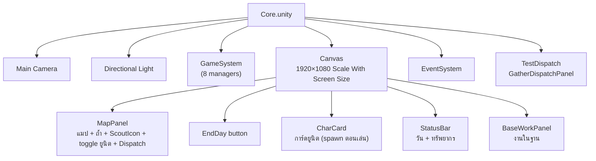
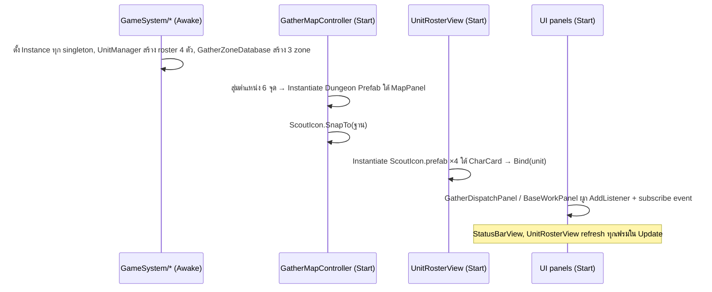

# clogged (Unity V2) — Core Scene Hierarchy

**Version:** 2.0 | **Last Updated:** 2026-10-14
> อธิบาย Hierarchy ทั้งหมดของ `Unity-Projects/Assets/V2/Scenes/Core.unity` — สร้างจากการ parse ไฟล์ scene จริง (GameObject, component, การอ้างอิงใน Inspector, prefab)
> ตรรกะของแต่ละระบบดู [Unity V2 System Design](04-unity-system-design.md) · class ดู [Unity V2 Class Diagram](05-unity-class-diagram.md)

## 1. ภาพรวม

Root object 6 ตัว แบ่งเป็น 3 กลุ่ม:

| Root | กลุ่ม | หน้าที่ |
|---|---|---|
| `Main Camera` | Rendering | กล้อง URP + AudioListener |
| `Directional Light` | Rendering | แสง URP (UI ล้วน จึงแทบไม่มีผล) |
| `GameSystem` | **Logic** | ที่รวม manager/controller ทั้งหมด (ไม่มีภาพ) |
| `Canvas` | **UI** | ทุกอย่างที่ผู้เล่นเห็นและกด |
| `EventSystem` | Input | ส่ง click ให้ UI (ใช้ **Input System package** — `InputSystemUIInputModule`) |
| `TestDispatch` | Logic ↔ UI | ถือ `GatherDispatchPanel` (UI controller ของการส่งสำรวจ) |



## 2. Hierarchy เต็ม

สัญลักษณ์: **ตัวหนา** = มี script ของ V2 · `[inactive]` = ปิดไว้ใน scene · `[PREFAB]` = prefab instance · ⟳ = ถูก spawn เพิ่มตอน runtime (ไม่อยู่ในไฟล์ scene)

```
Core.unity
├── Main Camera                      Camera, UniversalAdditionalCameraData, AudioListener
├── Directional Light                Light, UniversalAdditionalLightData
├── GameSystem                       (Transform เปล่า — ใช้จัดกลุ่ม)
│   ├── UnitManager                  **UnitManager**
│   ├── RunResources                 **RunResources**
│   ├── DayManager                   **DayManager**
│   ├── GatherDispatchController     **GatherDispatchController**
│   ├── GatherZoneDatabase           **GatherZoneDatabase**
│   ├── GatherMapController          **GatherMapController**
│   ├── BaseworkController           **BaseWorkController**
│   └── StavingController            **StarvationController**
├── Canvas                           Canvas (Screen Space - Overlay), CanvasScaler, GraphicRaycaster
│   ├── MapPanel                     Image  (เต็มจอ — พื้นที่แมป)
│   │   ├── [PREFAB] ScoutIcon       ← ScoutIcon.prefab  (**ScoutWalkerView**, UnitIconView, CanvasGroup)
│   │   ├── ⟳ Dungeon Prefab ×6      ← spawn โดย GatherMapController (**MapNodeView**)
│   │   ├── Ann                      Toggle
│   │   │   ├── Background           Image
│   │   │   │   └── Checkmark        Image
│   │   │   └── Label                Text (legacy)
│   │   ├── Boon                     Toggle   (โครงเดียวกับ Ann)
│   │   ├── Cia                      Toggle   (โครงเดียวกับ Ann)
│   │   ├── Dan                      Toggle   (โครงเดียวกับ Ann)
│   │   ├── MessageUi                TextMeshProUGUI  (ข้อความผลการสำรวจ)
│   │   └── Dispatch                 Button, Image
│   │       └── Text (TMP)           "Dispatch"
│   ├── EndDay button                Button → DayManager.EndDay(), Image
│   │   └── Text (TMP)               "EndDay"
│   ├── CharCard                     **UnitRosterView**, HorizontalLayoutGroup
│   │   └── ⟳ ScoutIcon(Clone) ×4    ← spawn โดย UnitRosterView (**UnitIconView**)
│   ├── StatusBar                    **StatusBarView**, HorizontalLayoutGroup
│   │   ├── Day                      TextMeshProUGUI
│   │   ├── Food                     TextMeshProUGUI
│   │   ├── CookingMaterial          TextMeshProUGUI
│   │   ├── Medicine                 TextMeshProUGUI
│   │   ├── Materials                TextMeshProUGUI
│   │   └── CoreItem                 TextMeshProUGUI, LayoutElement
│   └── BaseWorkPanel                **BaseWorkPanel**, VerticalLayoutGroup, Image
│       ├── JobRow                   HorizontalLayoutGroup
│       │   ├── CookButton           Button → "Cook"
│       │   ├── HealButton           Button → "Heal"
│       │   └── WorkshopButton       Button → "Craft"
│       ├── WorkerLabel              TextMeshProUGUI "Worker"
│       ├── WorkerDropdown           TMP_Dropdown, LayoutElement
│       │   ├── Label, Arrow
│       │   └── Template [inactive]  ScrollRect (โครง dropdown มาตรฐานของ TMP)
│       │       ├── Viewport/Content/Item (Toggle + Item Background/Checkmark/Label)
│       │       └── Scrollbar/Sliding Area/Handle
│       ├── PatientRoot              VerticalLayoutGroup  (แสดงเฉพาะงาน Heal)
│       │   ├── PatientLabel         TextMeshProUGUI "Patient"
│       │   └── PatientDropdown      TMP_Dropdown (โครงเดียวกับ WorkerDropdown)
│       ├── RoundsRoot               HorizontalLayoutGroup  (แสดงเฉพาะ Cook/Craft)
│       │   ├── RoundsMinusButton    Button "-"
│       │   ├── RoundsText           TextMeshProUGUI "1"
│       │   └── RoundsPlusButton     Button "+"
│       ├── PreviewText              TextMeshProUGUI, LayoutElement  (ต้นทุน/ผลได้)
│       ├── ConfirmButton            Button "Confirm", LayoutElement
│       └── MessageText              TextMeshProUGUI "Ready"  (ผลหลัง Confirm)
├── EventSystem                      EventSystem, InputSystemUIInputModule
└── TestDispatch                     **GatherDispatchPanel**
```

> หมายเหตุชื่อ: `BaseWorkPanel ` และ `JobRow ` ในไฟล์ scene มี **ช่องว่างท้ายชื่อ** ถ้าจะหาด้วย `GameObject.Find` ต้องระวัง (โค้ดปัจจุบันไม่ได้ใช้ `Find` จึงไม่มีผล)

## 3. รายละเอียดแต่ละส่วน

### 3.1 `GameSystem` — Logic layer

GameObject ลูกแต่ละตัวถือ singleton 1 ตัว ไม่มีภาพ ไม่มีลูก ค่าใน Inspector ณ ปัจจุบัน:

| GameObject | Component | ค่าใน Inspector | อ้างถึง |
|---|---|---|---|
| `UnitManager` | `UnitManager` | `units: []` → ใช้ roster default ในโค้ด (Ann, Boon, Cia, Dan) | — |
| `RunResources` | `RunResources` | food 8, cookingMaterial 2, medicine 1, materials 0, core item ปิดทั้งคู่ | — |
| `DayManager` | `DayManager` | currentDay 1, deadlineDay 7 | — |
| `GatherDispatchController` | `GatherDispatchController` | (ไม่มี field) | — |
| `GatherZoneDatabase` | `GatherZoneDatabase` | `zones: []` → ใช้ 3 zone default ในโค้ด | — |
| `GatherMapController` | `GatherMapController` | baseOffset (0, 10), nodesPerDifficulty 2, margin L120 / **R420** / T120 / B260, baseClearRadius 180, candidatesPerNode 60 | `mapPanel` → `MapPanel`, `nodeViewPrefab` → `Dungeon Prefab.prefab`, `scoutWalker` → `ScoutIcon` (prefab instance) |
| `BaseworkController` | `BaseWorkController` | cook 1 AP / 1 วัตถุดิบ → 1 Food (2 ถ้าถนัด); heal 1 AP+ยา หรือ 2 AP; workshop 1 AP + 2 Materials → 1 Medicine | — |
| `StavingController` | `StarvationController` | foodCostPerFeed 1 | — (ยังไม่มี UI เรียก) |

> `marginRight` ใน scene = **420** (โค้ด default 120) — กันไม่ให้ถ้ำไปทับ `BaseWorkPanel` ที่อยู่ขอบขวา

ลำดับ `Awake` ของ singleton ไม่สำคัญ เพราะทุกตัวแค่ตั้ง `Instance` ใน `Awake` และ UI ไปอ่าน `Instance` ใน `Start` (ซึ่งรันหลัง `Awake` ทุกตัว)

### 3.2 `Canvas` — UI layer

- **Render Mode:** Screen Space - Overlay
- **CanvasScaler:** Scale With Screen Size, reference **1920×1080**, match 0.5 (width/height)

ตำแหน่งบนจอของแต่ละ panel (จาก anchor ของ RectTransform):

```
┌──────────────────────── StatusBar (ยืดบนสุด สูง 70) ─────────────┐
│                                                  MessageUi (ขวาบน)│
│                                                                  │
│                MapPanel (เต็มจอ)                   ┌────────────┐│
│                                                    │BaseWorkPanel││
│        ● ถ้ำ ×6 (สุ่มตำแหน่ง)                     │ 320×500    ││
│                   ◆ ScoutIcon (กลางจอ = ฐาน)       │ ชิดขวา-กลาง ││
│                                                    └────────────┘│
│ CharCard            [Ann] [Boon] [Cia] [Dan]  ← toggle           │
│ (ล่างซ้าย)                     [Dispatch]   [EndDay]             │
└──────────────────────────────────────────────────────────────────┘
```

| GameObject | Anchor | หน้าที่ | ใครควบคุม |
|---|---|---|---|
| `MapPanel` | stretch เต็มจอ | พื้นแมป; เป็น parent ของถ้ำ, ScoutIcon, toggle, Dispatch, MessageUi | `GatherMapController` (spawn ถ้ำ, ใช้ rect คำนวณขอบเขตสุ่ม) |
| `MapPanel/ScoutIcon` | — | ไอคอนเดินจากฐานไปถ้ำแล้วกลับ | `GatherMapController` → `ScoutWalkerView.MoveTo` |
| `MapPanel/Ann…Dan` | ล่าง-กลาง | toggle เลือกยูนิตส่งสำรวจ (≤ 2) — **ลำดับต้องตรงกับ roster** | `GatherDispatchPanel.unitToggles[0..3]` |
| `MapPanel/Dispatch` | กลาง (y −446) | ปุ่มส่งสำรวจ | `GatherDispatchPanel.dispatchButton` |
| `MapPanel/MessageUi` | ขวาบน | ข้อความผลทอย/loot/trait | `GatherDispatchPanel.messageText` |
| `EndDay button` | ล่าง-กลาง | จบวัน | **ผูก onClick ใน Inspector** → `DayManager.EndDay()` (ปุ่มเดียวที่ผูกแบบนี้) |
| `CharCard` | ล่างซ้าย | กล่องการ์ดยูนิต (HorizontalLayoutGroup) | `UnitRosterView` (container = ตัวเอง) |
| `StatusBar` | stretch บนสุด | HUD | `StatusBarView` (6 text) |
| `BaseWorkPanel` | ขวา-กลาง | panel งานในฐาน | `BaseWorkPanel` (13 reference) |

ปุ่มอื่นทั้งหมด (`Dispatch`, `CookButton`, `HealButton`, `WorkshopButton`, `RoundsMinus/Plus`, `ConfirmButton`) **ไม่ได้ผูกใน Inspector** — script ผูกด้วย `onClick.AddListener` ใน `Start()`

### 3.3 การอ้างอิงใน Inspector ของ UI script

**`StatusBarView`** (บน `StatusBar`)

| Field | → GameObject |
|---|---|
| dayText | `StatusBar/Day` |
| foodText | `StatusBar/Food` |
| cookingMaterialText | `StatusBar/CookingMaterial` |
| medicineText | `StatusBar/Medicine` |
| materialsText | `StatusBar/Materials` |
| coreItemStatusText | `StatusBar/CoreItem` |

**`UnitRosterView`** (บน `CharCard`): container → `CharCard`, iconPrefab → `ScoutIcon.prefab`

**`GatherDispatchPanel`** (บน `TestDispatch`): dispatchButton → `MapPanel/Dispatch`, unitToggles → `[Ann, Boon, Cia, Dan]`, messageText → `MapPanel/MessageUi`

**`BaseWorkPanel`** (บน `BaseWorkPanel`)

| Field | → GameObject |
|---|---|
| cookButton / healButton / workshopButton | `JobRow/CookButton` / `HealButton` / `WorkshopButton` |
| workerDropdown | `WorkerDropdown` |
| patientRoot / patientDropdown | `PatientRoot` / `PatientRoot/PatientDropdown` |
| roundsRoot | `RoundsRoot` |
| roundsMinusButton / roundsPlusButton / roundsText | `RoundsRoot/RoundsMinusButton` / `RoundsPlusButton` / `RoundsText` |
| previewText / messageText / confirmButton | `PreviewText` / `MessageText` / `ConfirmButton` |

`BaseWorkPanel.Start()` ตรวจ reference ทั้ง 13 ช่อง ถ้าขาดตัวใดจะ log error แล้วไม่ทำงานทั้ง panel

### 3.4 Prefab ที่ใช้ใน scene

| Prefab | โครงสร้างภายใน | ใช้ที่ |
|---|---|---|
| `V2/Prefabs/Dungeon Prefab.prefab` | `Dungeon Prefab` (Image, Button, **MapNodeView**) → ลูก `SelectedHighlight` (Image) | `GatherMapController` spawn 6 ตัวใต้ `MapPanel` ตอน `Start` (Easy/Normal/Hard อย่างละ 2, สีเขียว/เหลือง/แดง) |
| `V2/Prefabs/ScoutIcon.prefab` | `ScoutIcon` (Image, **ScoutWalkerView**, **UnitIconView**, CanvasGroup) → ลูก `nametext`, `statustest` (TMP) | (1) instance ใน scene ใต้ `MapPanel` = ไอคอนเดินทาง (2) `UnitRosterView` spawn 4 ตัวใต้ `CharCard` = การ์ดยูนิต |

> `ScoutIcon.prefab` ถูกใช้ **สองบทบาท** — ตัวที่เป็นไอคอนเดินทางมี `UnitIconView` ติดมาด้วยแต่ไม่เคยถูก `Bind` (จึงแสดงข้อความ default ของ prefab) และการ์ดยูนิต 4 ใบก็มี `ScoutWalkerView` ที่ไม่ได้ใช้ ถ้าจะทำกราฟิกจริง ควรแยกเป็น 2 prefab (`ScoutIcon` กับ `UnitCard`)

## 4. สิ่งที่เกิดใน Hierarchy ตอนกด Play



## 5. ข้อสังเกตเกี่ยวกับ Hierarchy

- `TestDispatch` (ถือ `GatherDispatchPanel` ของจริง) ยังใช้ชื่อสมัยทดสอบและอยู่นอก `Canvas` ควรเปลี่ยนชื่อเป็น `GatherDispatchPanel` และย้ายไปไว้ใต้ `Canvas` หรือ `GameSystem` ให้เป็นกลุ่มเดียวกัน
- `StavingController` สะกดผิด (ควรเป็น `StarvationController`)
- Toggle `Ann…Dan` ใช้ `Text` แบบ legacy ขณะที่ UI อื่นใช้ TextMeshPro
- `EndDay button` ไม่ถูกปิดเมื่อเกมจบ และไม่ถูกล็อกระหว่างทริป (ดู [04 §6](04-unity-system-design.md#6-known-gaps--technical-debt-สังเกตจากโค้ด-ณ-2026-10-14))
- ยังไม่มี GameObject สำหรับ: หน้าจอจบเกม (Win/Lose), ปุ่มให้อาหาร (`StarvationController`), animation ทอยเต๋า (`DiceRollView`)

## Related Documents
- [Unity V2 System Design](04-unity-system-design.md)
- [Unity V2 Class Diagram](05-unity-class-diagram.md)
