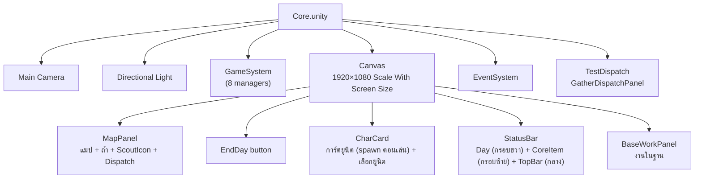

# clogged (Unity V2) — Core Scene Hierarchy

**Version:** 2.0 | **Last Updated:** 2026-10-14
> อธิบาย Hierarchy ทั้งหมดของ `Unity-Projects/Assets/V2/Scenes/Core.unity` — สร้างจากการ parse ไฟล์ scene จริง (GameObject, component, การอ้างอิงใน Inspector, prefab)
> ตรรกะของแต่ละระบบดู [Unity V2 System Design](04-unity-system-design.md) · class ดู [Unity V2 Class Diagram](05-unity-class-diagram.md)

## 1. ภาพรวม

Root object 6 ตัว แบ่งเป็น 3 กลุ่ม:

| Root | กลุ่ม | หน้าที่ |
|---|---|---|
| `Main Camera` | Rendering | กล้อง URP + AudioListener |
| `Directional Light` | Rendering | แสง URP (UI ล้วน จึงแทบไม่มีผล) |
| `GameSystem` | **Logic** | ที่รวม manager/controller ทั้งหมด (ไม่มีภาพ) |
| `Canvas` | **UI** | ทุกอย่างที่ผู้เล่นเห็นและกด |
| `EventSystem` | Input | ส่ง click ให้ UI (ใช้ **Input System package** — `InputSystemUIInputModule`) |
| `TestDispatch` | Logic ↔ UI | ถือ `GatherDispatchPanel` (UI controller ของการส่งสำรวจ) |



## 2. Hierarchy เต็ม

สัญลักษณ์: **ตัวหนา** = มี script ของ V2 · `[inactive]` = ปิดไว้ใน scene · `[PREFAB]` = prefab instance · ⟳ = ถูก spawn เพิ่มตอน runtime (ไม่อยู่ในไฟล์ scene)

```
Core.unity
├── Main Camera                      Camera, UniversalAdditionalCameraData, AudioListener
├── Directional Light                Light, UniversalAdditionalLightData
├── GameSystem                       (Transform เปล่า — ใช้จัดกลุ่ม)
│   ├── UnitManager                  **UnitManager**
│   ├── RunResources                 **RunResources**
│   ├── DayManager                   **DayManager**
│   ├── GatherDispatchController     **GatherDispatchController**
│   ├── GatherZoneDatabase           **GatherZoneDatabase**
│   ├── GatherMapController          **GatherMapController**
│   ├── BaseworkController           **BaseWorkController**
│   └── StavingController            **StarvationController**
├── Canvas                           Canvas (Screen Space - Overlay), CanvasScaler, GraphicRaycaster
│   ├── MapPanel                     Image  (เต็มจอ — พื้นที่แมป)
│   │   ├── [PREFAB] ScoutIcon       ← ScoutIcon.prefab  (**ScoutWalkerView**, UnitIconView, CanvasGroup)
│   │   ├── ⟳ Dungeon Prefab ×6      ← spawn โดย GatherMapController (**MapNodeView**) → ลูก `ZoneLabel` (สร้างตอน runtime)
│   │   ├── MessageUi                TextMeshProUGUI  (ข้อความผลการสำรวจ — ย้ายไปล่างกลางแล้ว)
│   │   └── Dispatch                 Button, Image, **ButtonVisual**   (ขวาล่าง)
│   │       ├── Text (TMP)           "Dispatch"
│   │       └── Icon                 Image [disabled]  (เตรียมไว้สลับเป็นรูป)
│   ├── EndDay button                Button → DayManager.EndDay(), Image, **ButtonVisual**  (ขวาล่าง)
│   │   ├── Text (TMP)               "EndDay"
│   │   └── Icon                     Image [disabled]  (เตรียมไว้สลับเป็นรูป)
│   ├── CharCard                     **UnitRosterView** (HorizontalLayoutGroup ถูกปิดตอน runtime)
│   │   └── ⟳ ScoutIcon(Clone) ×4    ← spawn โดย UnitRosterView (**UnitIconView**)
│   │       ├── Portrait             Image (สร้างตอน runtime)
│   │       ├── nametext             TextMeshProUGUI
│   │       ├── statustest           TextMeshProUGUI
│   │       └── Frame0..3            Image ×4 (กรอบสีแดง/เหลือง/เขียว/น้ำเงิน)
│   ├── StatusBar                    **StatusBarView** (HorizontalLayoutGroup เดิมปิดการใช้งาน — วางด้วย anchor)
│   │   ├── DayFrame                 (ขวาบน) กรอบดำ 4 เส้น 176×92
│   │   │   ├── DayBackground        Image ขาวโปร่ง 50%
│   │   │   ├── Day                  TextMeshProUGUI "DAY / 1 / 7 (n left)"
│   │   │   └── BorderTop/Bottom/Left/Right   Image ดำ 3px
│   │   ├── CoreItemGroup            (ซ้าย) 160×140
│   │   │   ├── CoreItem             TextMeshProUGUI "Core Item" + สถานะ
│   │   │   └── CoreItemFrame        กรอบดำ 4 เส้น 88×88
│   │   │       ├── CoreItemIcon     Image (placeholder สำหรับ sprite จริง)
│   │   │       └── BorderTop/Bottom/Left/Right   Image ดำ 3px
│   │   └── TopBar                   HorizontalLayoutGroup (กลาง)
│   │       ├── Food                 TextMeshProUGUI
│   │       ├── Medicine             TextMeshProUGUI
│   │       ├── CookingMaterial      TextMeshProUGUI
│   │       └── Materials            TextMeshProUGUI
│   ├── BaseWorkPanel                **BaseWorkPanel**, VerticalLayoutGroup, Image
│       ├── JobRow                   HorizontalLayoutGroup
│       │   ├── CookButton           Button → "Cook"
│       │   ├── HealButton           Button → "Heal"
│       │   └── WorkshopButton       Button → "Craft"
│       ├── WorkerLabel              TextMeshProUGUI "Worker"
│       ├── WorkerDropdown           TMP_Dropdown, LayoutElement
│       │   ├── Label, Arrow
│       │   └── Template [inactive]  ScrollRect (โครง dropdown มาตรฐานของ TMP)
│       │       ├── Viewport/Content/Item (Toggle + Item Background/Checkmark/Label)
│       │       └── Scrollbar/Sliding Area/Handle
│       ├── PatientRoot              VerticalLayoutGroup  (แสดงเฉพาะงาน Heal)
│       │   ├── PatientLabel         TextMeshProUGUI "Patient"
│       │   └── PatientDropdown      TMP_Dropdown (โครงเดียวกับ WorkerDropdown)
│       ├── RoundsRoot               HorizontalLayoutGroup  (แสดงเฉพาะ Cook/Craft)
│       │   ├── RoundsMinusButton    Button "-"
│       │   ├── RoundsText           TextMeshProUGUI "1"
│       │   └── RoundsPlusButton     Button "+"
│       ├── PreviewText              TextMeshProUGUI, LayoutElement  (ต้นทุน/ผลได้)
│       ├── ConfirmButton            Button "Confirm", LayoutElement
│       ├── MessageText              TextMeshProUGUI "Ready"  (ผลหลัง Confirm)
│   ├── WarningBackdrop              Image (ดำ a0.85), CanvasGroup  (ฉากหลังให้ WarningText อ่านง่าย)
│   └── WarningText                  **WarningView**, CanvasGroup, TextMeshProUGUI  (แบนเนอร์เตือนในเกม)
├── EventSystem                      EventSystem, InputSystemUIInputModule
└── TestDispatch                     **GatherDispatchPanel**
```

> หมายเหตุชื่อ: `BaseWorkPanel ` และ `JobRow ` ในไฟล์ scene มี **ช่องว่างท้ายชื่อ** ถ้าจะหาด้วย `GameObject.Find` ต้องระวัง (โค้ดปัจจุบันไม่ได้ใช้ `Find` จึงไม่มีผล)

## 3. รายละเอียดแต่ละส่วน

### 3.1 `GameSystem` — Logic layer

GameObject ลูกแต่ละตัวถือ singleton 1 ตัว ไม่มีภาพ ไม่มีลูก ค่าใน Inspector ณ ปัจจุบัน:

| GameObject | Component | ค่าใน Inspector | อ้างถึง |
|---|---|---|---|
| `UnitManager` | `UnitManager` | `units: []` → ใช้ roster default ในโค้ด (Ann, Boon, Cia, Dan) | — |
| `RunResources` | `RunResources` | food 8, cookingMaterial 2, medicine 1, materials 0, core item ปิดทั้งคู่ | — |
| `DayManager` | `DayManager` | currentDay 1, deadlineDay 7 | — |
| `GatherDispatchController` | `GatherDispatchController` | (ไม่มี field) | — |
| `GatherZoneDatabase` | `GatherZoneDatabase` | `zones: []` → ใช้ 3 zone default ในโค้ด | — |
| `GatherMapController` | `GatherMapController` | baseOffset (0, 10), nodesPerDifficulty 2, margin L120 / **R420** / **T200** / B330, baseClearRadius 180, candidatesPerNode 60 | `mapPanel` → `MapPanel`, `nodeViewPrefab` → `Dungeon Prefab.prefab`, `scoutWalker` → `ScoutIcon` (prefab instance) |
| `BaseworkController` | `BaseWorkController` | cook 1 AP / 1 วัตถุดิบ → 1 Food (2 ถ้าถนัด); heal 1 AP+ยา หรือ 2 AP; workshop 1 AP + 2 Materials → 1 Medicine | — |
| `StavingController` | `StarvationController` | foodCostPerFeed 1 | — (ยังไม่มี UI เรียก) |

> `marginRight` ใน scene = **420** (โค้ด default 120) — กันไม่ให้ถ้ำไปทับ `BaseWorkPanel` ที่อยู่ขอบขวา

ลำดับ `Awake` ของ singleton ไม่สำคัญ เพราะทุกตัวแค่ตั้ง `Instance` ใน `Awake` และ UI ไปอ่าน `Instance` ใน `Start` (ซึ่งรันหลัง `Awake` ทุกตัว)

### 3.2 `Canvas` — UI layer

- **Render Mode:** Screen Space - Overlay
- **CanvasScaler:** Scale With Screen Size, reference **1920×1080**, match 0.5 (width/height)

ตำแหน่งบนจอของแต่ละ panel (จาก anchor ของ RectTransform):

```
┌──────────────────── StatusBar (เต็มความกว้าง สูง 70) ─────────────┐
│ Core Item          Food  Medicine  CookingMaterial  Material  ┌───┐│
│ ┌──────┐                                                     │DAY││
│ │      │  (กรอบดำรอใส่ sprite)                                │1/7││
│ └──────┘                                                     └───┘│
│                MapPanel (เต็มจอ)                   ┌────────────┐│
│                                                    │BaseWorkPanel││
│        ● ถ้ำ ×6 (สุ่มตำแหน่ง)                     │ 320×500    ││
│                   ◆ ScoutIcon (กลางจอ = ฐาน)       │ ชิดขวา-กลาง ││
│                                                    └────────────┘│
│        [MessageUi]  ← ผลทอย/loot (ล่างกลาง y 306)                  │
│ ┌Ann┐┌Boon┐┌Cia┐┌Dan┐   [WarningText]       [EndDay ]            │
│ │   ││    ││   ││   │   (เตือน/error)       [Dispatch]           │
│ └───┘└────┘└───┘└───┘                                            │
└──────────────────────────────────────────────────────────────────┘
```

| GameObject | Anchor | หน้าที่ | ใครควบคุม |
|---|---|---|---|
| `MapPanel` | stretch เต็มจอ | พื้นแมป; เป็น parent ของถ้ำ, ScoutIcon, Dispatch, MessageUi | `GatherMapController` (spawn ถ้ำ, ใช้ rect คำนวณขอบเขตสุ่ม) |
| `MapPanel/ScoutIcon` | — | ไอคอนเดินจากฐานไปถ้ำแล้วกลับ | `GatherMapController` → `ScoutWalkerView.MoveTo` |
| `MapPanel/Dispatch` | ขวาล่าง (1,0) | ปุ่มส่งสำรวจ + `ButtonVisual` (สลับเป็นรูปได้) | `GatherDispatchPanel.dispatchButton` |
| `MapPanel/MessageUi` | ล่าง-กลาง (y 306) | ข้อความผลทอย/loot/trait + ข้อความเลือกยูนิต | `GatherDispatchPanel.messageText` |
| `EndDay button` | ขวาล่าง (1,0) y 104 | จบวัน + `ButtonVisual` (สลับเป็นรูปได้) | **ผูก onClick ใน Inspector** → `DayManager.EndDay()` (ปุ่มเดียวที่ผูกแบบนี้) |
| `CharCard` | ล่างซ้าย (40, 32) | **การ์ดยูนิต 4 ใบ** (195×265) — คลิกการ์ดเพื่อเลือก/ยกเลิก (≤ 2) | `UnitRosterView` (container = ตัวเอง) |
| `WarningBackdrop` | ล่าง-ขวา (x 880, y 60) 620×120 | แผงดำโปร่ง 85% หลังข้อความเตือน (fade พร้อมกัน) | `WarningView.backdropGroup` |
| `WarningText` | ล่าง-ขวา (x 880, y 60) 620×120 | แบนเนอร์เตือน: ตัวอักษรขาว, outline เปลี่ยนสีตามระดับ (เหลือง/แดง/ฟ้า) | `WarningView` |
| `StatusBar` | stretch เต็มความกว้าง (สูง 70) | HUD: `CoreItemGroup` (ซ้าย, มีกรอบดำรอใส่ sprite) / `TopBar` (กลาง: Food, Medicine, CookingMaterial, Materials) / `DayFrame` (ขวา, กรอบดำ) | `StatusBarView` |
| `BaseWorkPanel` | ขวา-กลาง | panel งานในฐาน | `BaseWorkPanel` (13 reference) |

ปุ่มอื่นทั้งหมด (`Dispatch`, `CookButton`, `HealButton`, `WorkshopButton`, `RoundsMinus/Plus`, `ConfirmButton`) **ไม่ได้ผูกใน Inspector** — script ผูกด้วย `onClick.AddListener` ใน `Start()`

### 3.3 การอ้างอิงใน Inspector ของ UI script

**`StatusBarView`** (บน `StatusBar`)

| Field | → GameObject |
|---|---|
| dayText | `StatusBar/DayFrame/Day` |
| foodText | `StatusBar/TopBar/Food` |
| cookingMaterialText | `StatusBar/TopBar/CookingMaterial` |
| medicineText | `StatusBar/TopBar/Medicine` |
| materialsText | `StatusBar/TopBar/Materials` |
| coreItemStatusText | `StatusBar/CoreItemGroup/CoreItem` |
| coreItemIcon / coreItemSprite | `StatusBar/CoreItemGroup/CoreItemFrame/CoreItemIcon` (placeholder ในกรอบดำ) |
| foodIcon / cookingMaterialIcon / medicineIcon / materialsIcon | ว่าง (0) — ยังไม่มีกรอบไอค่อนใน TopBar; ใส่ภายหลังได้โดยไม่ต้องแก้ layout |
| hideResourceLabelWhenIconSet | true — ถ้าใส่ sprite + icon ให้ช่องไหน จะซ่อนข้อความของช่องนั้น |

**`UnitRosterView`** (บน `CharCard`): container → `CharCard`, iconPrefab → `ScoutIcon.prefab` (การ์ดถูก restyle เป็นการ์ดตอน `Bind`)

**`GatherDispatchPanel`** (บน `TestDispatch`): dispatchButton → `MapPanel/Dispatch`, rosterView → `CharCard`, warningView → `WarningText`, messageText → `MapPanel/MessageUi`

**`WarningView`** (บน `WarningText`): label → `WarningText` (TMP), backdropGroup → `WarningBackdrop`, hold 2.5s / fade 0.3s; ตัวอักษรเป็นสีขาวคงที่ ส่วน outline (TMP material, width 0.28) เปลี่ยนสีตามระดับ — Warning เหลือง, Error แดง, Info ฟ้า

**`ButtonVisual`** (บน `Dispatch` และ `EndDay button`): iconImage → `<ปุ่ม>/Icon`, label → `<ปุ่ม>/Text (TMP)`; ค่าเริ่มต้นเป็นโหมด Label (แสดงข้อความ) — ใส่ sprite แล้วสลับ `mode` เป็น `Icon` ได้ทันทีโดยไม่ต้องแก้ onClick

**`BaseWorkPanel`** (บน `BaseWorkPanel`)

| Field | → GameObject |
|---|---|
| cookButton / healButton / workshopButton | `JobRow/CookButton` / `HealButton` / `WorkshopButton` |
| workerDropdown | `WorkerDropdown` |
| patientRoot / patientDropdown | `PatientRoot` / `PatientRoot/PatientDropdown` |
| roundsRoot | `RoundsRoot` |
| roundsMinusButton / roundsPlusButton / roundsText | `RoundsRoot/RoundsMinusButton` / `RoundsPlusButton` / `RoundsText` |
| previewText / messageText / confirmButton | `PreviewText` / `MessageText` / `ConfirmButton` |

`BaseWorkPanel.Start()` ตรวจ reference ทั้ง 13 ช่อง ถ้าขาดตัวใดจะ log error แล้วไม่ทำงานทั้ง panel

### 3.4 Prefab ที่ใช้ใน scene

| Prefab | โครงสร้างภายใน | ใช้ที่ |
|---|---|---|
| `V2/Prefabs/Dungeon Prefab.prefab` | `Dungeon Prefab` (Image, Button, **MapNodeView**) → ลูก `SelectedHighlight` (Image); `MapNodeView` สร้าง `ZoneLabel` (TMP) ตอน runtime แสดงชื่อโซน + AP กลางวงกลม (ชดเชย scale ที่ไม่เท่ากันของ prefab ด้วย localScale ผกผัน) | `GatherMapController` spawn 6 ตัวใต้ `MapPanel` ตอน `Start` (Easy/Normal/Hard อย่างละ 2, สีเขียว/เหลือง/แดง) |
| `V2/Prefabs/ScoutIcon.prefab` | `ScoutIcon` (Image, **ScoutWalkerView**, **UnitIconView**, CanvasGroup) → ลูก `nametext`, `statustest` (TMP) | (1) instance ใน scene ใต้ `MapPanel` = ไอคอนเดินทาง (2) `UnitRosterView` spawn 4 ตัวใต้ `CharCard` = การ์ดยูนิต |

> `ScoutIcon.prefab` ถูกใช้ **สองบทบาท** — ตัวที่เป็นไอคอนเดินทางมี `UnitIconView` ติดมาด้วยแต่ไม่เคยถูก `Bind` (จึงแสดงข้อความ default ของ prefab) ส่วนการ์ดยูนิตจะถูกแปลงเป็น card layout ตอน `Bind` (`UnitIconView` สร้าง `Portrait` + `Frame0..3` และย้าย text ใหม่ตอน runtime) ถ้าจะทำกราฟิกจริง ควรแยกเป็น 2 prefab (`ScoutIcon` กับ `UnitCard`)
> Frame สีประจำตัวเรียงตาม roster: **Ann = แดง, Boon = เหลือง, Cia = เขียว, Dan = น้ำเงิน** (แก้ได้ที่ `UnitRosterView.unitColors`)

## 4. สิ่งที่เกิดใน Hierarchy ตอนกด Play

```mermaid
sequenceDiagram
    participant GS as GameSystem/* (Awake)
    participant GMC as GatherMapController (Start)
    participant URV as UnitRosterView (Start)
    participant UI as UI panels (Start)

    GS->>GS: ตั้ง Instance ทุก singleton, UnitManager สร้าง roster 4 ตัว, GatherZoneDatabase สร้าง 3 zone
    GMC->>GMC: สุ่มตำแหน่ง 6 จุด → Instantiate Dungeon Prefab ใต้ MapPanel
    GMC->>GMC: ScoutIcon.SnapTo(ฐาน)
    URV->>URV: Instantiate ScoutIcon.prefab ×4 ใต้ CharCard → Bind(unit, สีกรอบ) → จัดวางการ์ดเอง
    UI->>UI: GatherDispatchPanel / BaseWorkPanel ผูก AddListener + subscribe event
    Note over UI: StatusBarView refresh ทุกเฟรม; UnitRosterView.Refresh() อัปเดตการ์ด + ตัดยูนิตที่เลือกไว้แต่วิ่งไม่ได้ออกจาก selection
```

## 5. ข้อสังเกตเกี่ยวกับ Hierarchy

- `TestDispatch` (ถือ `GatherDispatchPanel` ของจริง) ยังใช้ชื่อสมัยทดสอบและอยู่นอก `Canvas` ควรเปลี่ยนชื่อเป็น `GatherDispatchPanel` และย้ายไปไว้ใต้ `Canvas` หรือ `GameSystem` ให้เป็นกลุ่มเดียวกัน
- `StavingController` สะกดผิด (ควรเป็น `StarvationController`)
- Toggle `Ann…Dan` ถูก**ลบออกจาก scene แล้ว** — การเลือกยูนิตย้ายไปที่การ์ด `UnitIconView` ทั้งหมด
- `Dispatch` / `EndDay button` ถูกย้ายไปมุมขวาล่างชั่วคราว (ตำแหน่งยังไม่ final)
- `EndDay button` ไม่ถูกปิดเมื่อเกมจบ และไม่ถูกล็อกระหว่างทริป (ดู [04 §6](04-unity-system-design.md#6-known-gaps--technical-debt-สังเกตจากโค้ด-ณ-2026-10-14))
- ยังไม่มี GameObject สำหรับ: หน้าจอจบเกม (Win/Lose), ปุ่มให้อาหาร (`StarvationController`), animation ทอยเต๋า (`DiceRollView`)

## Related Documents
- [Unity V2 System Design](04-unity-system-design.md)
- [Unity V2 Class Diagram](05-unity-class-diagram.md)
