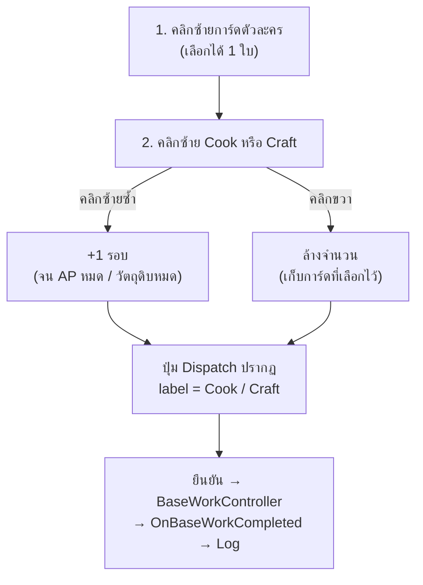
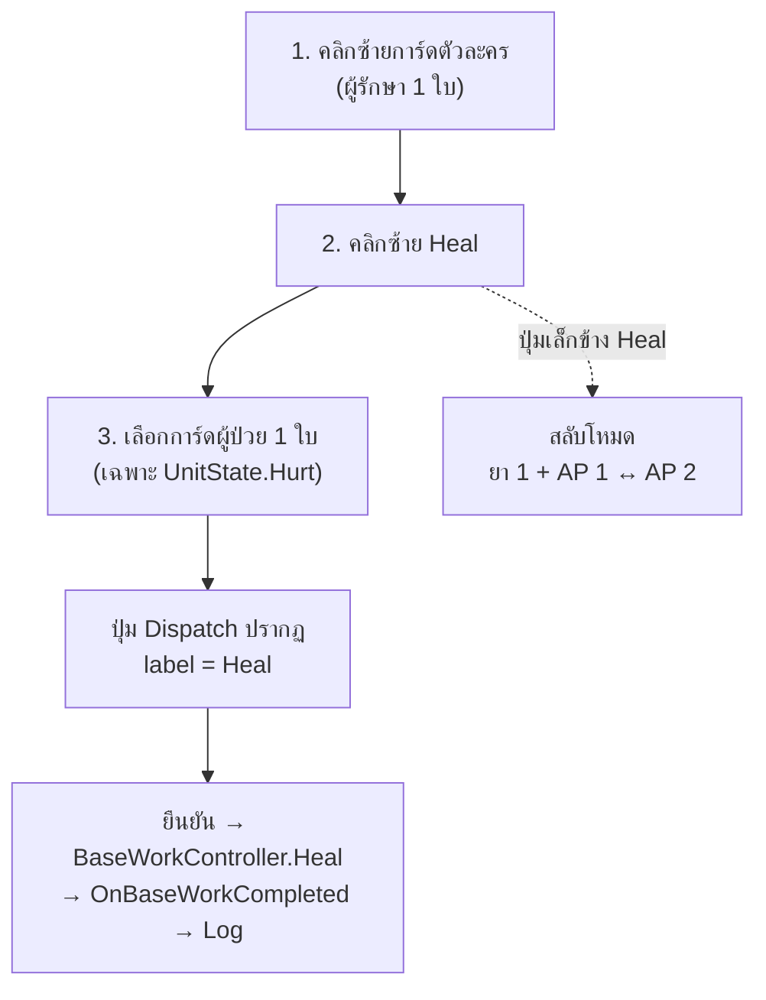
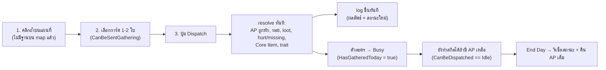

# clogged (Unity V2) — UI Layout Redesign Spec

**Version:** 0.22 (Draft) | **Last Updated:** 2026-10-28 | **Status:** ✅ P0–P5 เสร็จครบ · แก้ bug DayFrame click (§7.11) · รวมชุดทดสอบเหลือไฟล์เดียว (§7.12) · ไฮไลต์คนที่รักษาได้ (§7.13) · ฟอนต์จาก tileset (§7.14) · เปลี่ยน TMP ทั้ง V2 UI (§7.15) · จัดกลุ่ม `Warning` ให้ตรงกัน (§7.16) · สี Warning = สี log (§7.17) · รอ final review
**ที่มา:** แบบร่างกระดาษ 3 โซน + คำอธิบายผู้พัฒนา (2026-10-27)
> เอกสารนี้แปลงแบบร่างเป็นสเปกที่ลงมือได้ — §7.5–§7.9 คือสถานะที่ลงมือจริงแล้ว
> ประกอบ: [Unity V2 System Design](04-unity-system-design.md) · [Core Scene Hierarchy](06-unity-core-scene-hierarchy.md) · [V2 Task Overview](../agile/user-stories/V2-TASK-OVERVIEW.md) · [GDD Mechanics](../gdd/01-mechanics.md)

---

## 1. ที่มาและปัญหาที่ต้องแก้

| # | ปัญหา | รายละเอียด |
|---|---|---|
| P-1 | **ตำแหน่ง UI สลับกันในบิลด์ที่นำเสนอ** | `WarningText` ไปแสดงข้าง `CharCard` และ `MessageUi` ไปแสดงกลางจอ (ที่ถูก: warning กลางจอ, message ช่องว่างด้านขวาของการ์ด) |
| P-2 | **คำสั่งซ้ำซ้อน 2 ระบบ** | `BaseWorkPanel` (ปุ่มงาน + dropdown + Confirm) ทำงานซ้ำกับ flow การส่งสำรวจ (เลือกการ์ด → ยืนยัน) ผู้เล่นต้องเรียนรู้ 2 ภาษา interaction |
| P-3 | **ไม่มีประวัติการกระทำ** | ผลของทริป/งานในฐาน/การแจ้งเตือน เขียนทับกันใน `MessageUi` บรรทัดเดียว ผู้เล่นย้อนดูไม่ได้ |
| P-4 | **ปุ่มหลักจม** | `Dispatch` / `EndDay` ถูกย้ายไปมุมขวาล่างชั่วคราว ขนาดเล็ก ไม่มีที่ใส่ภาพ |
| **P-5** | **Core Item มีชิ้นเดียวในโค้ด + บังคับลำดับดรอป** | ดีไซน์ต้องการ 2 ชิ้น (A = ใช้ escape, B = key) แต่ `RunResources` มีแค่ flag เดี่ยว `hasCoreItemUnlock` + `hasCoreItem` และต้องได้ key ก่อนจึงจะดรอปชิ้นหลักได้ |

---

## 2. ขอบเขต

**อยู่ในขอบเขต**

- Layout ใหม่ทั้งจอ (Canvas) ตามแบบร่าง B
- WarningText / Log / CoreItemGroup / DayFrame / CharacterCard / Dispatch / SkillTriggerPanel
- Interaction model ใหม่: คลิกซ้าย = select/เพิ่มจำนวน, คลิกขวา = ล้างจำนวน
- เปลี่ยน `BaseWorkPanel` → **Skill Trigger** (Cook / Heal / Craft)
- โมเดล Core Item 2 ชิ้น + เงื่อนไขชนะ/แพ้

**ไม่อยู่ในขอบเขต (คงเดิม)**

- ระบบทอยเต๋า `DiceRollView` (ยกเว้นข้อความที่ส่งเข้า log)
- ตรรกะ `GatherResolver`, `GatherDispatchController`, `GatherZoneDatabase`
- ภาพศิลป์/เสียง (ใช้ placeholder ไปก่อน)
- หน้าจอจบเกม `RunEndPanel` (มีอยู่ใน [US-V2-UI-01](../agile/user-stories/US-V2-UI-01.md) แล้ว — สเปกนี้แค่ผูก event)

---

## 3. Layout ใหม่

### 3.1 แผนผังโซน (อ้างอิง Canvas 1920×1080)

```
┌──────────────────────────────────────────────────────────────────────────┐
│ [CoreItemA][CoreItemB]   [Food][Med][CM][Mat] (กลางบน คงเดิม)  [ DAY 3 / 7 ]│
│        (บนซ้าย)                                 (บนขวา, คลิกที่ Day = จบวัน) │
│                                                                          │
│                    ┌────────────────────────────┐                        │
│                    │   ⚠ Warning (กลางจอ)        │                       │
│                    └────────────────────────────┘                        │
│                                                                          │
│            ┌───────────────────────────────────────┐                     │
│            │        MAP AREA (เดิม)                 │   ┌───────────────┐ │
│            │         แผนที่ + ถ้ำเท่านั้น            │   │ Cook      [2] │ │
│            └───────────────────────────────────────┘   │ Heal [MED]    │ │
│  ┌──────────────┐                                      │ Craft     [1] │ │
│  │ LOG   [–]    │      ┌────┐┌────┐┌────┐┌────┐        │               │ │
│  │ ...          │      │card││card││card││card│        │  ┌─────────┐  │ │
│  │ บรรทัดล่าสุด  │      └────┘└────┘└────┘└────┘        │  │DISPATCH │  │ │
│  └──────────────┘        CharacterCard (มือไพ่)         │  └─────────┘  │ │
│   (ล่างซ้าย — ห้ามสูง    (ล่างกลาง)                      │    (ขวา/ล่างขวา) │
│    ล้ำเข้า MAP AREA)                                                     │
└──────────────────────────────────────────────────────────────────────────┘
```

### 3.3 ตัวเลข layout ที่ล็อกไว้ (อ้างอิง Canvas 1920×1080)

| Panel | anchorMin/Max | pivot | anchoredPosition | size |
|---|---|---|---|---|
| `LogPanel` | (0,0) | (0,0) | (24, 24) | 700 × 300 |
| `CharacterHandPanel` | (0.5, 0) | (0.5, 0) | (**190**, 20) | **830** × 300 |
| `SkillTriggerPanel` | (1, 0) | (1, 0) | (−24, 244) | 236 × 300 |
| `DispatchActionPanel` | (1, 0) | (1, 0) | (−24, 24) | 300 × 200 |
| `Warning` | (0.5, 0.5) | (1, 1) | (300, 60) | **620 × 120** |
| `Warning/WarningBackdrop` | stretch | (0.5, 0.5) | (0, 0) | inset 0 |
| `Warning/WarningText` | stretch | (0.5, 0.5) | (0, 0) | inset 8 / 6 |

- การ์ดในมือ: **195 × 265**, spacing **12** → 4 ใบ = 816 px พอดีกับพื้นที่ 830 px
- เหตุผลที่ hand เยื้อง +190: พื้นที่ว่างจริงคือระหว่าง Log (จบที่ x = 724) กับ Dispatch (เริ่มที่ x = 1596) → จุดกึ่งกลาง = 1148 = 960 + 188, ปัดเป็น +190 ให้เหลือขอบเท่ากันสองข้าง
- ช่องไฟ: Log→การ์ด 24 px · การ์ด→Dispatch 48 px → ไม่มีอะไรทับกัน
- **MAP AREA:** `GatherMapController` กัน node ไว้ด้วย margin L150 / R**400** / T**300** / B420 (นับครึ่งความสูงของ portal ~65 px แล้ว) → ไม่มีถ้ำไปอยู่ใต้ Log / มือการ์ด / คอลัมน์สกิล / DayFrame · ค่า R400/T300 ปรับเพิ่มใน §7.11 เพราะ rect ของถ้ำยังคาบเกี่ยวกรอบ DAY

### 3.4 ป้ายบนปุ่มสลับโหมด Heal

ใช้ข้อความ **`MED`** (ใช้ยา 1 + AP 1) / **`AP`** (ใช้ 2 AP) แทนไอคอนลูกศร เพราะ TMP atlas เริ่มต้นไม่มี glyph `⇄` (ทดสอบแล้วขึ้นเป็นสี่เหลี่ยมว่าง)

### 3.2 ตารางเทียบกับของเดิม

| โซนใหม่ | ของเดิม | สิ่งที่เปลี่ยน |
|---|---|---|
| บนซ้าย `CoreItemGroup` | `Canvas/StatusBar/CoreItemGroup/CoreItem` | **1 ช่อง → 2 ช่อง** (`CoreItemA`, `CoreItemB`) |
| บนกลาง `ResourceStrip` | `Canvas/StatusBar/TopBar` (Food/Medicine/CookingMaterial/Materials) | **คงตำแหน่งเดิม (กลางบน)** ไม่ย้าย |
| บนขวา `DayFrame` | `Canvas/StatusBar/DayFrame` + `Canvas/EndDay button` | รวมปุ่ม End Day เข้า DayFrame → **คลิกที่ Day = จบวัน** |
| กลางจอ `Warning` | `Canvas/WarningText` + `WarningBackdrop` | **รวมเป็น group เดียว** (`Warning` ถือ CanvasGroup + `WarningView`), คงตำแหน่งกลางจอ, **แสดงเฉพาะ Error** |
| ล่างซ้าย `LogMessagePanel` | `Canvas/MapPanel/MessageUi` | **ของใหม่** — log มี history, minimize ได้ |
| ล่างกลาง `CharacterHandPanel` | `Canvas/CharCard` | ย้ายมาล่างกลาง, ทำเป็นมือไพ่ |
| ขวา `SkillTriggerPanel` | `Canvas/BaseWorkPanel` | **Rework** เป็นปุ่มสกิล + queue |
| ล่างขวา `DispatchActionPanel` | `Canvas/MapPanel/Dispatch`, root `TestDispatch` | ขยายใหญ่ขึ้น, มีที่ใส่รูป, **ซ่อนเมื่อยังไม่ใช้งาน** |
| กลาง-บน `MapPanel` | `Canvas/MapPanel` | คงไว้ — เหลือแค่พื้นหลัง + ถ้ำ (ลบ `MessageUi`/`Dispatch`/`ScoutIcon` ออกแล้ว) |

---

## 4. สเปกองค์ประกอบ

### 4.1 `Warning` — เตือนเฉพาะที่ทำไม่ได้

| หัวข้อ | สเปก |
|---|---|
| ตำแหน่ง | กลางจอ (เหนือ map area) |
| แสดงเมื่อ | **เฉพาะการกระทำที่ทำไม่ได้** — บันทึกเป็น `LogKind.Warning` ทั้งใน log และบนแบนเนอร์ |
| ตัวอย่าง | เลือกการ์ดตัวที่ 3 (เกิน limit), AP ไม่พอ, Cooking Material / Materials ไม่พอ, กด Heal ตอนไม่มีคนบาดเจ็บ, ยืนยันโดยยังไม่เลือกผู้ป่วย |
| ข้อความทั่วไป/ข้อมูล | **ไม่ขึ้น warning** → ลง log เท่านั้น |
| พร้อม log | ทุกครั้งที่ขึ้น warning ต้องมี log entry ชนิดเดียวกันด้วย |
| สี | **อ่านจาก `UiPalette.For(kind)` ตัวเดียวกับ log** — ข้อความบนแบนเนอร์จึงเป็นสีเดียวกับบรรทัดใน log เป๊ะ (เดิมข้อความขาวล้วน + outline แยกชุดสีของตัวเอง) |
| Animation | **คงของเดิม** — fade in 0.3s → hold 2.5s → fade out 0.3s, คิวทีละข้อความ |
| โครงสร้าง | group `Warning` (CanvasGroup + `WarningView`) → `WarningBackdrop` (Image, stretch เต็ม) + `WarningText` (TMP, stretch inset 8/6) — ดู §7.16 |
| API | `WarningView.Show(text, LogKind kind)` — kind ตัวเดียวตัดสินทั้งสีและคู่ log (ไม่มี enum ที่สองแล้ว) — ดู §7.17 |

### 4.2 `LogMessagePanel` — ประวัติการกระทำ (ล่างซ้าย)

| หัวข้อ | สเปก |
|---|---|
| ตำแหน่ง | **มุมล่างซ้ายเท่านั้น** — ขอบบนของ panel **ต้องไม่สูงล้ำเข้าเขต MAP AREA** |
| ความสูง | ล็อกด้วยพื้นที่ว่างที่เหลือใต้ MAP AREA (ไม่ใช่จำนวนบรรทัดคงที่) |
| ลำดับ | **ใหม่สุดอยู่บรรทัดล่างสุด** แล้วดันของเก่าขึ้น (chat style), auto-scroll ลงล่าง |
| ความจุ (memory) | เก็บ **16 entry ล่าสุด** (`RunLog.Capacity` = 16) |
| แสดงผล | **แสดงเท่าที่ช่องใส่ได้จริง** — ถ้าพื้นที่ใส่ได้ 6 บรรทัด ก็แสดง 6 บรรทัดล่าสุด ที่เหลือเลื่อนดูด้วย scroll |
| Minimize | ปุ่มย่อ → เหลือ **บรรทัดล่าสุดบรรทัดเดียว**; กางกลับได้ |
| เนื้อหา | ทุก action ของผู้เล่น + ผลลัพธ์ + warning + เหตุการณ์วันเปลี่ยน |
| รูปแบบบรรทัด | `[วันที่] [ไอคอน] ข้อความ` — สีตามชนิด (ปกติ/สำเร็จ/ล้มเหลว/เตือน) |
| ชนิด entry | `LogKind { Action, Success, Fail, Warning, DayEnd, System }` |

**แหล่งข้อมูลที่ต้องต่อเข้า log**

| แหล่ง | event/จุดเรียก | สถานะปัจจุบัน |
|---|---|---|
| งานในฐาน (Cook/Heal/Craft) | `BaseWorkController.OnBaseWorkCompleted` (contract C1) | ✅ ต่อแล้ว (P2) |
| ทริปสำรวจ | `GatherDispatchController.OnGatherResolved` | ✅ ต่อแล้ว — loot/tier/hurt/missing/Core Item |
| ข้อมูลถ้ำที่เลือก | `GatherMapController.OnSelectionChanged` | ✅ ต่อแล้ว (P5) — AP/unit, success value, loot |
| trait ที่ได้จากทริป | `GatherDispatchPanel` เทียบ traits ก่อน/หลัง | ✅ ต่อแล้ว (P5) |
| Warning | `WarningView.Show*` | ✅ เรียกคู่กับ `RunLog.Add(LogKind.Warning, …)` ทุกจุด |
| จบวัน/กินอาหาร/อดอาหาร | `DayManager.OnDayEnded` (contract C4) | ✅ ต่อแล้ว (P2) |
| Core Item ได้รับ | `RunResources` (C7 `OnChanged` หรือ method ใหม่) | ✅ ผ่าน `GatherDispatchResult.coreItemsObtained` |

### 4.3 `CoreItemGroup` — 2 ช่อง

| ช่อง | ชื่อ field ใหม่ | ความหมาย | ที่มา |
|---|---|---|---|
| ช่องที่ 1 | `CoreItemA` | **ชิ้นที่ใช้ escape** | drop จาก dungeon (อิสระ) |
| ช่องที่ 2 | `CoreItemB` | **key** (ต้องมีครบทั้งคู่จึงใช้ escape ได้) | drop จาก dungeon (อิสระ) |

- **2 สถานะต่อช่อง** (ตัด `Unlocked` ออก เพราะไม่มีการดรอปแบบมีเงื่อนไขแล้ว): `NotObtained` / `Obtained`
- ไฮไลต์เมื่อได้ครบทั้ง 2 (แจ้งเตือนภาวะชนะ)
- **Win = มีครบ A + B**
- **ไม่มีลำดับการดรอป** — A และ B สุ่มแยกกัน อันไหนก่อนก็ได้ (B ไม่ใช่เงื่อนไขให้ A ดรอป)

### 4.4 `DayFrame` — รวม End Day

| หัวข้อ | สเปก |
|---|---|
| เนื้อหา | `DAY n / deadline` + จำนวนวันเหลือ (เหมือน `StatusBarView.RefreshDay`) |
| อินพุต | **คลิกที่ frame = `DayManager.EndDay()`** (ไม่มีปุ่ม End Day แยก) — implement ด้วย `EndDayTrigger` (`IPointerClickHandler`) บน `DayFrame` |
| **พื้นผิวที่กดได้** | **ต้องมี Graphic ที่ `raycastTarget = true` อยู่ใต้ `DayFrame`** — ตัวที่ใช้คือ `DayBackground` (ปิด `Day`/border ไม่ให้แย่งคลิก) · `EndDayTrigger.EnsureClickSurface()` เติม transparent hit area ให้เองถ้าไม่มี และเตือนใน console |
| **ห้ามมีถ้ำอยู่ใต้ frame** | `GatherMapController` margin ต้องกัน rect ของ node (160×30) ออกจากกรอบ — ปัจจุบัน `marginRight = 400`, `marginTop = 300` |
| สถานะปิด | **run จบแล้วเท่านั้น** (ไม่มีสถานะ "ระหว่างทริป" เพราะทริป resolve ทันที) — `EndDayTrigger` เช็ค `DayManager.Outcome != InProgress` แล้วขึ้น warning "The run is already over." + log |
| คำเตือนก่อนจบวัน | **ไม่มี confirm dialog** — คลิกเดียวจบวันทันที (ผลการกิน/AWOL ลง log หลังจบวัน) |

### 4.5 `CharacterHandPanel` — การ์ดตัวละครล่างกลาง

| หัวข้อ | สเปก |
|---|---|
| รูปแบบ | "มือไพ่" เรียงแนวนอนกลางจอ |
| ข้อมูลบนการ์ด | ชื่อ + พอร์เทรต, **AP (pips/ตัวเลข)**, สถานะ, ความหิว, ป้าย "ออกสำรวจแล้ววันนี้" |
| อินพุต | **คลิกซ้าย = เลือก** (ไฮไลต์กรอบ), คลิกซ้ายซ้ำ = ยกเลิก |
| ใช้ร่วม | ทั้ง flow **dispatch** และ **skill trigger** (ภาษา interaction เดียวกัน) |
| จำนวนที่เลือกได้ | dispatch = **2** · skill = **1 ใบ** |
| **เงื่อนไขเลือกได้ขึ้นกับโหมด** | **Dispatch / Skill ใช้กฎเดียวกัน: `CanBeDispatched` (`state == Idle`)** — ต่างกันแค่จำนวนที่เลือกได้ · **unit ที่ "busy" (ออกสำรวจแล้ววันนี้) จึงยังเลือกทำสกิลได้ถ้ามี AP เหลือ** · **HealTarget:** เฉพาะ `UnitState.Hurt` (โหมดที่ 3 เกิดหลังกด Heal) — เหตุผลที่เปลี่ยนจากเดิมดู §7.8 |
| แสดงสถานะ Busy | การ์ดที่ `HasGatheredToday == true` ติดป้าย "ออกสำรวจแล้ววันนี้" (สีต่างจากปกติ) แม้ยังมี AP |
| ปุ่มให้อาหาร | คงไว้ตาม [US-V2-UI-01](../agile/user-stories/US-V2-UI-01.md) U1 (ไม่กระทบสเปกนี้) |
| ของเดิมที่ใช้ต่อ | `UnitRosterView` / `UnitIconView` (การ์ด 195×265 — ปรับขนาดเป็นไพ่) |

### 4.6 `DispatchActionPanel` — ปุ่มยืนยัน (ล่างขวา)

| หัวข้อ | สเปก |
|---|---|
| ขนาด | ใหญ่ขึ้น มีช่องใส่ภาพ/ไอคอน |
| **ซ่อนเมื่อยังไม่ใช้งาน** | ซ่อนเมื่อไม่มีการ์ดถูกเลือกเลย (queue เดี่ยว ๆ ไม่มีอยู่จริง เพราะ counter ผูกกับการ์ดที่เลือก) |
| แสดงเมื่อ | มีการ์ดที่เลือกอย่างน้อย 1 ใบ — โหมดสำรวจ = `DISPATCH`, โหมดสกิล = `COOK` / `CRAFT` / `HEAL` |
| Label | เปลี่ยนตามบริบท: `Dispatch` (โหมดสำรวจ) / `Cook` / `Heal` / `Craft` (โหมดสกิล) |
| ปิดการใช้งาน | เงื่อนไขไม่ครบเท่านั้น (Heal ยังไม่เลือกผู้ป่วย, ไม่มีถ้ำที่เลือก, AP ไม่พอ) — **ไม่มี `TripInProgress` แล้ว** |
| ข้อความ/ไอคอน | ใช้ `ButtonVisual` เดิมสลับข้อความ ↔ sprite |

### 4.7 `SkillTriggerPanel` — แทน `BaseWorkPanel` (คอลัมน์ขวา)

| ปุ่ม | พฤติกรรม |
|---|---|
| **Cook** | คลิกซ้าย = queue +1 รอบ (1 AP); คลิกซ้ำ = เพิ่มจำนวน · **คลิกขวา = ล้างจำนวน** |
| **Craft** | เหมือน Cook ทุกข้อ |
| **Heal** | **ไม่มี queue** — คลิกซ้ายครั้งเดียว = เลือกสกิล Heal แล้วรอเลือกผู้ป่วย · **disabled ทั้งปุ่มถ้าไม่มีคนบาดเจ็บเลย** |

| หัวข้อ | สเปก |
|---|---|
| ตำแหน่ง | คอลัมน์ขวา **แสดงตลอด** (ไม่ซ่อนตามบริบท) |
| ตัวเลข queue | **แสดงบนปุ่ม Cook / Craft เท่านั้น** — ปุ่ม Heal ไม่มีตัวเลข (ไม่มีการนับรอบ) |
| เพดานจำนวน | **จน AP ของตัวละครที่เลือกหมด** (ไม่ใช้ค่าคงที่รายรอบ) + หยุดเมื่อวัตถุดิบหมด |
| วัตถุดิบไม่พอ | **หยุด queue** (ไม่เพิ่ม) + warning + log |
| Heal — 2 โหมด | ปุ่มเล็กข้างปุ่ม Heal สลับ `ยา 1 + AP 1` ↔ `AP 2` (ปุ่มเดียว ไม่มี queue) |
| Heal — ผู้ป่วย | หลังกด Heal **ต้องเลือกผู้ป่วย 1 คน** จาก `CharacterHandPanel` (**เฉพาะตัวที่ `UnitState.Hurt`**) |
| Heal — จำนวน | **1 ครั้งต่อ 1 การยืนยัน** (ไม่มีรอบ/ไม่มีคิว) |
| ไม่มี state "สกิลที่เลือก" | เก็บแค่ **การ์ดที่เลือก** + counter ของ Cook/Craft (Heal ไม่มี counter) |
| ของเดิมที่นำกลับมาใช้ | ตัวเลข/เงื่อนไขทั้งหมดอ่านจาก `BaseWorkController` (`CookApPerRound`, `GetMaxCookRounds`, `GetHealPlan`, `WorkshopApPerRound`, …) — ห้าม hard-code ใน UI |

> **ต้องแก้ `BaseWorkController` เพิ่ม (P4):** ตอนนี้ `GetHealPlan` / `Heal` เลือกยาให้อัตโนมัติถ้ามียาในคลัง — แต่ UI มี toggle ให้ผู้เล่นเลือกโหมด จึงต้องเพิ่ม overload ที่รับ mode ชัดเจน เช่น
> `GetHealPlan(UnitCharacter healer, bool useMedicine, out int apCost)`, `CanHeal(healer, patient, bool useMedicine)`, `Heal(healer, patient, bool useMedicine)` โดยคง signature เดิมไว้เป็น wrapper

---

## 5. Interaction Model (normalize ทั้งเกม)

| อินพุต | บนการ์ดตัวละคร | บนปุ่ม Cook / Craft | บนปุ่ม Heal | บนปุ่ม Dispatch |
|---|---|---|---|---|
| **คลิกซ้าย** | เลือก / ยกเลิกการเลือก | เพิ่มจำนวน +1 | เลือกโหมด Heal (ครั้งเดียว) | ยืนยันการกระทำ |
| **คลิกซ้ายซ้ำ** | สลับ selected | เพิ่มจำนวนต่อ | — | — |
| **คลิกขวา** | (ไม่กระทำ) | **ล้างจำนวน** | ยกเลิกโหมด Heal | (ไม่กระทำ) |

> คลิกขวา **ไม่** ล้างการ์ดที่เลือก — ล้างเฉพาะจำนวน (Cook/Craft) หรือยกเลิกโหมด Heal

---

## 6. Flow

### 6.1 โหมด Cook / Craft (มี queue)



### 6.2 โหมด Heal (ไม่มี queue)



> ปุ่ม Heal ไม่มีตัวเลข/ไม่มีการนับรอบ — 1 การยืนยัน = 1 ครั้ง

### 6.3 โหมดสำรวจ (ไม่มีเวลาเดินทาง)



**กติกาที่ล็อกแล้ว**

| ข้อ | กติกา |
|---|---|
| เวลาทริป | **0** — ไม่มีเดินทางไป-กลับ, ไม่มีอนิเมชันกัน UI |
| ลำดับ | คลิกยืนยัน → คำนวณผลทั้งหมด → เขียน log **ในเฟรมเดียวกัน** |
| สถานะหลัง dispatch | `HasGatheredToday = true` (busy) · `state` กลับเป็น `Idle` ถ้ายังมี AP, `Resting` ถ้า AP หมด |
| ส่งซ้ำวันเดียว | ไม่ได้ (`CanBeSentGathering` false) |
| ใช้สกิลต่อ | **ได้** ถ้า `state == Idle` และ AP พอ |
| End Day | กดได้ทุกเมื่อ ไม่ผูกกับทริป — รีเซ็ต `HasGatheredToday`, คืน AP, ปลด `Resting` |
| `TripInProgress` | **ไม่มีแล้ว** — ลบออกจาก `GatherMapController` และ UI ทั้งหมด |

> **ต้องประสานกับกลุ่ม 2 (contract C3):** `GatherMapController.ConfirmTrip` ต้องเรียก `Dispatch()` แล้วยิง `OnTripResolved` ทันที (ไม่ผ่าน `ScoutWalkerView`) · `ScoutIcon` บน `MapPanel` และ `ScoutWalkerView` ไม่มีบทบาทแล้ว (ลบตอน P5) · ต้องอัปเดต C3 ใน [V2 Task Overview](../agile/user-stories/V2-TASK-OVERVIEW.md)

---

## 7. การเปลี่ยนข้อมูลและตรรกะ

### 7.1 `RunResources` — Core Item 2 ชิ้น

| เดิม | ใหม่ |
|---|---|
| `bool hasCoreItemUnlock` (key) | `bool coreItemB` |
| `bool hasCoreItem` (escape item) | `bool coreItemA` |
| `HasCoreItemUnlock`, `HasCoreItem` | `HasCoreItemA`, `HasCoreItemB`, **`HasBothCoreItems`** |
| `UnlockCoreItemMaterial()` | `ObtainCoreItemB()` |
| `ObtainCoreItem()` (เฉพาะ `coreItemB` ได้แล้ว ไม่มีเงื่อนไขลำดับ) | `ObtainCoreItemA()` (เฉพาะ `coreItemA` ยังไม่มี ไม่มีเงื่อนไขลำดับ) |

> **ไม่มีลำดับการดรอป:** ทั้ง A และ B สุ่มดรอปได้อิสระจากกัน อันไหนก่อนก็ได้ ไม่มี precondition ต่อกัน
> การดรอปย้ายไปเป็น **ตารางข้อมูลในโซน** — ดู §7.2
> `GatherDispatchResult` มี field `unlockedCoreItemMaterial` / `obtainedCoreItem` → เปลี่ยนเป็น **`List<CoreItemKind> coreItemsObtained`** (ทริปเดียวอาจได้ทั้ง 2 ชิ้น) เพื่อให้ log เขียนถูกชิ้น

### 7.2 `GatherZoneConfig` — Core Item chance (แบบ 2)

ย้ายจุดดรอปจาก `if/else` ผูกโซนใน `GatherDispatchController.HandleCoreItemProgress()` มาเป็น **ตัวเลขใน config ของโซน** — ปรับใน Inspector ได้ และทำให้ Hard มีโอกาสมากกว่า Normal ตามที่ต้องการ

> **อ้างอิง:** main loot ของแต่ละโซนคือ `CookingMaterial` (Easy) / `Medicine` (Normal) / `Materials` (Hard) + `hardSuccessBonusPool` — **Core Item เป็นของแยกจาก main loot** ไม่ได้อยู่ใน loot pool

```csharp
public enum CoreItemKind { A, B }

public class GatherZoneConfig
{
    // ...ของเดิม...

    [Range(0, 100)]
    [Tooltip("โอกาส (%) ที่จะเจอ Core Item 1 ชิ้น เมื่อทริปจบด้วย HardSuccess")]
    public int coreItemChancePercent;
}
```

#### ค่าเริ่มต้นที่เสนอ (tunable)

| Zone | `coreItemChancePercent` | หมายเหตุ |
|---|---|---|
| Easy | **0%** | โซนง่าย ไม่ให้ของสำคัญ |
| **Normal** | **5%** | ต้องพึ่งดวง |
| **Hard** | **15%** | **สูงกว่า Normal 3 เท่า** แลกกับ SV ต่ำ + Fumble เสียยูนิต |

> ตัวเลขนี้คือ **"โอกาสเมื่อทอยได้ HardSuccess"** ไม่ใช่โอกาสต่อทริปตรง ๆ — เพราะ Core Item ดรอปเฉพาะ HardSuccess เท่านั้น (ดูตารางถัดไป)

#### อัตราจริงต่อทริป (ส่ง 2 คนถนัดโซน, ยังไม่มี trait)

| Zone | SV | P(HardSuccess) | ยังไม่มีทั้ง A,B | มีอยู่แล้ว 1 ชิ้น | ได้อย่างน้อย 1 ชิ้น/ทริป |
|---|---|---|---|---|---|
| Normal | 90 | 45% | 9.75% | 5% | 45% × 9.75% ≈ **4.4%** |
| Hard | 65 | 32% | 27.75% | 15% | 32% × 27.75% ≈ **8.9%** |

- คอลัมน์ "ยังไม่มีทั้ง A,B" = `1 − (1 − p)²` เพราะ **ทอยแยกอิสระต่อชิ้น**
- คอลัมน์สุดท้ายคือตัวเลขที่ผู้เล่นรู้สึกจริง = **Hard ≈ 8.9% > Normal ≈ 4.4%** (ประมาณ 2 เท่า)

#### กติกาการทอย (ตกลงแล้ว)

| ข้อ | กติกา |
|---|---|
| **ทอยเมื่อไหร่** | **เฉพาะ tier `HardSuccess`** — `Regular` / `Failure` / `Fumble` **ไม่ดรอป** |
| จำนวนครั้ง | ทอยแยก **ต่อชิ้น** (A 1 ครั้ง, B 1 ครั้ง) ต่อ 1 ทริป — ไม่ทอยซ้ำถ้าทริปเดียวมีหลายยูนิต |
| ยังไม่มีทั้ง A และ B | **ทอยทั้ง A และ B** |
| มี A แล้ว ไม่มี B | **ทอยเฉพาะ B** (ข้าม A) |
| มี B แล้ว ไม่มี A | **ทอยเฉพาะ A** (ข้าม B) |
| มีครบทั้ง A และ B | **ไม่ทอยเลย** |
| จำนวนที่ได้ | 1 ชิ้นต่อชิ้นต่อทริป (ทริปเดียวได้มากสุด 2 ชิ้น = ครบพอดี) |
| หลังทอย | ถ้าครบทั้ง 2 → `DayManager.CheckImmediateWin()` **ครั้งเดียว** (ไม่ใช่ต่อชิ้น) |
| log | เขียน 1 บรรทัดต่อชิ้นที่ได้ เช่น `ได้รับ Core Item A` |

#### จุดแก้ใน `ApplyOutcome`

```text
เดิม  : case HardSuccess: ... HandleCoreItemProgress(zone, result);
ใหม่  : case HardSuccess: ... TryRollCoreItems(config, result);   // ไม่รับ tier แล้ว เพราะRegular ไม่ดรอป
        (ลบ HandleCoreItemProgress ทั้ง method)
```

```csharp
private void TryRollCoreItems(GatherZoneConfig config, GatherDispatchResult result)
{
    foreach (CoreItemKind kind in new[] { CoreItemKind.A, CoreItemKind.B })
    {
        if (RunResources.Instance.HasCoreItem(kind)) continue;          // ข้ามชิ้นที่มีแล้ว

        if (UnityEngine.Random.Range(0, 100) >= config.coreItemChancePercent) continue;

        RunResources.Instance.ObtainCoreItem(kind);
        result.coreItemsObtained.Add(kind);
    }

    if (result.coreItemsObtained.Count > 0) DayManager.Instance?.CheckImmediateWin();
}
```

### 7.3 `DayManager` — เงื่อนไขชนะ/แพ้

| จุด | เดิม | ใหม่ |
|---|---|---|
| `EndDay()` ก่อนกินอาหาร | `HasCoreItem` → Win | `HasBothCoreItems` → Win |
| หลัง `day++` | `day > deadline && !HasCoreItem` → `LoseDeadline` | `day > deadline && !HasBothCoreItems` → `LoseDeadline` |
| `CheckImmediateWin()` | `HasCoreItem && day <= deadline` | `HasBothCoreItems` |
| `RunOutcome` | คงเดิม (`Win` / `LoseDeadline` / `LoseAllUnitsLost`) | คงเดิม |

### 7.4 Log — คลาสที่ใช้จริง

```text
LogKind   { Action, Success, Fail, Warning, DayEnd, System }
LogEntry  { readonly LogKind Kind; readonly string Text; readonly int Day; }
RunLog    static class
          + event Action<LogEntry> OnEntryAdded
          + event Action OnCleared
          + void Add(LogKind, string)       // stamp Day จาก DayManager.CurrentDay
          + void Clear()
          + IReadOnlyList<LogEntry> Entries
          + int Capacity { get; set; } = 16
          + [RuntimeInitializeOnLoadMethod] ResetStatics()   // ล้างทุกครั้งที่เข้า play mode
LogMessagePanel : MonoBehaviour   // (P2) subscribe RunLog.OnEntryAdded, render, minimize/expand
```

**ทำไมเป็น static:** ทุกกลุ่มต้องเขียน log ได้โดยไม่ต้องมี Inspector reference และไม่ต้องเพิ่ม GameObject ลงใน `Core.unity` (ไฟล์ที่กลุ่ม 2 เป็นเจ้าของ) — static ถูกล้างอัตโนมัติเมื่อเข้า play mode ด้วย `RuntimeInitializeOnLoadMethod`

---

## 7.5 สถานะการลงมือ (Implementation Status)

| Phase | สถานะ | หมายเหตุ |
|---|---|---|
| **P0 — Data & logic** | ✅ **เสร็จ (2026-10-27)** | ดูรายการไฟล์ด้านล่าง |
| **P1 — โครง prefab** | ✅ **เสร็จ** (สร้าง prefab 4/4) | ดู §7.6 |
| **P2 — LogPanel + wiring** | ✅ **เสร็จ (2026-10-27)** | ดู §7.7 |
| **P3 — CharacterHand + Dispatch panel** | ✅ **เสร็จ (2026-10-27)** | ดู §7.8 |
| **P4 — SkillTriggerPanel** | ✅ **เสร็จ (2026-10-27)** | ดู §7.9 |
| **P5 — ลบของเดิม + DayFrame** | ✅ **เสร็จ (2026-10-28)** | ดู §7.10 |

### 7.6 P1 — Prefab ที่สร้างแล้ว

สร้างด้วย `AgentScripts/BuildUIPrefabs.cs` (เรียกผ่าน `unity command script.run`, ไม่แตะ `Core.unity`)

| Prefab | Root component | ลูกที่สำคัญ |
|---|---|---|
| `Assets/V2/Prefabs/UI/LogPanel.prefab` | `LogMessagePanel` | `Header` (Title + MinMaxButton), `Expanded` (ScrollRect → Viewport → Content → EntryTemplate), `Collapsed` (บรรทัดเดียว) |
| `Assets/V2/Prefabs/UI/CharacterHandPanel.prefab` | `CharacterHandPanel` | `Cards` (HorizontalLayoutGroup) + `CardPlaceholder` |
| `Assets/V2/Prefabs/UI/DispatchActionPanel.prefab` | `DispatchActionPanel` | `Icon` (placeholder 120×120), `Label` (TMP "DISPATCH"), Button บน root |
| `Assets/V2/Prefabs/UI/SkillTriggerPanel.prefab` | `SkillTriggerPanel` | `CookButton` (+Count), `HealRow` (`HealButton` + `HealModeButton` MED/AP), `CraftButton` (+Count) |

**ตรวจด้วยภาพแล้ว** (render ผ่าน Canvas ชั่วคราว 1920×1080) — พบและแก้ 2 ปัญหา:
1. การ์ด 4 ใบกว้าง 1040 ทับ `LogPanel` → ลด hand เป็น 800 px, การ์ด 190 px, เยื้อง +188
2. ปุ่มสลับโหมดใช้ glyph `⇄` ไม่มีใน TMP atlas → เปลี่ยนเป็นข้อความ `MED` / `AP`

> scene ชั่วคราว `UIPreview.unity` ถูกลบแล้ว · `Core.unity` ไม่ถูกแก้ (`isDirty: false`)

### 7.7 P2 — Log wiring (เสร็จ)

| ไฟล์ | สิ่งที่ทำ |
|---|---|
| `Scripts/UI/LogMessagePanel.cs` | render จาก `RunLog` ด้วย **row pool** (clone template ไม่เกิน `capacity` แล้ว reuse), ใหม่สุดล่าง, auto-scroll, ย่อ/กางพร้อมเปลี่ยนความสูง panel (`expandedHeight` 300 → `collapsedHeight` 64) |
| `Scripts/UI/RunLogNarrator.cs` **(ใหม่)** | แปลง event เกมเป็น log: `OnBaseWorkCompleted`, `OnDayEnded`, `OnGatherResolved`, `OnRunEnded` — เลือก `LogKind` ให้เอง (blocked/อดอาหาร = `Warning`, ผลลัพธ์ = `Success`/`Fail`) |
| `Scripts/Controllers/BaseWorkController.cs` | เพิ่ม `OnBaseWorkCompleted` (ยิงทุก path ผ่าน `Emit()`), เพิ่ม overload `GetHealPlan(healer, useMedicine, out apCost)` / `CanHeal(..., bool? useMedicine)` / `Heal(..., bool? useMedicine)` สำหรับ toggle โหมด Heal |
| `Scripts/Controllers/DayManager.cs` | เพิ่ม `DayEndReport` (dayBefore/dayAfter/fed/starved/lostSignal), `PreviewFeeding()` (dry-run) และ `OnDayEnded` |

**ตรวจสอบแล้ว (play mode, Core scene)**

| การทดสอบ | ผล |
|---|---|
| log 9 entry (ผสมทุก kind) | แสดงครบ, สีถูก, ใหม่สุดล่าง |
| 20 entry (เกิน capacity) | `RunLog` เก็บ 16, panel มี 16 row active + template, scroll ไปล่างสุด (`verticalNormalizedPosition = 0`) |
| กดย่อ | `Expanded=false`, `Collapsed=true`, panel height **300 → 64**, บรรทัดล่าสุดอัปเดตสด |
| `Cook(unit, 2)` | narrator เขียน 1 บรรทัด: `Ann cooked 2x — +2 Food, -2 Cooking Material.` |
| `DayManager.EndDay()` | narrator เขียน `Day 2 — everyone ate (4 fed).` |
| `PreviewFeeding()` | คืน fed/starved/lostSignal ถูกต้องโดยไม่แก้ state |
| Console | 0 error / 0 warning หลังล้าง (ตัด `CS0414` ของ skeleton ด้วย `#pragma warning disable 0414`) |

**ข้อควรรู้:** `RunLog` เป็น static → ระหว่าง play mode การเรียก `RunLog.Clear()` ในเทสต์จะล้างของจริง (ใช้เฉพาะตอน debug)

### 7.8 P3 — CharacterHandPanel + DispatchActionPanel (เสร็จ)

| ไฟล์ | สิ่งที่ทำ |
|---|---|
| `Scripts/UI/CharacterHandPanel.cs` | `SelectionMode { Dispatch, Skill, HealTarget }` · `MaxSelection` ตามโหมด (2 / 1 / 1) · `CanSelect` · `CardSize` / `CardSpacing` · `OnModeChanged` |
| `Scripts/UI/DispatchActionPanel.cs` | ปุ่มยืนยันตัวเดียว: `Show(label)` / `ShowDispatch()` / `SetInteractable()` / `Hide()` / `Clicked` — ซ่อนตัวเองใน `Awake` |
| `Scripts/UI/UnitRosterView.cs` | ต่อกับ hand (`handPanel`), `CanPick` ตามโหมด, single-select replacement, `TrimSelectionToMax()`, `SelectedUnit`, และ **คำนวณ selectability ใหม่ทุกเฟรม** ใน `Update()` |
| `Scripts/UI/UnitIconView.cs` | `Refresh()` ไม่เขียนทับ `selectable` ที่คนอื่นตั้งไว้ + ป้าย `Out today` |
| `Scripts/Controllers/GatherMapController.cs` | `ConfirmTrip` resolve ทันทีและยิง `OnTripResolved` ในเฟรมเดียว · `TripInProgress` = `[Obsolete]` และคืน `false` เสมอ · `PlayScoutFlourish` เป็นของประดับเท่านั้น |
| `Scripts/UI/GatherDispatchPanel.cs` | ใช้ `DispatchActionPanel`, ไม่ล็อกระหว่างทริป, `interactable` มาจาก `CanDispatch()` dry-run + บอกเหตุผลใน `MessageUi` |
| `Scenes/Core.unity` | เพิ่ม `CharacterHandPanel` / `DispatchActionPanel` / `LogPanel`, ปิด `CharCard` และ `MapPanel/Dispatch`, ต่อ `RunLogNarrator` ที่ `GameSystem` |

**การตัดสินใจที่ล็อกเพิ่ม (P3)**

| ข้อ | กติกา | เหตุผล |
|---|---|---|
| กติกาเลือกการ์ด | **`Dispatch` และ `Skill` ใช้กฎเดียวกัน: `unit.CanBeDispatched` (Idle)** — ต่างกันแค่ `MaxSelection` | ถ้าใช้ `CanBeSentGathering` การ์ดของคนที่ออกสำรวจแล้ววันนี้จะกดไม่ได้ ทำให้ "เลือกตัวละคร → กดสกิล" ของคนที่ busy ทำไม่ได้เลย (สเปก §4.5 เดิมขัดกับ §6.3) |
| ความถูกต้องของการกระทำ | ตัดสินที่ **ปุ่มยืนยัน** ไม่ใช่ที่การ์ด: `CanDispatch()` / `CanCook()` / `CanHeal()` เป็นคนบอก แล้วปุ่มจะเทา + `MessageUi`/`WarningText` บอกเหตุผล | ผู้เล่นเลือก "ใคร" ก่อน แล้วระบบบอกว่าทำอะไรได้ — ไม่ต้องเดาโหมด |
| ปุ่มยืนยันโผล่เมื่อไร | **เมื่อมีการ์ดถูกเลือกอย่างน้อย 1 ใบ** (ไม่มีถ้ำ → ปุ่มเทา + "Pick a cave on the map first.") | ตรงกับ §4.6 "ซ่อนเมื่อยังไม่ใช้งาน" และไม่เหลือปุ่มตายกลางจอ |
| `HealTarget` | โหมดที่ 3 ใช้เฉพาะตอนกด Heal แล้ว — การ์ดที่เลือกได้เหลือแค่ `UnitState.Hurt` | ผู้รักษาถูกจำไว้ใน controller ทำให้ช่องเลือก 1 ใบยกให้ผู้ป่วยได้ |

### 7.9 P4 — SkillTriggerPanel + SkillFlowController (เสร็จ)

| ไฟล์ | สิ่งที่ทำ |
|---|---|
| `Scripts/UI/SkillTriggerPanel.cs` | `SkillKind { None, Cook, Heal, Craft }` · event `CookClicked/CookCleared/CraftClicked/CraftCleared/HealClicked/HealCancelled/HealModeToggled` · `SetCookCount()` / `SetCraftCount()` / `SetArmed()` (ไฮไลต์ปุ่มที่ active) / `SetHealAvailable()` / `SetHealMode()` |
| `Scripts/UI/RightClickHandler.cs` **(ใหม่)** | `IPointerClickHandler` ที่ยิง event เฉพาะคลิกขวา (Unity `Button` มีแต่คลิกซ้าย) — ประกอบเข้าปุ่มอัตโนมัติใน `Awake` |
| `Scripts/UI/SkillFlowController.cs` **(ใหม่)** | เจ้าของ flow ทั้งหมด: counter ของ Cook/Craft, โหมด Heal, การเลือกผู้ป่วย, `IsSkillActive` + `StateChanged` ให้ gather flow รู้ว่าใครถือปุ่มอยู่ |
| `Scripts/UI/GatherDispatchPanel.cs` | gate ด้วย `IsSkillActive()` ทั้งตอนกดและตอน `RefreshActionPanel()` + กลับมาใช้ปุ่มเองเมื่อ `StateChanged` |

**กติกาที่ลงมือตามสเปก §4.7 / §6.1 / §6.2**

| ข้อ | ผลลัพธ์ |
|---|---|
| Cook / Craft | คลิกซ้าย +1 รอบ (เพดาน = `GetMaxCookRounds` / `GetMaxWorkshopRounds` = AP และวัตถุดิบที่จ่ายได้จริง) · คลิกขวาล้างจำนวน (การ์ดยังเลือกอยู่) · เปลี่ยนสกิลกลางทาง = counter ของอีกอันถูกล้าง |
| เกินเพดาน | ไม่เพิ่ม + `WarningText` + `Debug.LogWarning` ("No AP or cooking material left for another round.") |
| Heal | คลิกซ้าย = arm (ไม่มี counter) · **ต้องเลือกผู้ป่วยก่อนปุ่ม HEAL จึงโผล่** · คลิกขวา = ยกเลิกโหมด Heal |
| Heal disabled | เทาปุ่มทั้งปุ่มเมื่อไม่มีใคร `UnitState.Hurt` |
| Heal 2 โหมด | ปุ่มเล็ก `MED` (ยา 1 + AP 1) ↔ `AP` (AP 2) · ไม่มี medication ในคลัง = บังคับ `AP` และปุ่ม toggle ตาย |
| ตัวเลขบนปุ่ม | แสดงเฉพาะ Cook / Craft (Heal ไม่มี) |

**ตรวจสอบแล้ว (play mode, Core scene)**

| การทดสอบ | ผล |
|---|---|
| เริ่มเกม | ไม่มีสกิลถูก arm, ปุ่มยืนยันซ่อน, hand = `Dispatch` (max 2) |
| เลือกการ์ด → Cook ×2 | arm = Cook, counter 1 → 2, hand หดเหลือ 1 ใบ, ปุ่มขึ้น `COOK` |
| คลิกขวา Cook | counter = 0, arm = None, **การ์ดยังเลือกอยู่** |
| ยืนยัน Cook | AP ถูกหัก, Food เพิ่ม, log มีบรรทัด cook, disarm |
| สลับไป Craft | counter ของ Cook ถูกล้าง, Craft เริ่มที่ 1, ยืนยันแล้ว Materials ลด |
| Heal (มี Hurt 1 คน) | arm = Heal, `healer` ถูกจำไว้, hand เปลี่ยนเป็น `HealTarget`, ปุ่มยืนยันซ่อนจนเลือกผู้ป่วย |
| เลือกผู้ป่วย | เฉพาะคน Hurt กดได้, ปุ่มขึ้น `HEAL`, ยืนยันแล้วหาย Hurt + Medicine ลด 1 |
| Heal โหมด `AP` | ไม่แตะ Medicine, AP ลด 2, ผู้ป่วยหาย |
| ไม่มีใคร Hurt | ปุ่ม Heal เทา |

**ตรวจ regression การสำรวจ**

| การทดสอบ | ผล |
|---|---|
| ไม่เลือกอะไร | ปุ่มซ่อน |
| เลือกถ้ำอย่างเดียว | ปุ่มยังซ่อน |
| เลือกการ์ด 1 ใบ | ปุ่มขึ้น `DISPATCH` |
| arm Cook | label เปลี่ยนเป็น `COOK` (gather flow ไม่แย่ง) |
| คลิกขวาล้าง Cook | label กลับเป็น `DISPATCH` |
| ยืนยันสำรวจ | resolve ทันที: `HasGatheredToday = true`, AP ลด, selection ถูกล้าง, ปุ่มซ่อน, log มีบรรทัดทริป |
| คนที่ busy | ยังกดการ์ดได้ (ทำสกิลต่อได้) |

> **ข้อควรรู้:** `script.run` ของ pipeline compile ทีละไฟล์ → helper ที่อยู่ในไฟล์อื่น (เช่น `ViewLayout`) เรียกจากสคริปต์อื่นไม่ได้<br/>
> **ข้อควรรู้:** `FindAnyObjectByType<T>()` ไม่คืน object ที่ inactive → ต้องระวังตอน `CharCard` (roster เก่า) ยังอยู่ในซีน

### 7.10 P5 — ลบของเดิม + DayFrame = End Day (เสร็จ)

| สิ่งที่ทำ | รายละเอียด |
|---|---|
| **`DayFrame` = ปุ่มจบวัน** | เพิ่ม `Scripts/UI/EndDayTrigger.cs` (`IPointerClickHandler`) บน `StatusBar/DayFrame` — คลิกซ้าย = `DayManager.EndDay()` ไม่มี confirm dialog, ไม่ทำงานซ้ำถ้า run จบแล้ว · คลิกที่ `DayBackground`/ตัวเลข DAY ถูก bubble ขึ้นมาที่ `DayFrame` เอง (พฤติกรรมเดียวกับ EventSystem จริง) |
| **ลบ `EndDay button`** | ออกจากซีน (แทนที่ด้วย DayFrame) |
| **ลบ `BaseWorkPanel`** | ออกจากซีน + ลบไฟล์ `Scripts/UI/BaseWorkPanel.cs` (ทับด้วย `SkillTriggerPanel` + `SkillFlowController`) |
| **ลบ `CharCard`** | roster เก่าที่ปิดไว้ — เหลือ `CharacterHandPanel` ตัวเดียว (กำจัดปัญหา `FindAnyObjectByType<UnitRosterView>` คืนตัวผิด) |
| **ลบ `MapPanel/MessageUi`** | ข้อความย้ายไป log: เลือกถ้ำ → `LogKind.Action` บอก AP/unit, success value, loot · ข้อความที่บล็อก → `WarningText` + `LogKind.Warning` (ลบ field `messageText`/`dispatchButton` ออกจาก `GatherDispatchPanel`) |
| **ลบ `MapPanel/Dispatch`** | ปุ่มเดิม (inactive) — แทนที่ด้วย `DispatchActionPanel` |
| **ลบ `MapPanel/ScoutIcon`** | ของประดับจากยุคที่มีเวลาเดินทาง · **`ScoutIcon.prefab` ยังอยู่** (การ์ดในมือใช้ prefab นี้) · ลบ `ScoutWalkerView.cs`, ถอด field `scoutWalker`/`PlayScoutFlourish` และ property `TripInProgress` ออกจาก `GatherMapController` |
| **Core Item 2 ช่อง** | โคลน `CoreItemFrame` → `CoreItemFrameB` (icon ภายในชื่อ `CoreItemBIcon`) แล้วผูกเข้า `StatusBarView.coreItemBIcon` · เปลี่ยนชื่อ text สรุปเป็น `CoreItemStatus` |
| **Missing script** | ถอด component ที่ script ถูกลบออกจาก `ScoutIcon.prefab` (เดิมเตือน console ทุกครั้งที่ instantiate) |
| **Glyph ที่ฟอนต์ไม่มี** | `✓` (U+2713) ไม่มีใน LiberationSans SDF → เปลี่ยน `CoreItemStatus` เป็น ASCII `Core A +` / `Core B -` |
| **สี idle ของปุ่มสกิล** | `SkillTriggerPanel` ดึง `normalColor` จาก Cook แล้วใช้กับทั้ง Heal และ Craft เพื่อให้คอลัมน์ขวาเป็นชุดเดียวกัน |
| **Map area** | ปรับ `marginLeft/Right/Top/Bottom` ของ `GatherMapController` (150/360/150/420) เพื่อไม่ให้ถ้ำไปอยู่ใต้ LogPanel / มือการ์ด / คอลัมน์สกิล / DayFrame (เดิมมีถ้ำที่มองไม่เห็นและกดไม่ได้) |
| **LogPanel ทึบ** | `LogPanel` background alpha 0.94 → **1** (เดิมถ้ำที่อยู่ข้างหลังทะลุขึ้นมาเห็นผ่านหัว panel) แก้ทั้งในซีนและ prefab |

**ตรวจสอบแล้ว (play mode, Core scene)**

| ชุดทดสอบ | ผล |
|---|---|
| `AgentScripts/TestUiRedesign.cs` — รวมทุก phase ไว้ในไฟล์เดียว (32 ข้อ) | **32/32 ผ่าน** (รันซ้ำ 2 รอบได้ผลเท่ากัน) — โครงสร้าง, clickability, skill flow, dispatch, end day |
| Console (play mode) | **0 error / 0 warning** ที่ไม่ใช่ของ Unity Account API |

> **หมายเหตุ:** `script.run` ที่เรียก `EditorSceneManager.SaveScene` ใช้ได้เฉพาะตอน **ไม่** อยู่ใน play mode · `unity` CLI จะ timeout ทันทีหลัง domain reload — ต้อง `unity status --until-ready` ก่อนเรียกซ้ำ

### 7.11 P5 ตามด้วยการแก้ bug "กด DayFrame ไม่ได้" (2026-10-28)

**อาการ:** คลิกที่กรอบ DAY แล้วไม่มีอะไรเกิดขึ้น

**สาเหตุ (2 ชั้น):**

| # | ปัญหา | หลักฐาน |
|---|---|---|
| 1 | **ทุก Graphic ใต้ `DayFrame` มี `raycastTarget = false`** (`DayBackground`, `Day`, border ทั้ง 4) → raycast ทะลุลงไปโดน `MapPanel` ที่อยู่ข้างหลัง แล้วไม่มี handler ให้เรียก | raycast ที่กลาง frame ได้ผลลัพธ์เดียวคือ `MapPanel`, `GetEventHandler<IPointerClickHandler>` คืน `NONE` |
| 2 | **ถ้ำ 1 ใบอยู่ใต้ frame** (Normal ที่ x≈1535, y≈904 — rect 160×30 คาบเกี่ยวกับขอบซ้ายของ frame) → ถ้าเปิด raycast เฉย ๆ ถ้ำใบนั้นจะเสียพื้นที่คลิก | `overlap = True` จาก `DiagnoseNodeOverlap` |

**วิธีแก้:**

| ไฟล์/ที่ | สิ่งที่ทำ |
|---|---|
| `Scenes/Core.unity` → `StatusBar/DayFrame/DayBackground` | `raycastTarget = true` (พื้นผิวคลิกคือพื้นหลังของกรอบ) |
| `StatusBar/DayFrame/Day` (TMP) | `raycastTarget = false` (ไม่แย่งคลิกจากพื้นหลัง) |
| `Scripts/UI/EndDayTrigger.cs` | เพิ่ม `EnsureClickSurface()` — ถ้าไม่มี raycast target ใน subtree จะเพิ่ม transparent `Image` ให้เอง + `Debug.LogWarning` (กัน bug นี้กลับมาแบบเงียบ ๆ) และเพิ่ม warning + log "The run is already over." เมื่อกดหลัง run จบ |
| `GatherMapController` | `marginRight` 360 → **400**, `marginTop` 150 → **300** → rect ของถ้ำไม่ทับกรอบ DAY อีก |
| `AgentScripts/TestClickTargets.cs` (ภายหลังถูกรวมเข้า `TestUiRedesign.cs` แล้ว) | audit ทุก interactive element บน Canvas ด้วย **raycast จริง** (ไม่ใช่เรียก handler ตรง ๆ) |

**ตรวจสอบแล้ว (play mode)**

| การทดสอบ | ผล |
|---|---|
| `TestUiRedesign` §clickability (16 elements) | **ALL PASS** — DayFrame, การ์ด 4 ใบ, ปุ่ม Cook/Heal/HealMode/Craft, MinMax, ถ้ำ 6 ใบ |
| `TestUiRedesign` §end day | raycast ที่กลาง frame → hit `DayFrame` → handler = `EndDayTrigger` → คลิกแล้ว day เดินหน้า + log |
| Console | 0 error / 0 warning |

> **บทเรียน:** การทดสอบที่เรียก `button.onClick.Invoke()` หรือ `ExecuteEvents.ExecuteHierarchy()` ตรง ๆ จะ **ไม่** จับ bug นี้ เพราะข้าม raycast ไปเลย — ต้อง `EventSystem.RaycastAll` ก่อนเสมอถ้าอยากรู้ว่าผู้เล่นกดได้จริงหรือไม่

### 7.12 รวมชุดทดสอบเหลือไฟล์เดียว (2026-10-28)

เดิมต้องเข้า play mode 4 รอบ (`TestCleanup`, `TestSkillFlow`, `TestDispatchGating`, `TestClickTargets`) ซึ่งกินเวลาและทรัพยากรเพราะการสั่ง play Unity ช้า — รวมเป็น **`AgentScripts/TestUiRedesign.cs`** ไฟล์เดียว รันครั้งเดียวจบ **35 ข้อ** (เดิม 32 ข้อ; เพิ่ม 3 ข้อใน §7.13)

| ส่วน | ครอบอะไร | จำนวนข้อ |
|---|---|---|
| `structure` | ของเก่าถูกลบครบ, 2 ช่อง Core Item ไม่ทับกัน, `coreItemBIcon` ผูกแล้ว + เปลี่ยนสีเมื่อได้ B, `DayFrame` มี `EndDayTrigger` | 5 |
| `clickability` | ทุก interactive element (16 ชิ้น) ผ่าน `EventSystem.RaycastAll` จริง + ไม่มีถ้ำใต้กรอบ DAY + raycast ที่ DayFrame resolve ถึง `EndDayTrigger` | 3 |
| `skill flow` | Heal เทาเมื่อไม่มีคนเจ็บ, Cook queue 1→2, คลิกขวาล้าง (การ์ดยังเลือก), ยืนยันแล้วหัก AP/ได้อาหาร, สลับไป Craft ล้าง counter, Heal MED, Heal AP, **ไฮไลต์ผู้ป่วย 3 ข้อ (§7.13)** | 17 |
| `dispatch` | ปุ่มซ่อน/โผล่, สกิลแย่งปุ่มแล้วคืน, ทริป resolve ทันที, คนที่ busy ยังกดได้ | 8 |
| `end day` | คลิก DayFrame → day เดินหน้า + log | 2 |

**หลักการที่ทำให้รันซ้ำได้ใน play session เดียว**

| ปัญหา | วิธีจัดการ |
|---|---|
| บาดแผล/Lost Signal คงอยู่ข้ามวันโดยดีไซน์ → รอบสองเริ่มมาแบบเจ็บ | `ResetUnits()` ตั้ง `state = Idle` + `RefreshForNewDay()` ตรง ๆ (แยกจาก `Revive()` ที่ไม่ล้าง `HasGatheredToday`) |
| ใช้ AP หมดแล้วยูนิตเป็น `Resting` → การ์ดกดไม่ได้ | `Revive(unit)` ก่อนใช้ยูนิตซ้ำ |
| `Cards[0]` ไม่การันตีว่ากดได้ | `FirstSelectable(roster)` |
| UI รีเฟรชใน `Update()` แต่เทสต์รันในเฟรมเดียว | `ForceSkillPanelRefresh()` เรียก `RefreshPanel` ผ่าน reflection ก่อนอ่านสถานะปุ่ม |

**ลบสคริปต์ one-shot ที่ทำเสร็จแล้ว** (กันการรันซ้ำไปทับค่าที่แก้ไว้): `CleanupLegacyUI`, `PolishLayout`, `PolishMapBounds`, `FixMissingScripts`, `FixDayFrameClick`, `ViewLayout`, `TestCleanup`, `TestClickTargets`, `TestDispatchGating`, `TestSkillFlow` — เหลือ `BuildUIPrefabs` (สร้าง prefab ซ้ำได้), `WireSkillPanel` (ต่อ ref ในซีน), `DemoState` (จัดสถานะถ่ายภาพ) และ `TestUiRedesign`

> **หมายเหตุ:** `ProjectSettings/Packages/com.unity.pipeline/` (config ของ pipeline package ที่เก็บ port/watchdog) ถูกเพิ่มใน `.gitignore` เพราะเป็นค่าของแต่ละเครื่อง ไม่ควร commit

**ไฟล์ที่แก้ใน P0 (compile ผ่าน, รัน play mode ไม่มี error)**

| ไฟล์ | สิ่งที่ทำ |
|---|---|
| `Scripts/CoreItemKind.cs` **(ใหม่)** | enum `CoreItemKind { A, B }` |
| `Scripts/System/RunLog.cs` **(ใหม่)** | `LogKind` / `LogEntry` / `RunLog` (static, capacity 16) |
| `Scripts/System/RunResources.cs` | `coreItemA` / `coreItemB` + `HasCoreItemA/B` / `HasBothCoreItems` / `HasCoreItem(kind)` / `ObtainCoreItem(kind)` + `event OnChanged` |
| `Scripts/Entities/GatherZoneData.cs` | `coreItemChancePercent` (0–100) |
| `Scripts/System/GatherZoneDatabase.cs` | ค่าเริ่มต้น Easy 0 · Normal 5 · Hard 15 |
| `Scripts/Controllers/GatherDispatchController.cs` | ลบ `HandleCoreItemProgress` → `TryRollCoreItems` (เฉพาะ HardSuccess); `coreItemsObtained : List<CoreItemKind>` |
| `Scripts/Controllers/DayManager.cs` | ชนะ/แพ้จาก `HasBothCoreItems` (3 จุด) |
| `Scripts/UI/StatusBarView.cs` | ช่อง A/B (2 ช่อง) + สีตามสถานะ — *โครงชั่วคราวก่อนทำ P1* |
| `Scripts/UI/GatherDispatchPanel.cs` | แสดง Core Item ที่ได้จาก `coreItemsObtained` |

**ตรวจสอบแล้วใน Editor (Unity 6000.5.4f1)**

| การทดสอบ | ผล |
|---|---|
| `script.recompile` | `completed`, `failed: false`, 0 error |
| `GatherZoneDatabase` ค่าจริง | `Easy=0 Normal=5 Hard=15` |
| `ObtainCoreItem(A)` → `HasBothCoreItems` | `false` (ถูกต้อง) |
| `ObtainCoreItem(B)` → `HasBothCoreItems` | `true` (ถูกต้อง) |
| `RunLog.Add` → `Entries.Count` | `1`, stamp day ตรงกับ `DayManager` |
| Console ระหว่าง play mode | ไม่มี error (มีแค่ warning ของ Unity Account API) |

### 7.13 ไฮไลต์คนที่รักษาได้ (2026-10-28)

**ปัญหา:** ตอนกด Heal แล้วต้องเลือกคนไข้ การ์ดของคนที่เจ็บ (ซึ่งเป็นคนเดียวที่เลือกได้) กลับถูก `CanvasGroup.alpha` ลดลงเหลือ 0.55 เพราะ `Refresh()` ลดความสว่างให้ทุกคนที่ `state != Idle` — คนที่ต้องเลือกจึงดู "กดไม่ได้" มากกว่าคนอื่น

**ดีไซน์:** เพิ่มสถานะที่ 3 นอกจาก *selectable* และ *selected* คือ **targetable** = การ์ดที่ถูกต้องของ action ที่กำลังเล็งอยู่

| สถานะ | กรอบ | ความหนา | alpha | หมายเหตุ |
|---|---|---|---|---|
| ปกติ | สี `accent` ของตัวละคร | 4 | 0.6 (0.2 ถ้ากดไม่ได้) | |
| เลือกแล้ว | `accent` | 7 | 1.0 | + `selectedScale` 1.06 |
| **targetable** | **มินต์ `(0.55, 1, 0.75)`** | **7** | **1.0 · เต้น 0.55↔1.0** | สีไม่อยู่ในชุด `accent` ของทั้ง 4 ตัว |

- `UnitIconView.SetTargetable(bool)` เป็นทางเดียวที่ตั้งค่า; `ApplyFrame()` จัดการความหนา, `Update()` เฉพาะการ์ดที่ targetable เท่านั้นที่คำนวณพัลส์ (sin ที่ `targetablePulseSpeed` 3.2) — การ์ดปกติไม่มีค่าใช้จ่าย
- `SetSelectionEnabled(false)` ล้าง flag ทิ้ง เพื่อไม่ให้กรอบเต้นค้างตอนปิดการเลือกชั่วคราว
- `UnitRosterView` เป็นคนตัดสิน: `IsHealTargeting()` (`HandPanel.Mode == HealTarget`) && `CanPick(unit)` — เรียกทั้งใน `Update()` และ `RefreshAvailability()`
- `AlphaForState()` แยกออกมาจาก `Refresh()` เพื่อให้ `targetable` override alpha ได้ในที่เดียว

**ผลลัพธ์:** กด Heal → คนเจ็บกรอบมินต์หนา เต้นอยู่ที่ alpha เต็ม ส่วนคนที่รักษาไม่ได้จาง 0.5 → ตาเห็นทันทีว่าเลือกใครได้

**ยืนยันแล้ว:** `DemoTargets` จัดสถานะ (Boon เจ็บ, Ann เป็นหมอ) แล้วรายงาน `mode=HealTarget targetable=1/4` — ตรงกับภาพหน้าจอ (การ์ด Boon กรอบมินต์, อีก 3 ใบจาง)

### 7.14 ฟอนต์ pixel จาก tileset (2026-10-28)

`Assets/Day/Sprites/tilemap_packed.png` (288×176) เป็นชีตไทล์กริด **16×16 ไม่มี gutter, 18 คอลัมน์ × 11 แถว** ตรวจแล้วพบว่ามีตัวอักษรอยู่ 5 แถว:

| แถว (y) | คอลัมน์ 0–12 | สไตล์ |
|---|---|---|
| 6 (96–111) | `A`–`M` | มีเงา lavender ด้านล่าง |
| 7 (112–127) | `N`–`Z` | มีเงา lavender |
| 8 (128–143) | `%` `+` `-` `0`–`9` | มีเงา lavender |
| 9 (144–159) | `A`–`M` | แบน ไม่มีเงา |
| 10 (160–175) | `N`–`Z` | แบน ไม่มีเงา |

เลือกใช้ **แถว 6–8** เพราะเป็นชุดเดียวที่ครบทั้งตัวอักษรและตัวเลข (ชุดแบนไม่มีตัวเลขเลย)

**ข้อค้นพบสำคัญ:** ตัวอักษรแต่ละไทล์วาดเป็น *ตัวขาวบนแผ่นสีเข้ม + เงา lavender* แต่ TMP tint glyph ด้วย **alpha อย่างเดียว** ดังนั้นถ้าคัดลอกทั้งไทล์จะได้ "บล็อกทึบ" ไม่ใช่ตัวอักษร — ต้องสกัดเฉพาะพิกเซลขาว (`r,g,b > 0.85`) เป็น mask ขาวบนโปร่งใส

**ผลลัพธ์** (`Tools > V2 > Rebuild Pixel Font` → `Assets/V2/Editor/PixelFontBuilder.cs`)

| ไฟล์ | คืออะไร |
|---|---|
| `Assets/V2/Fonts/PixelTilesetAtlas.png` | 128×80, 39 glyph ในกริด 8 คอลัมน์, Point filter, ไม่บีบอัด |
| `Assets/V2/Fonts/PixelTileset.mat` | material shader `TextMeshPro/Bitmap` |
| `Assets/V2/Fonts/PixelTileset.asset` | `TMP_FontAsset` — 66 glyph / 66 character (ก่อนเติมวรรคตอนใน §7.15) |
| `Assets/V2/Fonts/Source/tilemap_packed.png` | สำเนาต้นฉบับ ให้ pipeline ไม่ต้องพึ่ง `Assets/Day` |

| ค่า | ผล (หลัง §7.15) |
|---|---|
| ตัวอักษรที่มี | `A`–`Z` + `a`–`z` (พับไปตัวพิมพ์ใหญ่) + `0`–`9` + `% + -` + วรรคตอนวาดเพิ่ม = **88 glyph / 88 character** |
| ขนาดตัวอักษรจริง | 6×8 px (`I` 2×8, `M`/`W` 8×8, `Q` 6×9) |
| em / cap height | `pointSize` 11 / cap 8 → cap/em = 0.727 (เท่า LiberationSans) |
| ระยะห่าง | `bearingX` = 0 (ตัด padding ของไทล์), advance = ink + 1, space = 6 |
| Fallback | LiberationSans SDF → เครื่องหมายที่ยังไม่มีไม่กลายเป็นกล่องเปล่า |

**วิธีใช้:** ตั้ง `fontSize` เป็น **22** (หรือ 11/33 = ตัวคูณของ `pointSize`) เพื่อให้ 1 texel = 2 px พอดี; ที่ขนาดอื่นภาพยังคม (Point filter) แต่ความหนาเส้นจะไม่สม่ำเสมอ
**ข้อจำกัด:** ไม่มีตัวพิมพ์เล็กจริง (พับเป็นใหญ่), ไม่มีสระไทย — ฟอนต์นี้เหมาะกับตัวเลข/ป้าย/HUD อังกฤษ ไม่ใช่บทสนทนา

**ยืนยันแล้ว:** รัน builder ซ้ำได้ผลเท่าเดิม (`glyphs=66`, `brightPixels=2295`), preview render ที่ `Temp/pixel-font-preview.png` อ่านออกครบ A–Z / a–z / 0–9 / `%+-` / "Day 7", compile 0 error

### 7.15 เปลี่ยน TMP ทั้งหมดของ V2 UI มาใช้ฟอนต์นี้ (2026-10-28)

งานนี้แก้ 4 อย่างที่ §7.14 ยังไม่พอ:

**1. วรรคตอนที่ไทล์ไม่มี — วาดเพิ่มแบบ procedural**
ไทล์มีแค่ `A–Z`, `0–9`, `% + -` แต่ UI พิมพ์ `: ( ) / [ ] , . — – …` ตลอด ถ้าปล่อยให้ fallback ไป LiberationSans ข้อความบรรทัดเดียวจะมี 2 ฟอนต์ปนกัน จึงวาดเพิ่ม 22 ตัวในสไตล์เดียวกัน (เส้นหนา 2px, วางบน baseline เดียวกัน, กริด 6×8) เป็นตาราง `SyntheticGlyphs` ใน builder — เพิ่ม/แก้ glyph ได้ด้วยการแก้ string 8 บรรทัด

**2. Metrics ให้ตรงกับ LiberationSans → layout ไม่ขยับ**
`pointSize` เดิม 16 ทำให้ cap/em = 0.5 (ตัวเล็กกว่าที่ layout ถูกออกแบบไว้ 30%) เปลี่ยนเป็น **11** → cap 8 / em 11 = **0.727** เท่ากับ LiberationSans ทำให้ `fontSize` เดิม (17–26) ให้ขนาดตัวอักษรใกล้เดิมที่สุด

| | เดิม (LiberationSans) | ใหม่ (PixelTileset) |
|---|---|---|
| cap height ที่ fontSize 22 | ~15.6 px | **16 px** |
| line height ที่ fontSize 22 | ~26.4 px | **26 px** |

**3. Advance เดิมติด padding ของไทล์**
ตัวอักษรในไทล์ถูก inset ไว้ 5px (เพราะมีแผ่นเข้ม) ค่า `bearingX` จึงกลายเป็น 5 และ advance = 13 units ทำให้ตัวอักษรห่างกันเกินจริง แก้โดยตัด inset ออก: `bearingX = max(0, inkX - 5)`, `advance = bearingX + inkW + gap` และปรับ `gap` 2 → **1** ให้ความกว้างต่อตัวใกล้ LiberationSans (A–Z 6–8 units + 1)

**4. ตัวเลขต่ำกว่าตัวอักษร 1px ในไทล์ต้นฉบับ**
ไทล์วางตัวเลขที่ y4–11 แต่ตัวอักษร y5–12 → `bearingY` ต่างกัน 1px ถ้าปล่อยไว้ HUD ที่มีทั้งตัวเลขและตัวอักษรจะเหลื่อม จึง snap เฉพาะ glyph ที่สูงเต็ม cap (`inkH == capHeight`) ให้อยู่บน cap line เสมอ ส่วนเครื่องหมายสั้น (`. , - –`) คงตำแหน่งของตัวเองไว้

**การเปลี่ยน component ทั้งหมด** — `Tools > V2 > Apply Pixel Font To V2 UI` (`Assets/V2/Editor/ApplyPixelFont.cs`)

| ขั้น | ทำอะไร |
|---|---|
| 1 | ตั้ง `TMP_Settings.m_defaultFontAsset` = PixelTileset — ครอบ TMP ที่สร้างจากโค้ด (เช่น `ZoneLabel` ใน `MapNodeView` ที่มาจาก `TmpOutlineUtil.CreateLabel` และไม่เคย assign font) |
| 2 | ไล่ prefab ทุกไฟล์ใต้ `Assets/V2/Prefabs` ผ่าน `LoadPrefabContents` → แก้ `m_fontAsset` + `m_sharedMaterial` → `SaveAsPrefabAsset` |
| 3 | เปิด `Core.unity`, แก้ TMP ทุกตัว, save |
| 4 | รายงานจำนวนที่เปลี่ยน (รันซ้ำได้, ตัวที่ตรงแล้วข้าม) |

**กับดักที่เจอ:** อ่าน `text.font` บน reference ที่ตายแล้วจะโยน `MissingReferenceException` และตัวที่ reference ว่างจะถูก TMP เติมจาก default ตอน `Awake` (จึงเห็นเป็น LiberationSans ทั้งที่ prefab ถูกแก้แล้ว) จึงเปลี่ยนไปเขียน/อ่านผ่าน `SerializedObject.FindProperty("m_fontAsset")` ซึ่งทน reference เสียได้ และเป็นเหตุผลที่ต้องตั้ง default font ด้วย ไม่ใช่แค่แก้ prefab

**Layout ที่ต้องขยับ 1 จุด:** ฟอนต์นี้เป็น uppercase-only จึงกว้างกว่า LiberationSans ต่อความสูงตัวอักษรเดียวกัน — `Food: 16 (need 4 tonight)` ต้องการ 302px แต่ label กว้าง 240px จึงตัดขึ้นบรรทัดใหม่ทับแถวบน แก้โดยขยาย label `Food` +80px และเลื่อน `Medicine` / `CookingMaterial` / `Materials` ตาม +80px (แถวเดิมห่างกัน 264px จึงยังไม่ชนกรอบ DAY)

**ตรวจแล้ว:** `TestUiRedesign` เพิ่ม 2 ข้อ → **ALL PASS 37 ข้อ** ในรอบเดียว — "all 34 labels use the pixel font" (นับรวม `ZoneLabel` 6 ตัวและ nametext/statustext 8 ตัวที่สร้างตอนรัน) และ "every printed character has a glyph" (สแกนข้อความจริงหลัง strip rich-text tag) · console 0 error 0 warning

**ยังไม่ทำ (ตั้งใจ):** `Assets/Day` และ `Assets/Night` scenes (`ShipDay`, `Night`, `NPCtest`, `Setup`) ยังใช้ LiberationSans ของเดิม — เป็น prototype คนละชุดกับ V2 และยังอยู่ใน Build Settings ถ้าต้องการให้เปลี่ยนด้วยสั่งได้ (`TMP_Settings` default เปลี่ยนแล้ว จึงมีผลกับ TMP ที่สร้างใหม่ในซีนเหล่านั้น แต่ component เดิมยังชี้ LiberationSans อยู่)

### 7.16 รวมกลุ่ม `Warning` ให้ parent/child ตรงกัน (2026-10-28)

เดิม `WarningBackdrop` กับ `WarningText` เป็น object **แยกกันบน Canvas** (ไม่ใช่พ่อลูก) แต่ละตัวมี `CanvasGroup` ของตัวเอง และ `WarningView` อยู่บน `WarningText` โดยอ้าง `backdropGroup` ของอีกตัว

หลังรวมเป็น group `Warning` (parent) ที่มีลูก 2 ตัว ปัญหาที่โผล่คือ **ลูกทั้งคู่ถูก stretch เต็ม parent แต่ยังถือค่า pivot/anchoredPosition เดิมจากตอนเป็น object อิสระ**

| object | anchor | pivot | anchoredPosition | sizeDelta | ผล |
|---|---|---|---|---|---|
| `WarningBackdrop` | (0,0)-(1,1) | **(0,0)** | **(300,60)** | (−100, 0) | มุมล่างซ้ายไปโผล่ที่ (300,60) ของ parent |
| `WarningText` | (0,0)-(1,1) | (0.5,0.5) | (250,60) | (−100, 0) | กึ่งกลางไปโผล่ที่ (250,60) |

→ backdrop กับ text ห่างกันเกินขนาดของ parent เอง

**หลักการ:** ลูกที่ stretch หมายถึง "เต็ม parent" — จะจริงก็ต่อเมื่อ `pivot = (0.5,0.5)`, `anchoredPosition = (0,0)`, และ `sizeDelta` คือ **inset** (ติดลบเมื่อต้องการขอบ) ไม่ใช่ offset ที่ตกค้าง

**ที่แก้**

| อย่าง | เดิม | ใหม่ |
|---|---|---|
| CanvasGroup | 2 ตัว (คนละลูก) + 1 ที่ root | **1 ตัวที่ `Warning`** — ลูกจึงจางตามพร้อมกัน |
| `WarningView` | อยู่บน `WarningText` | ย้ายไป `Warning` (root) — `label` → `Warning/WarningText`, `backdropGroup` → ว่าง |
| ลูกทั้งคู่ | pivot/offset ตกค้าง | `pivot .5`, offset `0`, backdrop `sizeDelta (0,0)`, text `sizeDelta (−16,−12)` |
| TMP margin | `(2, −3.86, 0.64, −4.05)` | `0` (ระยะขอบมาจาก inset ของ rect แทน) |
| ขนาด group | 200 × 60 | **620 × 120** (ขนาดเดิมของแบนเนอร์ — ที่ 200×60 ข้อความเต็มประโยคขึ้น 4 บรรทัด) |

**กับดักที่เจอ:** ลบ `CanvasGroup` ออกจาก object ที่ยังถือ `WarningView` อยู่ไม่ได้ เพราะ `[RequireComponent(typeof(CanvasGroup))]` จะเติมกลับให้ → ต้องย้าย `WarningView` ไป root **ก่อน** แล้วจึงลบ CanvasGroup ของลูก · การย้าย component ทำให้ serialized reference ของ `GatherDispatchPanel.warningView` / `SkillFlowController.warningView` ชี้ object ที่ถูกทำลาย สคริปต์จึงไล่ repoint ให้ (2 จุด)

**ผล:** `backdrop` world (640,480)-(1260,600) · `text` world (648,486)-(1252,594) → **inset L=8 R=8 B=6 T=6, centred=True** และ fade ด้วย alpha เดียว (ไม่เป็นกำลังสอง)

**ยืนยันแล้ว:** `TestUiRedesign` เพิ่ม 2 ข้อ → **ALL PASS 39 ข้อ** — "warning banner fades through one CanvasGroup on the group root" และ "warning text sits centred inside the backdrop" · console 0 error

> **บทเรียนเรื่อง process:** การแก้ `.unity` จากภายนอกขณะ editor เปิดซีนนั้นอยู่ ทำให้ Unity ขึ้น dialog "The open scene(s) have been modified externally" และบล็อก main thread (pipeline ทุกคำสั่ง timeout) — งานซีน/prefab ต้องทำผ่าน editor API (`script.run`) เท่านั้น

### 7.17 สีของ Warning อ่านจากตารางเดียวกับ log (2026-10-28)

**ปัญหา:** ข้อความเดียวกันเป็นสองสี — `[D1] Pick a cave on the map first.` ใน log เป็น**เหลืองอำพัน** แต่บนแบนเนอร์เป็น**ขาว** (และ outline แดง) เพราะสองฝั่งมีชุดสีของตัวเอง:

| | log (`LogMessagePanel`) | banner (`WarningView`) |
|---|---|---|
| แหล่งสี | 6 field ที่ serialize ไว้ | 3 field outline + `textColor` ขาว |
| enum | `LogKind` (6 ค่า) | `WarningKind` (3 ค่า) |
| ใช้สีกับ | `row.color` = ตัวข้อความ | `label.color` = ขาว · outline = สี |
| ค่าที่ผูกกับ "warning" | `(1, 0.72, 0.25)` อำพัน | `errorOutline (1, 0.25, 0.22)` แดง |

เรียกด้วย `WarningKind.Error` แต่ลง log ด้วย `LogKind.Warning` → สีไม่มีทางตรงกันได้

**อีกปัญหาที่เจอพร้อมกัน:** ฟอนต์ pixel ใช้ shader `TextMeshPro/Bitmap` ซึ่ง **ไม่มี property outline เลย** (`_MainTex _FaceTex _FaceColor _VertexOffsetX …`) ดังนั้น `TmpOutlineUtil.SetOutlineColor(...)` ที่ `WarningView` เรียกมาตลอดจึงเป็น no-op — ที่เห็นเป็นตัวขาวเฉย ๆ ไม่ใช่ "ขาว + outline แดง"

**ที่แก้**

| อย่าง | เดิม | ใหม่ |
|---|---|---|
| ตารางสี | 2 ชุด (6 + 4 สี) | **`UiPalette`** (`Scripts/UI/UiPalette.cs`) — 6 สีคงที่ + `For(LogKind)` |
| enum | `LogKind` + `WarningKind` | **`LogKind` ตัวเดียว** — ลบ `WarningKind` ทิ้ง |
| API | `Show(text, WarningKind)` + `ShowWarning/ShowError/ShowInfo` | `Show(text, LogKind kind = LogKind.Warning)` |
| สีข้อความ | ขาว + outline (no-op) | **`label.color = UiPalette.For(kind)`** |
| outline | สร้าง material instance ทุก Awake | ลบทิ้ง (ใช้ไม่ได้กับ bitmap shader) |
| `LogMessagePanel` | 6 field ใน Inspector | อ่าน `UiPalette.For(entry.Kind)` |
| call site | `Show(msg, WarningKind.Error)` + `RunLog.Add(LogKind.Warning, msg)` | `Show(msg, LogKind.Warning)` + `RunLog.Add(LogKind.Warning, msg)` — ค่าเดียวกัน |

**`SkillFlowController.Warn()`** เดิมขึ้นแบนเนอร์แต่ **ไม่ลง log** (แค่ `Debug.LogWarning`) ซึ่งขัดกับ AC ข้อ 1 — แก้ให้ลง `RunLog.Add(LogKind.Warning, …)` ด้วย ทำให้คู่ banner↔log ครบทุกจุด

**ผล:** วัดจากภาพหน้าจอ — แบนเนอร์ `#FFB840` และบรรทัด log ของข้อความเดียวกัน `#FFB840` (3028 vs 1511 พิกเซลที่ค่าตรงกัน)

**ยืนยันแล้ว:** `TestUiRedesign` เพิ่ม 3 ข้อ → **ALL PASS 42 ข้อ** — "banner colour matches the log row" สำหรับ `Warning` / `Fail` / `Success` โดยเทียบสีที่ **render จริง** ของทั้งสองฝั่ง (ไม่ใช่เทียบค่าคงที่) · console 0 error

> หมายเหตุ: `Show()` เรียก `StartCoroutine` ซึ่งรัน body ถึง `yield` แรกแบบ synchronous → ข้อความและสีถูกเพนต์ทันทีใน `Show()` เทสต์จึงเทียบสีได้ในเฟรมเดียว

### 7.18 ตัดสไปรต์ไอคอน AP และ CoreItem ออกจาก tileset เดิม (2026-10-28)

**ที่มา:** ต้องการไอคอนสำหรับ (ก) แถบ AP บนการ์ดตัวละคร แทนข้อความ `AP 3/3` และ (ข) ไอคอน Core Item ใน HUD

**แหล่งที่มา — สองไฟล์เดิม ไม่มีการย้าย/คัดลอกโฟลเดอร์**

| ไฟล์ | ขนาด | ใช้ทำอะไร |
|---|---|---|
| `Assets/Day/Sprites/tilemap_packed.png` | 288×176 | 3 สไปรต์ AP (อ่านชื่อ + rect จาก `.meta` ที่ slice ไว้แล้ว) |
| `Assets/Day/Sprites/tilemap_packed 1.png` | 288×208 | ไอคอน CoreItem (หา rect จากพิกัดพิกเซล) |

**สไปรต์ AP** — มาจาก slice ที่มีชื่ออยู่แล้วใน `.meta` จึงตัดตาม `rect` ตรง ๆ (Unity เก็บ `y` จากล่างขึ้นบน → `yTop = 176 − y − h`)

| ไฟล์ | slice | rect ใน `.meta` | y จากบน | สถานะ |
|---|---|---|---|---|
| `ap_45.png` | `tilemap_packed_45` | x 275, y 34, 10×12 | 130 | **มี AP** (แกนในสีน้ำเงิน) |
| `ap_30.png` | `tilemap_packed_30` | x 275, y 50, 10×12 | 114 | **กำลังจะถูกใช้** (สีส้ม) — พรีวิวต้นทุนของ action ถัดไป |
| `ap_15.png` | `tilemap_packed_15` | x 275, y 66, 10×12 | 98 | **ใช้ไปแล้ว** (แกนในมืด) |

**ไอคอน CoreItem** — ตัดด้วย bounding box ของ alpha ภายในหน้าต่างที่ปลอดจากไทล์ข้างเคียง (ไม่ใช่ตัดตามกริด 16 px เพราะชีตนี้เป็น packed sheet ที่ไอคอนล้ำเซลล์)

| ไฟล์ | พิกัด (จากบน) | ขนาด | รูป |
|---|---|---|---|
| `coreitem_crystal.png` | 258, 98 | 12×12 | คริสตัลม่วง + ประกายขาว (แบบมีแฉก) |
| `coreitem_crystal_b.png` | 258, 162 | 12×12 | คริสตัลเดียวกันแต่ขอบมนกว่า (ต่างกัน 36/144 px) |
| `coreitem_key_plain.png` | 0, 179 | 16×10 | กุญแจหัวเงิน |
| `coreitem_key_lit.png` | 48, 179 | 16×10 | กุญแจหัวส้ม |
| `coreitem_panel_orange.png` | 0, 194 | 16×14 | แผงส้ม + หมุดกลาง |
| `coreitem_panel_orange_bar.png` | 16, 192 | 16×16 | แผงส้ม + แถบดำ |
| `coreitem_panel_yellow.png` | 32, 194 | 16×14 | แผงเหลือง + หมุดสองข้าง |
| `coreitem_panel_yellow_bar.png` | 48, 192 | 16×16 | แผงเหลือง + แถบดำ |

**Import settings** (`Assets/V2/Sprites/Icons/`) — ตั้งด้วย `TextureImporter` ผ่าน `AgentScripts/ImportIconSprites.cs`: `Sprite (Single)` · `Point` · `FullRect` · `Uncompressed` · `alphaIsTransparency` · no mipmap · PPU 100 · Clamp · ไม่สร้าง physics shape

**ยังไม่ต่อเข้ากับ UI ตอนนั้น** — ต่อเข้าแล้วใน §7.19 (`ap_45/30/15` → pip บนการ์ด) · CoreItem 8 ไอคอนยังรอจับคู่ชื่อ Core Item A/B

**ยืนยันแล้ว:** `script.run` คืน `ok` ครบ 11 ไฟล์ พร้อมขนาด rect จริง (10×12, 12×12, 16×10, 16×14, 16×16) และ `.meta` แสดง `filterMode: 0` / `spriteMode: 1`

### 7.19 AP บนการ์ดเปลี่ยนจากตัวเลขเป็น pip (2026-10-28)

**โจทย์:** `statusText` เดิมพิมพ์ `AP 3/3` เป็นข้อความ ต้องการแทนด้วยไอคอนจาก tileset เพื่อให้เห็นต้นทุนของ action ก่อนกดยืนยัน

**รูปแบบ 3 สถานะ** (สไปรต์จาก §7.18) — วาดจากซ้ายไปขวา, AP ถูกใช้จากซ้าย

| ไอคอน | เงื่อนไข | ความหมาย |
|---|---|---|
| `ap_45` | `i < current − spending` | ยังเหลือและไม่ถูกใช้ใน action นี้ |
| `ap_30` | `current − spending ≤ i < current` | action ที่กำลังจะยืนยันจะกิน pip นี้ |
| `ap_15` | `i ≥ current` | ใช้ไปแล้ว |

**ที่แก้**

| ไฟล์ | สิ่งที่เพิ่ม |
|---|---|
| `Scripts/UI/UnitIconView.cs` | field `apPipAvailable/Pending/Spent` + metric (`18×22`, spacing 4, row 22) · `BuildApPips()` สร้าง row `ApPips` ใต้ชื่อ · `RefreshApPips()` สร้าง pip เท่า `maxActionPoints` แล้วเพนต์ sprite ตามสถานะ · `SetApCostPreview(int)` + `ApCostPreview` |
| `Scripts/UI/UnitRosterView.cs` | `CurrentPendingApCost()` — อ่านจาก `SkillFlowController.PendingApCost` ถ้ามีสกิล armed, ไม่งั้นอ่าน cave ที่เลือกบน map · เรียก `SetApCostPreview()` ทุกเฟรมก่อน `Refresh()` |
| `Scripts/UI/SkillFlowController.cs` | `PendingApCost` = base cost × จำนวนรอบ (cook/craft) หรือค่า heal ตามโหมดยา · 0 เมื่อไม่ได้ armed |
| `Scripts/Controllers/BaseWorkController.cs` | `CookBaseApCost` / `WorkshopBaseApCost` / `HealBaseApCost(bool)` — ต้นทุน **ก่อน** บวก starvation เพราะต้องใช้เพนต์การ์ดหลายใบ |
| `Scripts/UI/UnitIconView.cs` (layout) | `statusText` ย้ายลงมา `apPipRowHeight + 2` และลดความสูง 36 → 32 — บรรทัด `AP x/y` ถูกแทนที่ จึงไม่ต้องขยายการ์ด |
| `Assets/V2/Prefabs/ScoutIcon.prefab` | ผูกสไปรต์ 3 ตัว + metric ผ่าน `AgentScripts/WireApPips.cs` |

**ทำไมพรีวิวไม่ใช่การ push จากฝั่ง panel:** สองเจ้าของ (gather กับ skill) เขียนค่าเดียวกันไม่ได้ — ถ้า skill disarm แล้วเขียน 0 จะลบค่าของ cave ที่เลือกไว้ · จึงให้ `UnitRosterView` **อ่าน** จากระบบเจ้าของทุกเฟรมแทน (single reader, ไม่มีลำดับการเขียนที่ผิดได้)

**Starvation:** `UnitIconView` เรียก `unit.GetActualApCost(base)` เอง ทำให้หน่วยที่อดอาหารเห็น pip สี `ap_30` มากกว่าคนอื่นจากต้นทุนเดียวกัน

**ยืนยันแล้ว:** `TestUiRedesign` เพิ่ม 3 ข้อเป็น **ALL PASS 46 ข้อ** — "card paints one pip per action point", "pending cost flips the top pips to the about-to-be-spent state", "spent AP turns the pips into the spent state" และขยายข้อ "cook queues a second round" ให้ยืนยัน `flow.PendingApCost == 2` · ภาพหน้าจอ: เลือกถ้ำ Easy (1 AP) → ทุกการ์ดมี pip ขวาสุดเป็น `ap_30` ตามที่ควรเป็น

> หมายเหตุ: `RefreshApPips()` ถูกเรียกจาก `Refresh()` ซึ่ง roster เรียกทุกเฟรมอยู่แล้ว — ไม่มี allocation เพิ่มหลังสร้าง pip ครบ · ถ้าไม่ผูกสไปรต์ การ์ดจะยังพิมพ์ `AP x/y` แบบเดิม (fallback)

**แก้ตามรีวิว (2026-10-28):** `ap_30` โผล่บน**ทุกการ์ด** ทั้งที่การ์ดที่ไม่ได้เลือกไม่ได้กำลังจะทำอะไร → ย้ายเงื่อนไขไปที่ `ApCostPreview => IsSelected ? pendingApCost : 0` และ `RefreshApPips()` อ่านค่านี้ · `SetSelected()` เรียก `RefreshApPips()` เพิ่มเพื่อให้เปลี่ยนทันทีในเฟรมเดียวกับที่คลิก (ไม่ต้องรอ `Update` ของ roster) · ผลคือ **ไม่มีอะไรถูกเลือก → ไม่มี pip ส้มเลย** และเลือกการ์ดไหน การ์ดนั้นเท่านั้นที่พรีวิวต้นทุน

### 7.20 Core Item ใช้สไปรต์กุญแจ/กล่อง/คริสตัล (2026-10-28)

**โจทย์:** เปลี่ยนช่อง Core Item จาก "กรอบเปล่า + tint" เป็นสไปรต์จริง และกำหนดความหมายของแต่ละภาพ

**คู่สี — กล่องเป็นตัวกำหนดกุญแจ**

| กล่อง | กุญแจที่เปิดได้ | คริสตัลตอนชนะ |
|---|---|---|
| ส้ม — `coreitem_panel_orange` | **ส้ม** — `coreitem_key_lit` | `coreitem_crystal` (แบบมีแฉก) |
| เหลือง — `coreitem_panel_yellow` | **เทา** — `coreitem_key_plain` | `coreitem_crystal_b` (ขอบมน) |

**ทำไมกุญแจไม่มีทางผิด:** `RunResources` ทอยคู่สี **ครั้งเดียวตอนเริ่ม run** (`CoreItemVariant` = Orange / Yellow, สลับได้ด้วย `randomiseVariant`) แล้วทั้งกล่องและกุญแจอ่านคู่เดียวกัน → กุญแจที่ได้เป็นดอกที่เปิดกล่องได้เสมอ ไม่มีทางที่ RNG จะทำให้ run ชนะไม่ได้

**สถานะที่แสดง**

| ถืออะไร | ช่องกล่อง (A) | ช่องกุญแจ (B) |
|---|---|---|
| ยังไม่พบ | เงามืดของกล่อง (`LockedColor`) | เงามืดของกุญแจ |
| กล่อง | กล่อง**ปิด**สีตามคู่ | เงามืด |
| กล่อง + กุญแจ | **คริสตัล** — ไอคอนกลางเท่ากับ "เปิดกล่องแล้ว" | กุญแจสีจริง |

`HasBothCoreItems` = เงื่อนไขชนะอยู่แล้ว → ใช้ค่านี้เป็นสวิตช์ "เปิดกล่อง" ตรง ๆ ไม่ต้องเพิ่ม state ใหม่

**สิ่งที่แก้**

| ไฟล์ | สิ่งที่เพิ่ม |
|---|---|
| `Scripts/CoreItemKind.cs` | enum `CoreItemVariant { Orange, Yellow }` + คำอธิบายใหม่ของ A (กล่อง) / B (กุญแจ) |
| `Scripts/System/RunResources.cs` | field `variant` + `randomiseVariant` + `Variant` getter + `SetVariant()` (ปิด randomisation ให้ เทสต์/Inspector บังคับได้) · ทอยใน `Awake` |
| `Scripts/UI/StatusBarView.cs` | inner class `CoreItemArt { closedBox, key, crystal }` + field `orangePair` / `yellowPair` · `ApplyCoreItemIcon(icon, placeholder, art, obtained)` เลือกสไปรต์ตามคู่และ tint `Color.white` เมื่อมี art (ของจริงมีสีของตัวเอง) · ข้อความ HUD เปลี่ยนเป็น `BOX` / `KEY` |
| `Scripts/UI/RunLogNarrator.cs` | log เปลี่ยนจาก `Found Core Item A!` เป็น `Found the sealed box!` / `Found the key!` |
| `Core.unity` | ผูก 6 สไปรต์ในตาราง (`AgentScripts/WireCoreItemArt.cs`) และตั้งไอคอนทั้งสองช่องเป็น `96×96` กลางกรอบ (`AgentScripts/SizeCoreItemIcons.cs`) — 96 = 6× ของ 16×14/16×10 และ 8× ของ 12×12 จึงยังเป็นจำนวนเต็มเท่า พิกเซลไม่เพี้ยน |

**สไปรต์ที่ยังไม่ใช้:** `coreitem_panel_orange_bar` / `coreitem_panel_yellow_bar` (กล่องที่แถบดำ = สภาพ "เปิดฝา" ในชุดต้นฉบับ) เก็บไว้เผื่อทำอนิเมชันเปิดกล่อง — ตอนนี้ใช้คริสตัลแทนตามที่กำหนด

**ยืนยันแล้ว:** `TestUiRedesign` เพิ่ม 2 ข้อ → **ALL PASS 49 ข้อ** — "Orange pair shows its closed box, then the crystal once the key arrives" และคู่ Yellow ตรวจจาก **สไปรต์ที่ถูกเพนต์จริง** บน `Image` (ไม่ใช่ค่าคงที่) · ภาพหน้าจอ: กล่องส้มอย่างเดียว → กล่อง+กุญแจ = คริสตัล ทั้งคู่สีส้มและคู่สีเหลือง

---

## 8. Contracts ที่ต้องเพิ่ม (ต่อยอดจากข้อ 3 ใน Overview)

| # | API | เจ้าของ | ผู้ใช้ | หมายเหตุ |
|---|---|---|---|---|
| **L1** | `RunLog.OnEntryAdded : event Action<LogEntry>` + `Add(LogKind, string)` | กลุ่ม 3 | ทุกกลุ่ม | แหล่ง log กลาง |
| **L2** | `BaseWorkController.OnBaseWorkCompleted : event Action<BaseWorkResult>` | กลุ่ม 1 | กลุ่ม 3 (log), กลุ่ม 2 (SFX) | = C1 เดิม — ✅ **มีแล้ว** (P2) |
| **L3** | `RunResources.OnChanged : event Action` | กลุ่ม 3 | กลุ่ม 1 | = C7 เดิม — ✅ **มีแล้ว** (P0) |
| **L4** | `DayManager.OnDayEnded : event Action<DayEndReport>` + `PreviewFeeding()` | กลุ่ม 3 | กลุ่ม 1/2 | = C4 เดิม — ✅ **มีแล้ว** (P2) |
| **L5** | `RunResources.HasBothCoreItems` / `HasCoreItem(CoreItemKind)` + `ObtainCoreItem(CoreItemKind)` + enum `CoreItemKind { A, B }` | กลุ่ม 3 (แตะ shared) | กลุ่ม 1, กลุ่ม 2 | ✅ **มีแล้ว** (P0) — **ต้องแจ้งก่อนแก้** |
| **L6** | `GatherZoneConfig.coreItemChancePercent` (0–100, ทอยเฉพาะ HardSuccess) + `GatherDispatchResult.coreItemsObtained : List<CoreItemKind>` | กลุ่ม 2 (เจ้าของ `GatherZoneData`/`GatherDispatchController`) | กลุ่ม 3 (log) | ✅ **มีแล้ว** (P0) |
| **L7** | `GatherDispatchController.OnGatherResolved` ยิง **ทันที** หลัง resolve (ไม่ผ่าน walker) + ลบ `GatherMapController.TripInProgress` | กลุ่ม 2 | กลุ่ม 3 (log) | **C3 เดิมล้าสมัย — ต้องแก้** |
| **L8** | `UnitCharacter.HasGatheredToday` (busy) เปิดให้ UI อ่านตรง ๆ | มีอยู่แล้ว | กลุ่ม 3 | ใช้ตัดสิน selectability ตามโหมด |

---

## 9. ผลกระทบรายไฟล์ (Draft)

| ไฟล์ | การเปลี่ยนแปลง | ระดับ |
|---|---|---|
| `Scripts/UI/WarningView.cs` | จำกัดการเด้งกลางจอเฉพาะ Error + ส่งเข้า log | M |
| `Scripts/UI/StatusBarView.cs` | แยก CoreItem 2 ช่อง, ย้าย End Day ไป DayFrame, เลิก poll ทุกเฟรม (ใช้ C7) | M |
| `Scripts/UI/UnitRosterView.cs`, `UnitIconView.cs` | ปรับเป็นมือไพ่ล่างกลาง + รองรับ selection ร่วมกับ skill | M |
| `Scripts/UI/GatherDispatchPanel.cs` | ย้าย/ขยาย panel, ซ่อนเมื่อว่าง, label ตามบริบท | M |
| `Scripts/UI/BaseWorkPanel.cs` | **แทนที่**ด้วย `SkillTriggerPanel` (หรือ refactor ตัวเดิม) | L |
| `Scripts/UI/LogMessagePanel.cs` **(ใหม่)** | log list + minimize | M |
| `Scripts/System/RunLog.cs` **(ใหม่)** | buffer + event | S |
| `Scripts/System/RunResources.cs` | CoreItem A/B (ดรอปอิสระ ไม่มีลำดับ) + `HasBothCoreItems` + `ObtainCoreItem(CoreItemKind)` | S |
| `Scripts/Entities/GatherZoneData.cs` | เพิ่ม enum `CoreItemKind` + field `coreItemChancePercent` ใน `GatherZoneConfig` — **เจ้าของกลุ่ม 2** | S |
| `Scripts/System/GatherZoneDatabase.cs` | ใส่ค่าเริ่มต้น chance: Easy 0% · Normal 5% · Hard 15% — **เจ้าของกลุ่ม 2** | S |
| `Scripts/Controllers/GatherDispatchController.cs` | ลบ `HandleCoreItemProgress` → `TryRollCoreItems(config, result)` (เรียกเฉพาะ `HardSuccess`, ทอยแยกต่อชิ้น, ข้ามชิ้นที่มีแล้ว); `GatherDispatchResult.unlockedCoreItemMaterial/obtainedCoreItem` → `coreItemsObtained` — **เจ้าของกลุ่ม 2** | M |
| `Scripts/Controllers/GatherMapController.cs` | **ลบ `TripInProgress` + walker callbacks** → `ConfirmTrip` เรียก `Dispatch()` แล้วยิง `OnTripResolved` ทันที — **เจ้าของกลุ่ม 2** | M |
| `Scripts/UI/ScoutWalkerView.cs`, `DiceRollView.cs` | ไม่มีบทบาท (ลบตอน P5) — **เจ้าของกลุ่ม 2** | S |
| `Scripts/Controllers/DayManager.cs` | เงื่อนไขชนะ/แพ้จาก A+B | S |
| `Scripts/Controllers/BaseWorkController.cs` | เพิ่ม event C1 (ถ้าต้องการ) | S |
| `Scenes/Core.unity` | ย้าย/ลบ subtree ตาม §3.2 — **ทำหลัง prefab เสร็จ** | L |
| `Prefabs/UI/*` (ใหม่) | `CharacterCard`, `LogPanel`, `DispatchPanel`, `SkillTriggerPanel`, `WarningPanel` | L |

---

## 10. ลำดับงาน (Draft Phases)

| Phase | งาน | ผลลัพธ์ที่ตรวจได้ |
|---|---|---|
| **P0** | Data & logic: `CoreItemA/B` + `coreItemChancePercent` ใน `GatherZoneConfig`, `HasBothCoreItems`, `DayManager` win/lose, `RunLog` | ✅ **เสร็จ** — ดรอปจาก HardSuccess ได้จริง, Hard 15% > Normal 5%, Win เมื่อครบ 2 ชิ้น, แพ้เมื่อเกินวันที่ 7 |
| **P1** | โครง prefab เปล่า: Log / SkillTrigger / Dispatch / CharacterHand วางใน Canvas ใหม่ (ยังไม่ผูก logic) | ภาพ layout ตรงกับแบบร่าง |
| **P2** | `LogMessagePanel` + ต่อ event (C1/C4/L1) + minimize | ผลงาน/ทริป/วันเปลี่ยนขึ้น log ครบ |
| **P3** | `CharacterHandPanel` (ย้ายการ์ดล่างกลาง) + `DispatchActionPanel` (ซ่อนเมื่อว่าง) | dispatch เดิมยังเล่นได้ |
| **P4** | `SkillTriggerPanel` + queue (Cook/Craft) + heal toggle (ไม่มี queue) + right-click clear + `BaseWorkController` overload รับ `useMedicine` | ✅ **เสร็จ** — Cook/Craft/Heal ทำงานครบ, ไม่มี dropdown |
| **P5** | ลบของเดิม: `BaseWorkPanel`, `EndDay button`, `MessageUi`, `CharCard`, `ScoutIcon`, `CoreItem` เดี่ยว + `DayFrame` = End Day | ✅ **เสร็จ** — hierarchy ไม่มี dead object, console 0 warning, 2 ช่อง Core Item |

> **กติกา:** ทุก phase ทำ prefab ก่อน แล้วค่อยลากเข้า `Core.unity` (ตาม Overview §4) · แก้ `Core.unity` ทีละคน

---

## 11. คำถามที่ปิดแล้ว (Decisions)

| # | คำถาม | คำตอบที่ยืนยันแล้ว |
|---|---|---|
| Q1 | `ResourceStrip` อยู่ตรงไหน | **กลางบน เหมือนเดิม** (ไม่ย้าย) |
| Q2 | โหมดสกิลเลือกการ์ดได้กี่ใบ | **1 ใบ** |
| Q3 | `SkillTriggerPanel` แสดงตลอดไหม | **แสดงตลอด** |
| Q4 | พื้นที่ MapPanel / Log | **Log อยู่มุมซ้ายล่างเท่านั้น** และ **ห้ามสูงล้ำเข้าเขต MAP AREA** → MAP คงพื้นที่เดิม |
| Q5 | Heal มี queue ไหม | **ไม่มี queue** — เลือกผู้ทำ → กด Heal → เลือกผู้ป่วย → ยืนยัน (1 ครั้งต่อ 1 การยืนยัน) |
| Q6 | Log capacity | เก็บ **16** entry, **แสดงเท่าที่ช่องใส่ได้จริง** |
| Q7 | End Day ต้องมี confirm dialog ไหม | **ไม่ต้องมี** |
| Q8 | Warning ระหว่าง `TripInProgress` | **ไม่มีคำถามนี้แล้ว** — เกมไม่มีช่วง in-progress: dispatch resolve ทันที และ End Day กดได้ทุกเมื่อ |
| Q9 | Easy zone ดรอป Core Item ไหม | **ไม่มี** (0%) |

### ยังเปิดอยู่

ไม่มี — ทุกข้อปิดแล้ว (2026-10-27)

> **หมายเหตุสำคัญ:** เอกสาร sprint/contract เวอร์ชันก่อน (C3, `TripInProgress`, `ScoutWalkerView`) อ้างระบบ **time-unit** ที่เลิกใช้แล้ว — ปัจจุบันใช้ **AP** และ **ไม่มีเวลาเดินทาง/ฐานบน map** ต้องอัปเดต [V2 Task Overview](../agile/user-stories/V2-TASK-OVERVIEW.md) §3 C3 ด้วย

---

## 12. Acceptance Criteria (Draft)

1. [ ] warning ทุกกรณีที่ "ทำไม่ได้" ขึ้นกลางจอ **และ** มี log entry คู่กัน
2. [ ] ข้อความข้อมูล/ผลลัพธ์ทั่วไป **ไม่** เด้ง warning — ลง log เท่านั้น
3. [ ] log อยู่มุมล่างซ้าย **ไม่ล้ำเข้าเขต MAP AREA**, ใหม่สุดล่าง, ย่อเหลือบรรทัดเดียวได้, แสดงเท่าที่ช่องใส่ได้
4. [ ] CoreItem 2 ช่องแสดงสถานะแยกกัน, **ดรอปได้อิสระจากกัน (ไม่มีลำดับ)** และ **ชนะเมื่อมีครบทั้ง 2**
5. [ ] **ดรอปเฉพาะ HardSuccess**: `Regular` / `Failure` / `Fumble` ไม่ดรอป; ทอยแยกต่อชิ้น (A, B) และข้ามชิ้นที่มีอยู่แล้ว — มีครบทั้งคู่ = ไม่ทอย
6. [ ] **Hard มีโอกาสดรอปมากกว่า Normal** (ค่าเริ่มต้น Normal 5% · Hard 15% ต่อ HardSuccess → จริงต่อทริป ≈ 4.4% vs 8.9%) และปรับได้ใน Inspector
7. [ ] ยังไม่มีครบทั้ง 2 และวันที่เกิน deadline → **แพ้**
8. [ ] คลิกที่ DayFrame = จบวันทันที (ไม่มีปุ่มแยก, **ไม่มี confirm dialog**)
9. [ ] Cook/Craft: เลือกการ์ด 1 ใบ → คลิกเพิ่มจำนวนได้จน AP หมด → คลิกขวาล้างจำนวนโดยการ์ดยังเลือกอยู่
10. [ ] **Dispatch resolve ทันที** ไม่มีช่วงล็อก UI, ผลขึ้น log ในเฟรมเดียวกัน, ไม่มี `TripInProgress`
11. [ ] ตัวละครที่ dispatch แล้วเป็น **Busy** — ส่งซ้ำไม่ได้ แต่ **เลือกทำสกิลได้ถ้ามี AP เหลือ**
12. [ ] **End Day กดได้ทุกเมื่อ** และรีเซ็ต Busy + คืน AP เต็ม
13. [ ] Heal: เลือกผู้ทำ → กด Heal → เลือกผู้ป่วย (Hurt) → ยืนยัน · **ไม่มี queue/ตัวเลขบนปุ่ม** · กดไม่ได้เมื่อไม่มีคนบาดเจ็บ
14. [ ] ปุ่มสลับโหมด Heal (ยา ↔ AP) ทำงานและตัวเลข AP ที่แสดงตรงกับโหมด
15. [ ] ปุ่ม Dispatch ซ่อนเมื่อยังไม่ใช้งาน และ label เปลี่ยนตามสกิล
16. [ ] เลือกการ์ดในโหมดสกิลได้ **1 ใบ** และ panel สกิลแสดงตลอดเวลา
17. [ ] `ResourceStrip` ยังอยู่กลางบน
18. [ ] ไม่มีตัวเลข balance hard-code ใน UI — อ่านจาก Controller ทุกค่า
19. [ ] hierarchy ไม่มี object ของ flow เก่าค้าง (`BaseWorkPanel`, `EndDay button`, `MessageUi`, `ScoutIcon`)
20. [ ] **คลิกที่ `DayFrame` = จบวัน** (ไม่มีปุ่ม End Day แยก, ไม่มี confirm dialog)
21. [ ] ไม่มีถ้ำ (node) อยู่ใต้ panel ใด ๆ — ทุกใบมองเห็นและกดได้
22. [ ] ไม่มี console warning จาก missing script / glyph ที่ฟอนต์ไม่มี
23. [ ] **ทุก interactive element ผ่าน raycast จริง** — `EventSystem.RaycastAll` ที่กลาง element ต้อง hit element นั้น (ไม่ใช่ panel ข้างหลัง) · ตรวจด้วย `AgentScripts/TestUiRedesign.cs`
24. [ ] **ตอนเลือกคนไข้ คนที่รักษาได้ถูกไฮไลต์** — กรอบมินต์หนา alpha เต็มและเต้น ส่วนคนที่รักษาไม่ได้จาง และไฮไลต์หายทันทีที่จบการรักษา
25. [ ] **มีฟอนต์ pixel จาก tileset ที่ใช้ได้จริง** — `Assets/V2/Fonts/PixelTileset.asset` ครอบ A–Z / a–z / 0–9 / `% + -` + วรรคตอนที่ UI ใช้, มี fallback, และสร้างซ้ำได้จากเมนู `Tools > V2 > Rebuild Pixel Font`
26. [ ] **TMP ทุกตัวใน V2 UI ใช้ฟอนต์นี้** — รวม label ที่สร้างจากโค้ด (`TMP_Settings` default ชี้ PixelTileset) และไม่มีอักขระใดต้อง fallback · ตรวจด้วย `TestUiRedesign` 2 ข้อ
27. [ ] **ฟอนต์ใหม่ไม่ทำให้ layout แตก** — ขนาดตัวอักษร (cap height / line height) ตรงกับ LiberationSans เดิม และข้อความในแถบทรัพยากรไม่ตัดขึ้นบรรทัดใหม่
28. [ ] **กลุ่ม `Warning` เป็น parent/child ที่ตรงกัน** — CanvasGroup ตัวเดียวบน group root, backdrop กับ text stretch เต็ม group และข้อความอยู่กึ่งกลาง (inset เท่ากันทั้ง 4 ด้าน)
29. [ ] **สีบนแบนเนอร์ = สีใน log** ของข้อความเดียวกัน — ทั้งคู่อ่านจาก `UiPalette.For(LogKind)` และไม่มี enum/ตารางสีที่สอง
30. [ ] **การ์ดแสดง AP เป็นไอคอน ไม่ใช่ตัวเลข** — 1 pip ต่อ 1 AP: `ap_45` = ยังมี, `ap_30` = action ที่กำลังจะยืนยันจะกิน pip นี้, `ap_15` = ใช้ไปแล้ว · จำนวน pip ตรงกับ `maxActionPoints` และอัปเดตทันทีที่ AP เปลี่ยน
31. [ ] **พรีวิวต้นทุนอ่านจากระบบเจ้าของ** — Cave ที่เลือก (dispatch) หรือสกิลที่ queue ไว้ (cook/craft/heal) เป็นตัวกำหนดจำนวน pip สี `ap_30` และโหลด starvation ต่อคน (base + `starvationStacks`)
32. [ ] **`ap_30` แสดงเฉพาะการ์ดที่เลือก** — ยังไม่เลือกตัวละคร = ไม่มี pip ส้มบนการ์ดใดเลย
33. [ ] **ช่อง Core Item ใช้สไปรต์จริงตามคู่สีของ run** — กล่องส้ม↔กุญแจส้ม, กล่องเหลือง↔กุญแจเทา; ได้ครบทั้งคู่เมื่อไรช่องกล่องกลายเป็นคริสตัล (เปิดกล่องแล้ว) และกุญแจที่ได้เปิดกล่องได้เสมอ

> **สถานะ AC (2026-10-28):** ข้อ 1–33 ผ่านการตรวจด้วยสคริปต์ใน play mode — ชุดรวม `AgentScripts/TestUiRedesign.cs` รันครั้งเดียว **ALL PASS 49 ข้อ** (§7.12–§7.13, §7.15–§7.20) · ฟอนต์ตรวจด้วย preview render และภาพหน้าจอ (§7.14–§7.15) · pip และ Core Item ตรวจด้วยภาพหน้าจอ (§7.19–§7.20)

---

## Related Documents
- [Unity V2 System Design](04-unity-system-design.md)
- [Unity V2 Class Diagram](05-unity-class-diagram.md)
- [Core Scene Hierarchy](06-unity-core-scene-hierarchy.md)
- [V2 Task Overview](../agile/user-stories/V2-TASK-OVERVIEW.md)
- [US-V2-UI-01 UI หลัก](../agile/user-stories/US-V2-UI-01.md) · [US-V2-FACTORY-01 โรงงาน](../agile/user-stories/US-V2-FACTORY-01.md)
- [GDD §5 Base Work](../gdd/01-mechanics.md) · [Art Direction §4 Layout](../gdd/03-art-direction.md)
